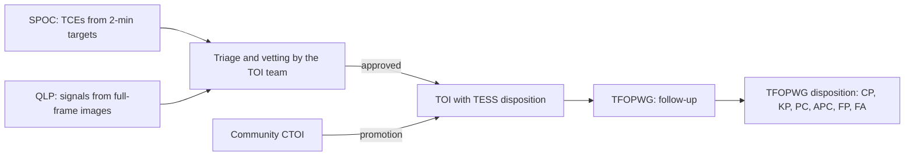

# A2. How missions do vetting

Advanced level · weeks 3–6 · about 16 hours

!!! abstract "In this lesson you will learn"
    - What the Kepler and TESS Data Validation computes for each signal (Twicken et al. 2018).
    - How the Kepler DR25 Robovetter decides and, above all, how it measures its own reliability (Thompson et al. 2018).
    - How a TOI is born and who decides what it is (Guerrero et al. 2021).
    - What the TESS eclipsing binary catalog is (Prša et al. 2022) and the real bug it caused in PlanetHunter.
    - How difference images and centroids work, and the transit-by-transit matching that came out of the HD 23472 case.

PlanetHunter did not invent vetting. Almost all of its tests have an ancestor in the pipelines of the Kepler and TESS missions. Studying these ancestors serves two purposes: understanding **why** each test exists and seeing **what is still missing** in the project.

## 1. Data Validation: the battery of diagnostics

The Kepler science pipeline, and later the TESS one (run by **SPOC**, the Science Processing Operations Center), has two main stages. The first, the search, produces **TCEs** (Threshold Crossing Events): periodic signals that crossed a detection threshold. The second, **Data Validation** (DV), fits a transit model to each TCE and runs a battery of diagnostics. Twicken et al. (2018), *PASP* 130, 064502, describe the architecture of Kepler's DV. SPOC inherited this architecture for TESS, and the DV reports for each TESS TCE are public on MAST and linked from the target pages on ExoFOP.

The main DV diagnostics:

| Diagnostic | Question | Ancestor of which PlanetHunter test |
|---|---|---|
| Odd/even depth | Do alternating transits have the same depth? | `odd_even` |
| Weak secondary | Is there a dip at another phase? | `secondary`, `secondary_scan` |
| Period-based binary discrimination | Does another TCE on the same star have the same period or a multiple of it? | `independence` (in part) |
| Centroid motion | Does the center of light of the aperture move during the transit? | `centroid` (MOM_CENTR) |
| Difference image centroid | Where is the source of whatever dimmed? | `tpf_difference_image` |
| Optical ghost | Is the signal stronger in the halo around the star than in the core of the aperture? | none |
| Bootstrap test | What is the probability that noise alone produces this SNR? | partly, through the noise floor in `other_sectors` and the null runs |
| Rolling band contamination | Do the transits coincide with a known electronic noise pattern of the detector? | none (it is Kepler-specific) |

DV **does not decide**. It produces numbers and plots for someone to decide. In Kepler, that decision was first made by humans and later automated.

## 2. The Kepler DR25 Robovetter

Thompson et al. (2018), *ApJS* 235, 38, present the final Kepler catalog (DR25), with about 4,000 planet candidates. The heart of the paper is the **Robovetter**: a decision tree that reads the diagnostics of each TCE and assigns one of four false positive flags:

- **NT** (Not Transit-like): does not look like a transit. Variability, systematics, odd shape.
- **SS** (Stellar eclipse): an eclipse by a star. Significant secondary, different odd/even depths, V shape.
- **CO** (Centroid Offset): the source is offset from the target.
- **EC** (Ephemeris match indicates Contamination): the period and epoch match those of another known star in the field, which points to contamination.

With no flag, the TCE becomes a candidate.

### The most important lesson of the Robovetter

It is not the tests. It is the **measurement**. The Kepler team measured two things that every vetting system should measure:

1. **Vetting completeness**: they injected synthetic transits into the pixels, ran the whole pipeline and counted how many the Robovetter approved.
2. **Reliability**: they created false alarms on purpose, by **inverting** the light curves (dips become bumps and vice versa) and **scrambling** the time order of the data. Any "transit" found in these curves is, by construction, false. The fraction of them the Robovetter approves estimates how many false ones still contaminate the catalog.

With this, each candidate got a **disposition score**: the fraction of times it passed when the Robovetter's limits were perturbed. It is an idea similar to PlanetHunter's score, but measured, not just defined.

!!! info "Inverted curves in PlanetHunter"
    PlanetHunter measures vetting on real false positives (TFOPWG FP/FA) and, since 2026-10-10, also on null runs in the Kepler style: `planethunter search --null inverted` turns the flux upside down and `--null scrambled` shifts each orbit of data in time. Every signal they produce is a false alarm, with no label needed. Measuring how many of them the vetting approves is a good project of your own for lesson A5.

## 3. The TOI catalog

Guerrero et al. (2021), *ApJS* 254, 39, describe how **TOIs** (TESS Objects of Interest) were born in the prime mission (sectors 1 to 26), with more than 2,200 objects. The flow, simplified:

Two details matter for you:

- There are **two different dispositions**. The **TESS Disposition** is given by the team that creates the TOI (for example, PC for candidate, EB for binary). The **TFOPWG Disposition** is given by the follow-up group after ground-based observations: CP (confirmed planet), KP (known planet), PC (still a candidate), APC (ambiguous candidate), FP (false positive), FA (false alarm). The project's benchmark uses the TFOPWG one when it exists (`benchmark.py`, function `build`).
- **CTOIs** enter the same flow. The team can promote them to TOI. This is the path you will prepare in lesson A6.

## 4. The TESS binary catalog and the hot Jupiter bug

Prša et al. (2022), *ApJS* 258, 16, published the TESS eclipsing binary catalog for sectors 1 to 26: about 4,600 systems, with period, epoch and a morphology parameter (how "detached" or "in contact" the stars are). PlanetHunter mirrors this catalog for the crossmatch.

The real bug: in the first calibration on sector 69, **9 signals** matched the binary catalog and were classified as `KNOWN_FP`. When someone looked at them one by one, they were **WASP-18 b, WASP-100 b, HATS-16 b** and other **confirmed planets**, all hot Jupiters. Giant planets very close to their star produce deep transits and, sometimes, visible occultations. A catalog built to find eclipses, with automatic criteria and visual review, inevitably catches some of them.

The fix (in `crossmatch/core.py`, function `_priority`) defines an **order of evidence** when several objects match on the same star:

1. Confirmed planet (Exoplanet Archive, exoplanet.eu, Kepler or K2, or TFOPWG CP/KP).
2. TFOPWG FP/FA disposition.
3. TOI.
4. CTOI.
5. Published candidate (lists such as DIAmante, DTARPS, LEO-Vetter, ExoMiner++, and Kepler/K2 candidates): class `KNOWN_PUBLISHED`.
6. Binary catalog (Prša et al. 2022 and the "TESS Ten Thousand" catalog of Kostov et al. 2025).

All the objects that match on the star are collected first, and only then is the order applied. Two more rules came from the 2026-10-10 audit. A binary (catalog row or FP disposition) matches at **any** alias, 2P or P/2 included, and gives `KNOWN_FP`: the planet exemption for near-resonant periods does not apply to binaries. And a binary-catalog row that is really the host's own known planet (such as WASP-173 A b) no longer marks the star as a binary host.

The lesson goes beyond this catalog: **no catalog is the truth**. Each one was made with a goal, by a method, with an error rate. When two catalogs disagree, the priority rule must reflect which evidence is stronger. A radial velocity confirmation weighs more than an automatic shape classification.

## 5. Side by side

| Test | DV / Robovetter | TOI team | PlanetHunter |
|---|---|---|---|
| Signal strength | SNR limit in the search (TPS) | SNR limit | `sde` ≥ 9, `snr` ≥ 7.1 (veto) |
| Number of transits | ≥ 2 in the search | ≥ 2 (single transits handled separately) | `n_transits` ≥ 2 (veto) |
| Odd/even | DV, Robovetter SS | Yes | `odd_even` (fail at 3σ, veto at 5σ) |
| Secondary | DV, Robovetter SS | Yes | `secondary` (veto only if ≥ 10 % of the primary), `secondary_scan` |
| V shape | Robovetter SS | Visual | `shape` (`v_shape_max` 0.35, hard fail); `kdr25_grazing` (k + b > 1.04, the DR25 cut, soft fail) |
| Implausible radius | Yes | Yes | `radius` (fail 22.4 R⊕; veto 33.6 R⊕ only with a reliable star and another binary sign) |
| Duration × density | Partial | Visual | `duration` (0.15 to 1.67 × predicted) |
| Centroid | DV, Robovetter CO | Yes | `centroid` offline, `tpf_difference_image` |
| Neighbors and dilution | Partial | Gaia | `gaia_neighbors` (PSF model over the real aperture) |
| Ephemeris contamination | Robovetter EC | Yes | crossmatch `NEARBY_KNOWN` (up to 2′), transit by transit, and shared signals across the run |
| Red noise | — | S/N_pink ≥ 9 (QLP) | `snr_pink` |
| Instrument systematics | Rolling band, ghost | Visual | `edges_dumps` |
| Other sectors / quarters | Consistency between quarters | Multi-sector | `other_sectors`, with a blind search |
| FP probability | Separate statistical validation | Follow-up | `fpp_triceratops` |
| Measured reliability | Inverted and scrambled curves | Ground-based follow-up | TFOPWG FPs in sectors 69 and 107; inverted and scrambled null runs |

What jumps out of the table: PlanetHunter covers most of the classic tests, but it does **not have** an optical ghost test or a formal bootstrap test, and its null runs are new and not yet used to report a reliability figure. These are natural candidates for improvements, and the self-assessment will ask you to propose one.

## 6. Difference images and centroids

A TESS pixel is 21″ wide. Several stars fit inside a target's aperture. The question "which star does the dip come from?" is, in many cases, the most important one in vetting.

### Centroid motion (offline)

For each cadence, SPOC records the **centroid** (weighted center of light) of the aperture, in the MOM_CENTR columns. If the dip comes from the target, the centroid barely moves. If it comes from a neighbor, the center of light shifts **in the direction opposite** to the neighbor during the transit.

The shift alone is misleading: a deep dip on a faint neighbor and a shallow dip on a bright neighbor can produce the same motion. The project uses the **implied source distance**:

$$
d_\text{source} \approx \frac{\Delta x}{\delta} ,
$$

the shift divided by the fractional depth. The `centroid` test only fails if the shift is larger than 3σ **and** the implied source is more than 1 pixel away (`centroid_max_offset_px`). This rule came from a measurement: with the significance-only criterion, 11 of 41 confirmed planets failed, and all of them had an implied source within 0.88 px.

Three refinements from the 2026-10-10 audit:

- **The depth in the aperture.** The PDCSAP depth is corrected for contamination, but the MOM_CENTR centroid is not. The right depth in the formula is $\delta_\text{ap} = \text{CROWDSAP} \times \delta$.
- **An empirical error.** The error that assumed white noise made random out-of-transit epochs "fail" 2 % to 47 % of the time, against 1 % expected. Now the same measurement is made at 200 fake epochs out of transit, and their scatter is the error of one epoch. Each sector is evaluated on its own, because the orientation of the detector pixels changes between sectors.
- **Knowing when not to decide.** Saturated stars (Tmag < 7) and sectors with fewer than 3 transits give "no data" (Kostov et al. 2019).

### Difference image (network, per candidate)

The `tpf_difference_image` test downloads the target's pixel file (TPF) and does:

1. Mean of the images **outside** the transit (between 1 and 3 durations from the center).
2. Mean of the images **inside** the transit (up to 0.4 duration from the center).
3. **Difference** = outside − inside. Whatever dimmed shows up bright.
4. Centroid of the difference compared with the **catalog position** of the target (the TIC position, epoch 2000, moved forward with the star's proper motion to the date of the TPF).
5. Uncertainty: the scatter of the centroids computed transit by transit, divided by the square root of the number of transits (needs at least 3).

It fails if the offset exceeds 1 pixel and is significant (3σ). It is a **hard fail**: on its own, it fails the signal. With fewer than 3 transits there is no error estimate, and an offset above 1 pixel gives "no data" instead of a failure. The first version compared the difference centroid with the out-of-transit centroid; Bryson et al. (2013) compare it with the catalog position. With the old reference, 10 of 20 failures in sector 107 had the difference centroid within 1 pixel of the TIC position. In the dossier, the red `x` (difference centroid) should fall inside the orange circle (TIC position); the white `+` marks the out-of-transit centroid. In the first real slice of 2,164 stars, signal 1528 was rejected at this test.

The professional method (Bryson et al. 2013) fits the difference image with the model of the instrument's response to a point source (the PRF), which is more accurate with close neighbors. The project's weighted centroid is a deliberately simple approximation.

### From the centroid to Gaia neighbors

The test cannot separate sources closer than its own uncertainty. The project defines an **exclusion radius** equal to 3 times the smallest centroid error (minimum 0.3 px). Then the `gaia_neighbors` test lists the Gaia DR3 stars within 2.5 pixels and, for each one, computes the depth it would need to produce the signal on its own. It uses the formula of triceratops (Giacalone et al. 2021):

$$
\delta_\text{needed} = \delta_\text{obs} \times \frac{F_\text{target,ap}}{F_\text{neighbor,ap}}, \qquad F_\text{ap} = 10^{-0.4\,T} \times (\text{fraction of the star's PSF inside the aperture}) .
$$

$T$ is the TESS magnitude (converted from Gaia $G$ and the color when needed), and the PSF is modeled as a Gaussian of 0.75 px over the real aperture pixels. The observed depth is the PDCSAP depth, already corrected for dilution, so it refers to the target's own light. That is why the target's flux, not the total flux, is in the numerator; the first version used the total flux and overestimated the needed depth.

Above 100 %, it is impossible. A possible neighbor **inside** the exclusion radius remains plausible, and the test ends with the note "needs high-resolution imaging": only such an image settles it. And if the difference image shows a significant offset and a neighbor able to produce the dip sits within 1 pixel of the difference centroid, the test fails: the culprit has a name.

## 7. Transit-by-transit matching: the HD 23472 case

HD 23472 has five known planets. In a single sector, TLS saw one transit of planet b and one of planet c and "found" a planet of **10.29 days**. The period crossmatch did not catch it: 10.29 days is not the period of any known planet, nor an alias. The signal got as far as P1. The same happened with TOI-703 (.01 + .02 turning into 11.40 d) and GJ 143 (8.80 d).

The fix, in `crossmatch/core.py` (function `explain_transits`), asks for **each observed transit**: does any known object on this star predict an event here?

- For each object, it propagates the ephemeris to the time of the transit: $n = \text{round}[(t - T_0)/P]$, predicted $= T_0 + nP$.
- Tolerance: the larger of half the duration and 1 hour, plus 3 times the propagated uncertainty, $3\,|n|\,\sigma_P$. When a catalog gives no $\sigma_P$, $10^{-4} P$ is assumed instead of zero.
- Objects whose $3\sigma$ propagated uncertainty is above 0.25 day (or 0.1 P) are ignored: the ephemeris is no longer useful.
- It also tests phase 0.5, because many TOIs and CTOIs are binaries and the "transit" may be the secondary eclipse. Not for confirmed planets, which have no secondary eclipse that could pass for a transit.

The first version classified the signal as known if **at least 50 %** of its transits were explained. After that fix, the 3 `NEW` candidates that made it through the funnel in the benchmark dropped to **0**. They were all false.

But the audit found the rule too loose: with windows of up to ± (duration + 1 day), phase 0.5 for every object and only two transits, it "explained" random signals 36 % of the time (80 % to 87 % for known periods under 2 days). The current rule adds a test of **chance**. If the windows of the known objects cover a fraction $f$ of the time, the probability that $k$ or more of the $n$ transits fall inside them by luck is binomial:

$$
P(X \geq k) = \sum_{j=k}^{n} \binom{n}{j} f^{j} (1-f)^{n-j} .
$$

The signal is known (`match_type = transit_times`) only if at least 50 % of the transits are explained **and** this probability is below 1 %. The measured chance-match rate dropped to between 0.3 % and 1.3 %. Near misses (between 1 % and 10 %) stay `NEW`, with the note `partial_known_transit_coincidence`, and cannot go above P2.

### Beyond one star: epoch spikes and shared signals

Some false signals only show up when you look at all the stars of a run together (`crossmatch/runlevel.py`):

- **Epoch spikes.** A telescope event at a given moment puts a "transit" on many unrelated stars at once. The project counts, in bins of 0.25 day, how many different stars have a transit there, and flags the bins with far more than chance allows. In sector 107 this check flagged hundreds of `NEW` signals. A signal with half or more of its transits on spikes (`epoch_spike_frac` ≥ 0.5) gets no alert.
- **Shared signals.** The same period (or 2P, P/2) and the same transit time on another target within 2′ means one signal seen through two apertures. The star that can really produce the dip, and whose aperture loses the most light, is the `source` (at most P2); the other is the `victim` (no alert). Two entries less than 2″ apart are a `duplicate`: the TIC split one star in two (Paegert et al. 2021).

!!! tip "In the tool"
    - The basic tests are in `src/planethunter/vetting/basic.py`; the deep ones (difference image, Gaia neighbors, other sectors, SIMBAD, Gaia binaries, FPP), in `src/planethunter/vetting/deep.py`.
    - The priority between catalogs and the transit-by-transit matching are in `src/planethunter/crossmatch/core.py`; epoch spikes and shared signals, in `src/planethunter/crossmatch/runlevel.py`.
    - In the dossier: section 7 (difference image) and section 9 (crossmatch, with the match type and the age of each mirror).
    - Run `uv run planethunter vet-deep <run_id>` to see the difference image and the neighbors of real candidates.

!!! example "Exercise 1. Which neighbor could be the source?"
    A candidate has a depth of 2,000 ppm (already corrected for dilution). The target has $T = 10.0$. There are two Gaia neighbors: A with $T = 14.0$ and B with $T = 18.0$. To simplify, assume that all the light of the three stars falls inside the aperture (PSF fraction 1 for all). Which one could produce the signal on its own?

    ??? success "Show answer"
        1. Flux of A relative to the target: $10^{-0.4 \times 4} = 10^{-1.6} \approx 0.0251$. Of B: $10^{-0.4 \times 8} = 10^{-3.2} \approx 0.000631$.
        2. A would need $0.002 / 0.0251 \approx 0.080$, that is, **8.0 %**. An eclipsing binary does that easily. **A is possible.**
        3. B would need $0.002 / 0.000631 \approx 3.17$, that is, **317 %**. Impossible: a star cannot lose more than all of its light. **B is ruled out.**
        4. If A is inside the centroid exclusion radius, the test ends with "needs high-resolution imaging".
        5. In real life, a neighbor at the edge of the aperture only puts part of its light inside it. That lowers $F_\text{neighbor,ap}$ and raises the depth it would need: a neighbor 2 pixels away is much harder to blame than one in the same pixel.

!!! example "Exercise 2. Whose transit is it?"
    A star has a known planet with $P = 17.667$ d, $T_0 = 1400.000$ BTJD, $\sigma_P = 0.0005$ d (hypothetical ephemeris). The system detected a 3.6 h (0.15 d) transit at 3184.400 BTJD. Is this transit explained by the known planet?

    ??? success "Show answer"
        1. $n = \text{round}[(3184.400 - 1400.000)/17.667] = \text{round}(101.0) = 101$.
        2. Predicted: $1400.000 + 101 \times 17.667 = 3184.367$ BTJD. Difference: $0.033$ d.
        3. Propagated uncertainty: $3 \times 101 \times 0.0005 = 0.152$ d. Below 0.25 day (and below $0.1 P = 1.77$ d), so the ephemeris is valid.
        4. Tolerance: $\max(0.15/2,\ 1/24) + 0.152 = 0.075 + 0.152 = 0.227$ d.
        5. $0.033 < 0.227$: **yes**, the transit is explained. If half or more of the signal's transits are explained this way, **and** the binomial chance of that many coincidences is below 1 %, it is classified as known.

!!! example "Exercise 3. A significant but innocent centroid"
    The target's centroid shifts $0.0020$ px during a transit of depth $0.005$ (5,000 ppm), with a significance of 6σ. Another signal: a shift of $0.010$ px, depth $0.002$, significance 4σ. Which one fails the `centroid` test?

    ??? success "Show answer"
        Assume CROWDSAP = 1 (no contamination), so the depth in the aperture equals the depth.

        1. First signal: implied source $0.0020 / 0.005 = 0.4$ px. Significant, but below 1 px. **It passes.** This is the typical behavior of a real planet on a star with faint neighbors.
        2. Second: $0.010 / 0.002 = 5$ px, or about 105″. Significant (4σ > 3σ) **and** above 1 px. **It fails.**
        3. Moral: significance tells you whether the motion is real; the implied distance tells you whether it matters.

## Lesson checklist

- [ ] I read Twicken et al. (2018) and can list five DV diagnostics.
- [ ] I read Thompson et al. (2018) and can explain the NT, SS, CO and EC flags and the use of inverted and scrambled curves.
- [ ] I read Guerrero et al. (2021) and know the difference between the TESS Disposition and the TFOPWG Disposition.
- [ ] I can tell the story of the hot Jupiter bug in the binary catalog and justify the crossmatch priority order.
- [ ] I can compute the implied source distance and the depth needed on a neighbor.
- [ ] I can explain transit-by-transit matching using the HD 23472 case, and why it needs a chance test.

## Going further

- Twicken et al. (2018), *Publications of the Astronomical Society of the Pacific* 130, 064502. The architecture of Data Validation; read the diagnostics section with the DV reports of a real TOI open beside you.
- Thompson et al. (2018), *The Astrophysical Journal Supplement Series* 235, 38. DR25 and the Robovetter; the part about measured reliability is the most important for anyone building systems.
- Guerrero et al. (2021), *The Astrophysical Journal Supplement Series* 254, 39. The process that turns signals into TOIs and the role of CTOIs.
- Prša et al. (2022), *The Astrophysical Journal Supplement Series* 258, 16. The TESS binary catalog; useful for understanding the morphology parameter and the limits of an automatic classification.
- Bryson et al. (2013), *Publications of the Astronomical Society of the Pacific* 125, 889. How to identify background false positives with difference images and PRF fitting.
- Coughlin et al. (2014), *The Astronomical Journal* 147, 119. Ephemeris matching in the Kepler field: hundreds of candidates were contamination from other stars. The basis of the EC flag and of `NEARBY_KNOWN`.
