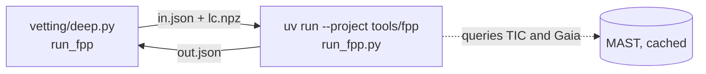

# A3. False positive probability

Advanced level · weeks 6–8 · about 12 hours

!!! abstract "In this lesson you will learn"
    - The Bayesian reasoning behind a false positive probability, without needing advanced calculus.
    - What Morton (2012) proposed with vespa and what Giacalone et al. (2021) changed with triceratops.
    - The meaning of each scenario (TP, EB, PEB, PTP, STP, SEB, DTP, BEB, NTP, NEB...) and how FPP and NFPP are computed.
    - Why the 0.015 and $10^{-3}$ thresholds exist and why a low FPP does **not** replace high-resolution imaging.
    - How PlanetHunter runs triceratops in an isolated environment and what the real case of WASP-100 b (FPP 0.35) teaches.

So far, each vetting test answered "yes" or "no" to a question. But the question that really matters is a different one: **given everything I know, what is the chance that this is a planet?** Answering it means combining what the data show with what is known about the population of stars and planets. That is the territory of Bayesian statistics.

## 1. Bayes in plain language

Imagine a medical test that is right 95 % of the time. Your result came back positive. What is the chance that you have the disease? The answer depends on how **common** the disease is. If only one person in a thousand has it, most positives are false alarms, even with a good test.

Transit signals work the same way. The question "is this a planet?" depends on two things:

1. **How well each explanation reproduces the data** (the shape of the transit, the depth, the absence of a secondary). This is called the **likelihood**.
2. **How common each explanation is before looking at the data**: how many stars have planets of this size, how many are binaries, how many background stars fit in the pixel. This is called the **prior probability** (prior).

Bayes' theorem brings the two together. For each scenario $j$:

$$
P(\text{scenario}_j \mid \text{data}) = \frac{P(\text{data} \mid \text{scenario}_j)\; P(\text{scenario}_j)}{\sum_k P(\text{data} \mid \text{scenario}_k)\; P(\text{scenario}_k)} .
$$

In words: multiply "how well it explains" by "how common it is", do this for every scenario and divide each result by the sum, so that the probabilities add up to 1.

The **false positive probability** (FPP) is simply the sum of the probabilities of all scenarios that are **not** "planet on the target".

## 2. Morton (2012) and vespa

Morton (2012), *The Astrophysical Journal* 761, 6, turned this idea into an automatic procedure, implemented in the **vespa** program. The scenarios considered:

- **Planet** transiting the target.
- **EB**: the target itself is an eclipsing binary.
- **HEB**: the target is part of a hierarchical triple system, and a pair of eclipsing stars is diluted by the light of the main star.
- **BEB**: an unresolved background eclipsing binary inside the aperture.
- **Double-period** versions of the binaries (equal primary and secondary eclipses, which look like transits with period $P$).

For each scenario, vespa simulates a realistic population (background stars from a model of the Galaxy, binary statistics, planet occurrence rates), generates the transit curve each member would produce and compares its **shape** with the observed one, summarized by depth, total duration and ingress duration. External constraints, such as a high-resolution image that rules out companions above a certain brightness, cut away parts of the population.

The method made it possible to **validate** planets without measuring their mass. Morton et al. (2016), *ApJ* 822, 86, applied the approach to the whole Kepler catalog and validated about 1,280 planets with FPP below 1 %. "Validated", here, has a precise meaning: the probability of any alternative explanation is very low. It is not "confirmed", which requires an independent measurement, usually of the mass.

## 3. Triceratops: vespa adapted to the TESS pixel

Giacalone et al. (2021), *The Astronomical Journal* 161, 24, created **triceratops** for TESS. The central difference: with 21″ pixels, the question "which known neighboring star is producing the signal?" takes center stage. Triceratops:

1. Queries the TIC and Gaia to list the stars around the target.
2. Uses the sector's **aperture pixels** to compute how much of each star's light falls inside it.
3. Computes, for each star, the depth it would need to produce the signal (the same calculation as the `gaia_neighbors` test in lesson A2).
4. For each scenario, draws many sets of plausible parameters, generates the model curve, compares it with the observed folded curve and computes the probability.

### The scenarios

| Code | What happens | Planet on the target? |
|---|---|---|
| **TP** | Planet transiting the target, with no companion | Yes |
| **EB**, EBx2P | The target is an eclipsing binary (x2P: the real period is twice as long, equal eclipses) | No |
| **PTP** | Planet transiting the target, which has an unresolved bound companion diluting the light | Yes |
| **PEB**, PEBx2P | The target has an unresolved bound companion, and the target itself is eclipsed by another star | No |
| **STP** | Planet transiting the unresolved bound **companion** | No (the planet exists, but around the other star, and its radius is wrong) |
| **SEB**, SEBx2P | The unresolved bound companion is an eclipsing binary | No |
| **DTP** | Planet transiting the target, diluted by an unresolved background star | Yes |
| **DEB**, DEBx2P | The target is an eclipsing binary, diluted by a background star | No |
| **BTP** | Planet transiting an unresolved background star | No |
| **BEB**, BEBx2P | An unresolved background star is an eclipsing binary | No |
| **NTP** | Planet transiting a **known neighboring** star (resolved in Gaia) | No |
| **NEB**, NEBx2P | A known neighbor is an eclipsing binary | No |

The letters help you remember: **P** for primary (the target in an unresolved system), **S** for secondary (the companion), **D** for diluted, **B** for background, **N** for nearby.

### FPP and NFPP

$$
\text{FPP} = 1 - \left(P_\text{TP} + P_\text{PTP} + P_\text{DTP}\right),
\qquad
\text{NFPP} = P_\text{NTP} + P_\text{NEB} + P_\text{NEBx2P} .
$$

The **FPP** is the probability of not being a planet on the target. The **NFPP** (nearby FPP) is the part of the FPP that comes from **known, resolved** neighbors. The distinction matters: a high NFPP points to a concrete culprit, which can be checked with a difference image or ground-based photometry of the neighbor.

### The thresholds

- **FPP < 0.015 and NFPP < $10^{-3}$**: the level Giacalone et al. propose for **statistical validation**. The authors calibrated these values with TOIs of known disposition.
- **FPP < 0.5**: "plausible candidate", more likely a planet than not.
- **NFPP > 0.1**: "likely nearby false positive".
- These classes only hold where the authors calibrated them: planets smaller than 8 R⊕, SNR of at least 15 and 2-minute data. For 30-minute full-frame data there is no confident validation region.

In PlanetHunter (function `fpp_test` in `vetting/deep.py`):

| Condition | Effect |
|---|---|
| FPP < 0.5 and NFPP ≤ 0.1 | Test passes |
| FPP ≥ 0.5, or NFPP > 0.1 | **Hard fail**: on its own, it fails the signal (weight 0.3 in the score) |
| NFPP > 0.5 | **Veto**: a known neighbor is the most likely source |
| FPP < 0.015 and NFPP < 0.001 | Note "validation level (requires high-resolution imaging)" |
| Rp ≥ 8 R⊕, SNR < 15 or data coarser than 2 min | Note "outside the validation region" |

Severity reads the same numbers (`alerts/severity.py`). **P0** needs complete deep vetting (difference image and Gaia neighbors passed, FPP computed) with FPP < 0.1, NFPP < 0.001 and the validation region above (Rp < 8 R⊕, SNR ≥ 15, 2-minute data). FPP < 0.1 is a project choice, between "plausible" (0.5) and "validated" (0.015). Anything that cannot be checked caps the signal at P1, and NFPP > 0.1 caps it at P2.

## 4. A real example: WASP-100 b

The project ran triceratops on the confirmed planet **WASP-100 b** (TIC 38846515), with sector 69 data, a depth of about 7,500 ppm and a period of 2.848 days. The result, stored in the vetting cache:

| Scenario | Probability |
|---|---|
| TP | 0.541 |
| PEB | 0.347 |
| PTP | 0.112 |
| SEB | 0.0001 |
| DTP | ~$2 \times 10^{-9}$ |

**FPP = 0.35. NFPP ≈ $10^{-109}$**, essentially zero.

A confirmed planet, with an FPP of 35 %. How should you read this?

1. **No known neighbor is a suspect** (negligible NFPP). The signal is on the target or on something unresolved next to it.
2. **The competitor is PEB**: the target would have an unresolved bound companion, and would itself be eclipsed by a small star. With a deep transit and only TESS photometry, this explanation reproduces the shape reasonably well.
3. **What would knock out PEB**: a high-resolution image that rules out close companions (triceratops accepts that image's **contrast curve** as input), and radial velocity, which measured the planetary mass of WASP-100 b. Neither one went into the calculation.

The lesson: **FPP measures what the data you provided can rule out**, not the truth. A real planet can have a middling FPP when the observations that would eliminate scenarios are missing. That is why FPP is one of the last tests, not the final judge.

Along the same lines, two signals from a project test on sector 107 show the other side:

- **Signal 4053** (TIC 139552249): NTP on a neighbor (TIC 139552250) at 0.68; TP 0.28. FPP 0.68, **NFPP 0.68**. Veto: the signal probably comes from the neighbor.
- **Signal 4278** (TIC 146320921): SEB 0.32, NEB 0.25, TP 0.21, STP 0.13. FPP 0.74, NFPP 0.25. Fails the FPP test (FPP ≥ 0.5, and NFPP above 0.1), but without a veto: the scenarios are varied and no culprit dominates.

## 5. Why a low FPP does not replace high-resolution imaging

This is the most misunderstood idea in statistical validation. Four reasons:

1. **The priors for unresolved companions are large.** About half of Sun-like stars have companions. Without imaging, the model must consider companions at any separation below the TESS resolution. A contrast curve eliminates a good part of this space, and that is exactly what moves the FPP from "low" to "validatable".
2. **The model only knows the scenarios it lists.** Instrument systematics, stellar variability and detrending errors are not among the scenarios. Triceratops assumes the signal is astrophysical and comes from some star. That is why tests such as `other_sectors` and `edges_dumps` must come first.
3. **The stellar parameters may be wrong.** A wrong stellar radius in the TIC changes the expected depth, the expected duration and the plausibility of each scenario.
4. **It is the rule in the literature itself.** Giacalone et al. recommend the validation threshold together with high-resolution imaging, and validation papers using triceratops usually show the contrast curve.

That is why PlanetHunter's note says "validation level (requires high-resolution imaging)". Even an FPP of 0.001 does not allow anyone to call the candidate a validated planet without that observation.

## 6. How the project runs triceratops

Triceratops requires old versions of numerical libraries (NumPy 1.26, SciPy 1.13). PlanetHunter's main environment uses TLS 2.0, which depends on NumPy 2. The two cannot live in the same environment.

The solution is an **isolated environment** in `tools/fpp/`, with its own `pyproject.toml` (triceratops 1.1.0, `numpy<2`, lightkurve). The two environments talk to each other through files:

1. The main code folds the light curve on the period, cuts out 2.5 durations around the transit and writes phase, flux and error to an `lc.npz` file. The curve is the same one the vetting uses: each sector flattened again with the transits masked.
2. It writes `in.json` with the TIC, sectors, depth (fraction), period, aperture pixels for each sector, number of draws, number of repeats and the real exposure time of the data.
3. It calls `uv run --project tools/fpp python tools/fpp/run_fpp.py in.json out.json` as a subprocess, with a time limit of 1,800 s per repeat (`fpp_timeout_s`).
4. The script in the isolated environment runs `calc_depths` and `calc_probs` **3 times** (`fpp_repeats`) and writes `out.json` with the mean and the scatter of the FPP and NFPP, and the five most likely scenarios. Giacalone et al. repeat each case 20 times; 3 repeats give a mean and a scatter at a bearable cost.
5. The flux error given to triceratops is the **measured** scatter of the out-of-transit flux (1.4826 × MAD) when it is larger than the pipeline's error bars. In the audit, all four candidates with FPP = 1.000 had a real scatter 2 to 46 times larger than the pipeline error: the model was being told the data were cleaner than they were.
6. Any error becomes `"ok": false` with the message, and so do runs that carry no information: a star without mass, radius, temperature or parallax in the catalog, or a "degenerate" run in which every draw was geometrically impossible. The main code **never crashes** because of the FPP. With no result, the test stays "no data", the `deep_pending` field records `fpp_triceratops` and the candidate cannot reach P0.

Cost: with $10^5$ draws (`fpp_draws`), about **6 minutes per repeat** on WASP-100 b, so about 18 minutes per candidate. That is why the FPP only runs for signals that passed all the rest of the vetting.

!!! tip "In the tool"
    - `uv run planethunter vet-deep <run_id>` runs the FPP for candidates that passed the basic and deep vetting.
    - Configuration: `fpp_enabled`, `fpp_draws`, `fpp_repeats`, `fpp_timeout_s` and the limits `fpp_max`, `fpp_nfpp_fail` and `fpp_nfpp_veto` in `config/thresholds.yaml`.
    - Inputs and outputs are kept in `data/cache/fpp/sig<signal_id>/`. Open `out.json` to see the scenarios.
    - In the dossier, the `fpp_triceratops` row of the vetting table shows the FPP and NFPP (mean and scatter of the repeats), the level, whether the signal is inside the validation region, and the three main scenarios.

!!! example "Exercise 1. Compute the FPP of WASP-100 b"
    Using the table in section 4, compute the FPP and NFPP and classify the result using the project's thresholds.

    ??? success "Show answer"
        1. Planet-on-target scenarios: TP 0.541 + PTP 0.112 + DTP ~0 = 0.653.
        2. FPP = 1 − 0.653 = **0.347**.
        3. No N scenario appears among the main ones; NFPP ≈ $10^{-109}$, below $10^{-3}$.
        4. FPP < 0.5 and NFPP ≤ 0.1: **the test passes**, "plausible candidate". But FPP ≥ 0.1: it would not allow P0. And it is far from 0.015: it does not reach validation level. (WASP-100 b is also a giant, larger than 8 R⊕: outside the region where these levels were calibrated.)
        5. The scenario to attack is PEB. Recommended observations: high-resolution imaging (to rule out a bound companion) and radial velocity.

!!! example "Exercise 2. Bayes with toy numbers"
    The numbers below are **illustrative**, not from the project. In a group of signals, before looking at the shape, 20 % are planets, 50 % are binaries on the target and 30 % are background binaries. The observed shape (flat bottom, no secondary) has a likelihood of 0.8 under "planet", 0.05 under "binary on the target" and 0.3 under "background binary". (a) What is the FPP? (b) A high-resolution image rules out 90 % of the possible background binaries. What is the new FPP?

    ??? success "Show answer"
        (a) Likelihood × prior products: planet $0.8 \times 0.2 = 0.16$; binary on the target $0.05 \times 0.5 = 0.025$; background $0.3 \times 0.3 = 0.09$. Sum $0.275$. P(planet) $= 0.16/0.275 \approx 0.58$. **FPP ≈ 0.42.**

        (b) The background prior drops from 0.30 to 0.03. Background: $0.3 \times 0.03 = 0.009$. Sum $0.16 + 0.025 + 0.009 = 0.194$. P(planet) $\approx 0.82$. **FPP ≈ 0.18.**

        The image did not change the light curve. It changed what is possible. That is exactly the role of the contrast curve in triceratops.

!!! example "Exercise 3. FPP on a planet and on a false positive (practice)"
    Pick a confirmed planet and a TOI with a TFOPWG FP disposition in sector 69 (the list comes from `uv run planethunter benchmark build 69 --kind fp`, saved in `data/benchmark/`). Build the `in.json` as described in section 6 and run the isolated script. Compare the dominant scenarios.

    ??? success "Show answer"
        There is no single answer, but the expected pattern is:

        - On the planet: TP and PTP make up most of the total; the main competitor tends to be PEB or SEB (unresolved companion), as with WASP-100 b. Very low NFPP.
        - On the false positive: EB, NEB or SEB scenarios dominate. If it is NEB, check the neighbor it points to in the difference image: the centroid should shift in its direction.
        - Write down the run time and the number of draws. Run it twice (the draws are random on each run): if the FPP varies a lot, the number of draws is too small for that case.
        - Write in your notebook: which observation would change the result of each one?

## Lesson checklist

- [ ] I can explain Bayes' theorem with the medical test example and with transit scenarios.
- [ ] I read Morton (2012) and can list the vespa scenarios.
- [ ] I read Giacalone et al. (2021) and know the meaning of each code in the scenario table.
- [ ] I can compute the FPP and NFPP from a list of scenarios.
- [ ] I can give four reasons why a low FPP does not replace high-resolution imaging.
- [ ] I can describe how the project runs triceratops in `tools/fpp` and what happens when it fails.
- [ ] I ran the FPP on at least one target and wrote down the scenarios.

## Going further

- Morton (2012), *The Astrophysical Journal* 761, 6. The statistical validation method; read the section that defines the scenarios and the figures on transit shape.
- Giacalone et al. (2021), *The Astronomical Journal* 161, 24. Triceratops; read the scenario table and the calibration of the thresholds.
- Morton et al. (2016), *The Astrophysical Journal* 822, 86. The mass application to Kepler; shows what "validated" means in practice.
- Torres et al. (2011), *The Astrophysical Journal* 727, 24. The BLENDER method, applied to Kepler-9 d; another school of statistical validation, more detailed and more expensive.
- Lissauer et al. (2012), *The Astrophysical Journal* 750, 112. Why candidates in systems with several planets are almost always planets; a "multiplicity boost" that enters validations as a prior.
- Sivia, *Data Analysis: A Bayesian Tutorial* (Oxford University Press, 2nd ed., 2006). A short, clear introduction to Bayesian statistics for people coming from the physical sciences.
