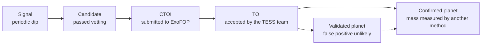

# B3. The TESS telescope

<p class="meta">Basic level · week 4 · about 4 hours</p>

!!! abstract "In this lesson you will learn"
    - What TESS is, what it observes and why it splits the sky into sectors of about 27 days.
    - What the cameras, the cadences (20 s, 2 min, 200 s) and the continuous viewing zone are.
    - Why the TESS pixel is large (21 arcseconds) and the problem this causes.
    - Where the data live (MAST) and what TIC and Tmag are.
    - What TOI, CTOI and TFOPWG are, and the path a signal takes to become a confirmed planet.

## What TESS is

**TESS** (*Transiting Exoplanet Survey Satellite*) is a NASA space telescope, operated in partnership with MIT, launched in April 2018. It has a single job: to measure the brightness of many stars very precisely, for weeks on end, in order to find transits.

Its predecessor, the Kepler telescope, stared at **one** small region of the sky for four years. It found thousands of planets, but most of them orbit faint, distant stars that are hard to study with other telescopes. TESS does the opposite: it observes **almost the entire sky**, prioritizing bright, nearby stars. Planets around bright stars are easier to confirm and to study afterward.

TESS data are **public**. Anyone can download and analyze them. That is what PlanetHunter does.

## Cameras and sectors

TESS has **four** identical **cameras**, lined up side by side. Each one sees a 24° × 24° square of the sky. Together they cover a 24° × 96° strip that runs from near the **ecliptic** (the plane in which Earth and the other planets orbit the Sun) up to the ecliptic pole. To give you an idea: 24° is about 48 times the diameter of the full Moon.

The telescope stays pointed at that strip for about **27 days**. This block of observation is called a **sector**. Then it turns and moves on to the next strip, like the segments of an orange.

```
              ecliptic pole
                     *
                  /  |  \
               /     |     \       each segment = 1 sector (~27 days)
            /   s3   |  s4    \    the segments overlap near the pole
         /     s2    |     s5   \
       /  s1         |        s6  \
      ---------------+-------------  ecliptic (plane of the orbits)
```

Why 27 days? TESS's orbit around Earth is very elongated and lasts **13.7 days**. One sector is two orbits. Each time it passes close to Earth, the telescope sends its data down by radio, which causes a **short pause in the middle of each sector**. You will see this gap in the light curves.

During the prime mission (2018 to 2020), TESS covered the southern half of the sky in the first year and the northern half in the second, 13 sectors per year. After that came extended missions, which return to the same regions. By 2026 TESS has passed 100 sectors and has covered almost the entire sky several times. This course uses **sector 69** as its example, which the project analyzed in detail.

## The continuous viewing zone

Look at the drawing: all the segments meet near the **ecliptic pole**. Stars within about 12° of each pole fall into every sector of that year. This region is called the **continuous viewing zone** (CVZ).

Stars in the continuous viewing zone are observed for almost a full year in a row on each pass. This makes it possible to find long-period planets. In sector 69, the project measured stars in the southern continuous viewing zone with **10 to 22 sectors** of data.

There is a useful consequence that shows up in vetting: if a star has 15 sectors of data and a deep "new" signal appears in only one of them, it is almost certainly a flaw in that sector. A real planet would show up in all of them.

## Cadences: how often a measurement is taken

The **cadence** is the time between two consecutive brightness measurements. TESS takes pictures continuously, but it does not send everything back to Earth: there is not enough radio bandwidth for that. So the data arrive as different products:

| Product | Cadence | Which stars |
|---|---|---|
| 20-second light curves | 20 s | a small selection of bright stars or stars of special interest (since 2020) |
| 2-minute light curves | 2 min | about 20,000 stars per sector, chosen before the observation |
| Full-frame images (FFI) | 30 min (2018–2020), 10 min (2020–2022), **200 s** (since 2022) | every star in the cameras' field of view |

The **FFIs** (*full-frame images*) contain millions of stars, but with a slower cadence and no individual processing. The 2-minute curves are the cleanest, and they are the ones PlanetHunter uses today. Searching the FFIs, which reaches fainter stars, is in the project's plan.

A shorter cadence shows the shape of the transit (entry and exit) better. A longer cadence covers more stars. It is a trade-off.

## The 21-arcsecond pixel

To measure sizes on the sky, astronomers use angles. One degree has 60 **arcminutes** (′), and one arcminute has 60 **arcseconds** (″). The full Moon is about half a degree across, or 1,800″.

Each pixel of the TESS cameras covers **21″ × 21″** of the sky. That is a huge pixel: ground-based telescopes, with good atmospheric conditions, can separate stars about 1″ apart. TESS was designed this way on purpose, to see a gigantic field all at once.

The consequence is serious: **several stars fit in the same pixel**. A star's light also spreads over a few neighboring pixels. So when the brightness measured "for the target" drops, the dip may have come from **another star** mixed into the same region. This is called **contamination** or a **blend**. It is one of the main sources of false positives, and you will study it in lesson B4.

!!! info "Fun fact"
    TESS observes in red and near-infrared light (from 600 to 1,000 nanometers). This favors red dwarfs, which shine more brightly in those colors. As you saw in lesson B2, small stars are exactly the best ones for finding small planets.

## Where the data live: MAST, TIC and Tmag

TESS data are stored at **MAST** (*Mikulski Archive for Space Telescopes*), NASA's public archive for space telescopes. There you will find light curves already processed by the mission team (the **SPOC** pipeline, for the 2-minute curves) and by other groups (such as **QLP**, for the full-frame images).

Each star has a number in the **TIC** (*TESS Input Catalog*), a catalog of more than 1.7 billion objects put together before launch. The TIC number is the star's ID number, like a social security number. Example: **TIC 261136679** is the star Pi Mensae, which you will analyze in lesson B5. The TIC also stores estimates of each star's radius, mass and temperature, which PlanetHunter uses to calculate the planet's radius.

Each star's brightness in the TIC is given in **Tmag**, the magnitude on the TESS "ruler". The magnitude scale is old and runs backward:

- **Smaller number = brighter star.** Tmag 6 is very bright; Tmag 13 is faint.
- The scale is multiplicative: **5 magnitudes = 100 times** in brightness. 1 magnitude ≈ 2.5 times.

A brighter star means more light reaching the detector and therefore **less relative noise**. A 300 ppm transit shows up clearly on a Tmag 6 star and gets lost in the noise on a Tmag 13 star.

Time in TESS files is given in **BTJD** (*Barycentric TESS Julian Date*): days counted from a reference date, corrected to the center of mass of the Solar System. In practice, it is "days since the start of the TESS era", with decimals. All times in PlanetHunter are in BTJD.

## From signal to confirmed planet

The TESS team runs its own pipelines on all the data. When a signal passes their tests and a human review, it gets a **TOI** number (*TESS Object of Interest*). Example: TOI-144.01 is the signal of Pi Men c. The ".01" means it is the first candidate around that star.

People outside the team (research groups, amateurs, you in the future) can submit their own candidates to **ExoFOP**, the mission's follow-up portal. These become **CTOIs** (*Community TOIs*). A good CTOI can be promoted to a TOI.

TOIs are followed up by **TFOP** (the TESS Follow-up Observing Program), a network of astronomers with ground-based telescopes. The **TFOPWG** working group records the status of each TOI:

| Code | Meaning |
|---|---|
| PC | planet candidate |
| APC | ambiguous planet candidate |
| CP | confirmed planet, found by TESS |
| KP | planet already known before TESS |
| FP | false positive (not a planet) |
| FA | false alarm (noise or a flaw, not an astrophysical signal) |

The full path, with the vocabulary this course uses:



A **validated planet** is one where a statistical analysis, together with high-resolution images taken by other telescopes, shows that the chance of it being a false positive is very small. A **confirmed planet** has independent evidence, usually its mass measured by radial velocity. Each step requires more evidence, and the last ones require other telescopes. That is why PlanetHunter **never** calls a candidate a "discovery".

In 2026, the catalogs that PlanetHunter mirrors hold about 8,100 TOIs, 5,100 CTOIs and 6,400 confirmed planets.

!!! tip "In the tool"
    - **Ingestion:** `uv run planethunter ingest sector 69 --limit 2000` downloads 2-minute curves from MAST and saves them as Parquet, in folders like `data/parquet/sector=0069/author=SPOC/`. The `author=SPOC` part tells you which pipeline produced the curve.
    - **TIC and Tmag:** the `tmag` column in the candidate list is the Tmag. Below 10 is bright, and easier to confirm with other telescopes. The dossier shows the TIC and a direct link to the star's page on ExoFOP.
    - **21″ pixel:** the crossmatch identifies the star by its TIC number or by position within **21″** (one pixel), and looks for known neighboring objects within **120″**. These values are in `config/thresholds.yaml` (`host_radius_arcsec` and `nearby_radius_arcsec`).
    - **TOI and CTOI:** `uv run planethunter mirrors sync` downloads the TOI and CTOI lists from ExoFOP, along with the TFOPWG decision. A signal that matches a TOI becomes `KNOWN_TOI`; one that matches a TOI marked FP becomes `KNOWN_FP`.

!!! example "Exercise 1"
    The full Moon is about 1,800″ across. How many TESS pixels would it span, from edge to edge? And how many pixels fit in the 120″ radius the crossmatch uses to look for neighbors?

    ??? success "Show answer"
        Moon: $1{,}800 / 21 \approx 86$ pixels across. The whole full Moon would fit in a square of about 86 × 86 pixels, that is, in a little over 7,000 pixels.

        Neighbors: $120 / 21 \approx 5.7$ pixels of radius. PlanetHunter looks for known objects in a circle of almost 6 pixels around the target, because a star's light spreads over several pixels and a neighbor a few pixels away can still contaminate the measurement.

!!! example "Exercise 2"
    How many times brighter is a Tmag 6 star than a Tmag 13 star? Why does this matter for finding planets?

    ??? success "Show answer"
        The difference is 7 magnitudes. Every 5 magnitudes is 100 times. Each magnitude is about 2.512 times.

        $$ 2.512^{7} \approx 630 $$

        Another way: 5 magnitudes give 100×, and the remaining 2 give $2.512^2 \approx 6.3$×. So $100 \times 6.3 = 630$.

        The Tmag 6 star is about **630 times brighter**. More light means less relative noise in each measurement, so shallow transits become visible. On top of that, planets around bright stars are much easier to confirm with radial velocity.

!!! example "Exercise 3"
    Place each case on the scale signal → candidate → CTOI → TOI → validated → confirmed.

    1. PlanetHunter found a periodic dip, but it has not gone through vetting yet.
    2. A group submitted to ExoFOP a candidate they found in TESS data.
    3. A TOI had its mass measured by radial velocity at a telescope in Chile.
    4. A TOI with status "PC" in TFOPWG.

    ??? success "Show answer"
        1. **Signal.** It has not gone through any false positive test yet.
        2. **CTOI.** It was submitted by the community; it can become a TOI if the team accepts it.
        3. **Confirmed planet.** A mass measured by another method is independent evidence.
        4. **TOI** with planet candidate status. It is not yet a validated or confirmed planet.

## Lesson checklist

- [ ] I know what TESS is and how it differs from Kepler.
- [ ] I know what a sector is (~27 days, two orbits of 13.7 days) and why there is a gap in the middle.
- [ ] I know about the four cameras and the 24° × 96° strip.
- [ ] I know what the continuous viewing zone is and why it has many sectors of data.
- [ ] I know the difference between 20 s curves, 2 min curves and full-frame images (FFI, 200 s).
- [ ] I can explain the 21″ pixel and why it mixes the light of several stars.
- [ ] I know what MAST, TIC, Tmag and BTJD are.
- [ ] I know what TOI, CTOI and TFOPWG are, and the path to a confirmed planet.
- [ ] I did all three exercises without looking at the answers.

## Going further

- Ricker et al. (2015), "Transiting Exoplanet Survey Satellite (TESS)", *Journal of Astronomical Telescopes, Instruments, and Systems* 1, 014003. The official description of the mission. Read the abstract and look at the figures of the field of view and the sector strategy.
- The TESS mission page on NASA's website (nasa.gov) and the TESS guide at HEASARC (heasarc.gsfc.nasa.gov). They explain sectors, cameras, cadences and data products.
- Stassun et al. (2019), "The Revised TESS Input Catalog and Candidate Target List", *The Astronomical Journal* 158, 138. How the TIC was built and where the stars' radii and masses come from. The introduction is enough.
- Guerrero et al. (2021), "The TESS Objects of Interest Catalog from the TESS Prime Mission", *The Astrophysical Journal Supplement Series* 254, 39. How the TESS team creates and follows up TOIs. Come back to it at the advanced level.
- [ExoFOP-TESS](https://exofop.ipac.caltech.edu/tess/). Open it and search for "261136679" to see the page for Pi Mensae, with its TOIs and community notes.
