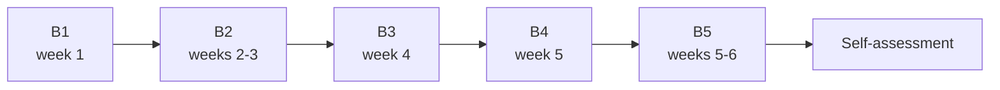

# Basic level: understanding what we are looking for

Basic level · about 6 weeks · 4 to 6 hours per week

This is the starting point. You don't need to know anything about astronomy, physics or programming. The goal is to build **intuition**: by the end, a light curve should no longer look like a scribble, and the sentence "the signal is 300 ppm deep with a period of 6.27 days" should make sense right away.

!!! abstract "By the end of the basic level you will be able to"
    - Explain what a star is, what an exoplanet is and how we find planets that nobody can see.
    - Explain the transit method and calculate, with pen and paper, how much a star's light drops when a planet passes in front of it.
    - Say what the TESS telescope observes, why it splits the sky into sectors and why its large pixels cause problems.
    - Recognize the main planet impostors: eclipsing binaries, neighbor stars and telescope glitches.
    - Run PlanetHunter on a known planet, open the dossier it produces and find the period, the depth and the transits in it.

## The lessons

| Lesson | Week | In one sentence |
|---|---|---|
| [B1. The sky, stars and planets](b1-sky-stars-planets.md) | 1 | What stars and exoplanets are, the units the field uses and the four methods for finding planets. |
| [B2. The transit method](b2-transit-method.md) | 2–3 | Why the light drops when a planet passes in front of its star, and by how much. |
| [B3. The TESS telescope](b3-tess-telescope.md) | 4 | How TESS observes the sky, where the data lives and who decides what becomes a planet. |
| [B4. Why almost every signal is false](b4-false-positives.md) | 5 | The most common planet impostors and three real stories from sector 69. |
| [B5. Practice with human eyes](b5-human-eye-practice.md) | 5–6 | Train your eye on Planet Hunters TESS and read the dossier of Pi Men c, step by step. |
| [Self-assessment](assessment.md) | 6 | Ten questions to find out whether you are ready for the intermediate level. |

## How long it takes

The plan assumes **4 to 6 hours per week** for about **6 weeks**. Each lesson takes 3 to 5 hours, counting reading, exercises and the hands-on part. If you have less time, go slower: pace matters less than consistency.

!!! note "What about programming?"
    At the basic level, the [programming track](../programming/index.md) is optional. If you have the energy, do lesson P1 (Python basics) in parallel. From the intermediate level on, it becomes required.

## What you will need

- Pen, paper and a calculator (the one on your phone is fine).
- A web browser, for the [transit simulator](../lab/transit-simulator.md) and for Planet Hunters TESS.
- For lesson B5: PlanetHunter installed (`uv sync` in the project folder) and an internet connection to download TESS data. The step-by-step instructions are in the lesson and in the [hands-on manual](../lab/using-planethunter.md).

!!! warning "A vocabulary rule from day one"
    In this course, and in PlanetHunter, nothing is called a "discovery". A signal becomes a **candidate**, and may then become a **CTOI**, a **TOI**, a **validated planet** and, finally, a **confirmed planet**. Each step requires more evidence. You will see why in lesson B3.

## How to know you are done

You have finished the basic level when:

1. You have ticked every checklist item in lessons B1 to B5.
2. You have taken the [self-assessment](assessment.md) **without looking anything up** and got at least **5 of the 6 main questions** right.

If you miss more than one, go back to the lessons pointed out in the answers and try again a few days later. Once you pass, move on to the [intermediate level](../intermediate/index.md).

New terms appear in the [glossary](../glossary.md).
