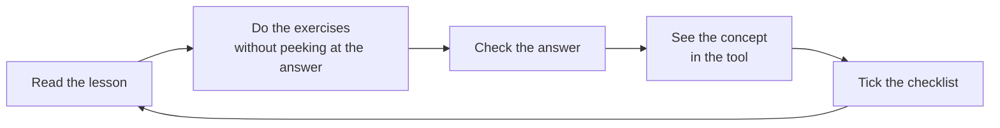

# How to study in this course

5-minute read

## Pace

- **4 to 6 hours per week** is the pace the schedule was designed for. Going slower works too: what matters is consistency.
- Prefer **short, frequent sessions** (40–60 minutes, 4–5 times a week) over a weekend marathon.

## The cycle of each lesson

1. **Read** calmly. New terms are in the [glossary](glossary.md).
2. **Exercises**: try to solve them before opening "Show answer". Getting it wrong and understanding why teaches you more than getting it right the first time.
3. **In the tool**: each lesson has a box saying where the concept shows up in PlanetHunter. Open it and see it with your own eyes.
4. **Checklist**: tick what you have finished. Your progress shows up on the [home page](index.md).

## Parallel tracks

| Week | Science | Programming |
|---|---|---|
| 1–6 | Basic level (B1–B5) | P1. Python basics (optional, but recommended) |
| 7–16 | Intermediate level (M1–M5) | P2 before M4; P3 together with M4 |
| 17 onward | Advanced level (A1–A6) | Use the PlanetHunter code |

## How to know you can move on

Each level ends with a **self-assessment**. Answer without looking anything up. If you reach the minimum score shown, move on. If not, go back to the lessons behind the questions you missed.

## Tips

- **Review notebook.** Write down every candidate you review: what you saw, what you decided and why.
- **Be suspicious of signals that look too good.** The most important story in the project is about perfect signals that turned out to be false.
- **Train your eye.** The [Planet Hunters TESS](https://www.zooniverse.org/projects/nora-dot-eisner/planet-hunters-tess) project on Zooniverse is the best practice for recognizing transits in real light curves.
- **Don't read scientific papers from start to finish at first.** Abstract, figures and conclusion first.
