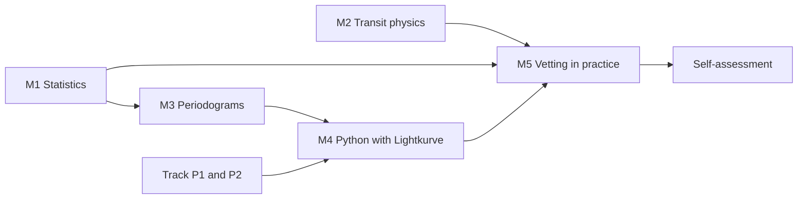

# Intermediate level: understanding how the tool decides

Intermediate level · about 10 weeks · 4 to 6 hours per week

At the basic level you learned to recognize a transit, you know what TESS is and why an eclipsing binary can fool you. Now the question changes. It is no longer "what are we looking for?", but "**how does PlanetHunter decide** whether a signal deserves attention?".

Every decision the tool makes is a number compared with a limit. SNR greater than 7.1. SDE greater than 9. Duration between 0.15 and 1.67 times the predicted value. V shape below 0.35. At this level you will understand where each number comes from, what it measures and when it gets things wrong. By the end, you will review candidates with your own judgment, without relying on the score.

!!! abstract "By the end of the intermediate level you will be able to"
    - Explain SNR, SDE, sigma, red noise and chi-squared in your own words and with a calculation.
    - Predict the duration of a transit from the period and the star, and say when a duration is suspicious.
    - Read a periodogram, recognize aliases and say why the detrending window matters.
    - Download, clean, fold and search for a known planet in Python with Lightkurve.
    - Explain each basic vetting test, calculate the score and review candidates with `planethunter review`.

## The lessons

| Lesson | Weeks | In one sentence |
|---|---|---|
| [M1. Statistics for signals](m1-statistics-for-signals.md) | 1–3 | Mean, median, sigma, SNR, red noise and chi-squared: the math that separates a signal from chance. |
| [M2. Transit physics](m2-transit-physics.md) | 3–5 | Kepler, stellar density, duration, impact parameter, limb darkening and secondary eclipse: the physics behind five vetting tests. |
| [M3. Periodograms](m3-periodograms.md) | 5–6 | How BLS and TLS find a period, what SDE is, why aliases appear and why the detrending window changes everything. |
| [M4. TESS data in Python](m4-tess-data-in-python.md) | 6–8 | Hands-on lesson: you find Pi Men c yourself with Lightkurve and compare it with PlanetHunter's result. |
| [M5. Vetting in practice](m5-vetting-in-practice.md) | 8–10 | Each vetting test with a real case, the score calculation, the measured validation and the candidate review routine. |
| [Self-assessment](assessment.md) | 10 | Six questions from the plan and four extra ones, with explained answers. |

The order matters. M1 gives you the statistical language that M3 and M5 use. M2 explains the physics of the `duration`, `shape` and `secondary` tests. M4 depends on M3 (you will run a periodogram) and on the programming track.

## Prerequisites

**Science.** The complete [basic level](../basic/index.md), with at least 5 out of 6 on the [basic self-assessment](../basic/assessment.md). You need to be comfortable with:

- transit depth $\delta \approx (R_p/R_\star)^2$ and the ppm unit;
- period, duration and what a TESS sector is;
- the visual difference between a planet transit and a binary eclipse;
- the vocabulary signal, candidate, CTOI, TOI, validated planet, confirmed planet.

**Programming.** From this level on, the programming track is no longer optional. Before lesson M4, finish:

- [P1. Python basics](../programming/p1-python-basics.md): variables, lists, loops, functions.
- [P2. NumPy, pandas and Matplotlib](../programming/p2-numpy-pandas-matplotlib.md): arrays, tables and plots.

See the [programming track page](../programming/index.md) for the suggested pace. You can do P1 and P2 in parallel with M1 to M3.

**Tool.** PlanetHunter installed and working (`uv sync` in the project folder). If you haven't installed it yet, follow [Using PlanetHunter](../lab/using-planethunter.md).

**Math.** Fractions, powers, square roots and cube roots. A scientific calculator (or Python itself) handles the rest. There is no calculus at this level.

## Suggested pace

| Week | Science | Programming | Practice in the tool |
|---|---|---|---|
| 1–2 | M1: mean to SNR | P1 | Read the `sde` and `snr` columns of `planethunter candidates` |
| 3 | M1: red noise, chi-squared; start of M2 | P1 | Find a signal that failed `consistency` |
| 4–5 | M2 | P2 | Calculate the predicted duration of 3 signals and compare with the dossier |
| 6 | M3 | P2 | Find the "Applied alias factor" and the detrending window in the dossier |
| 7–8 | M4 | P3 (optional) | Reproduce Pi Men c and compare with the dossier |
| 9–10 | M5 and self-assessment | — | Review 10 candidates with `planethunter review` |

If one week is less productive, that's fine. Better to fall behind than to skip the exercises.

## How to know you are done

You have finished the intermediate level when you have:

- [ ] ticked the checklist of all five lessons;
- [ ] solved at least two exercises from each lesson without looking at the answer first;
- [ ] reproduced the detection of Pi Men c in Python and written, in a few lines, how it differs from the PlanetHunter dossier;
- [ ] reviewed at least 10 candidates with `planethunter review`, each with a reason and a note;
- [ ] compared 5 `KNOWN_PLANET` dossiers with 5 `KNOWN_FP` dossiers and written down what tells them apart;
- [ ] got at least 5 of the 6 main questions of the [self-assessment](assessment.md) right.

!!! tip "In the tool"
    The golden rule of the plan matters even more here: whenever you learn a concept, look for it in a real dossier in `data/dossiers/`. Each lesson has a box like this one saying where the concept shows up in PlanetHunter: command, column, dossier plot or vetting test.

!!! note "A review notebook"
    Open a notebook now (paper or a text file). For each signal you look at in this level, write down: signal number, star, what you saw in each plot and what you decided. In ten weeks this notebook will be your most valuable study material.

## Complementary course (optional)

If you want another voice explaining the same topics, the courses *Super-Earths and Life* (Harvard, on edX) and *Astrobiology and the Search for Extraterrestrial Life* (University of Edinburgh, on Coursera) have modules on exoplanet detection in accessible language.

Ready to start? Go to [lesson M1](m1-statistics-for-signals.md).
