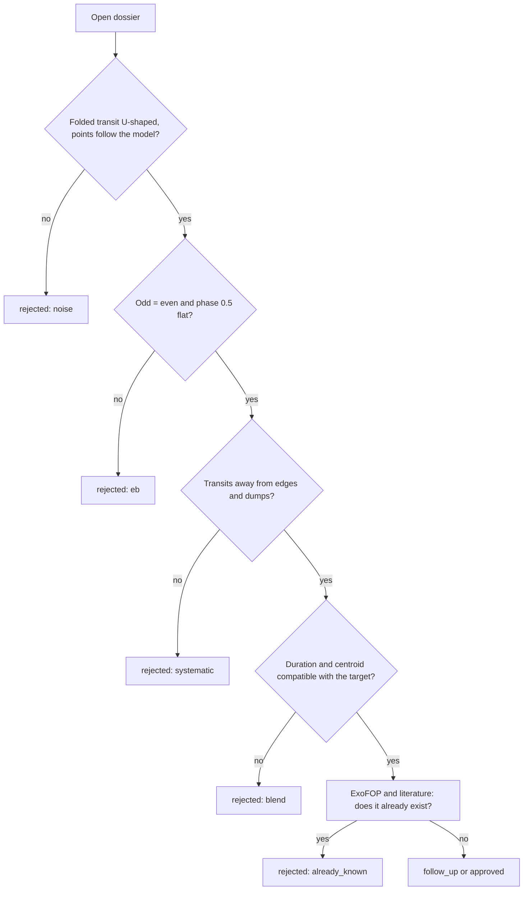

# M5. Vetting in practice

<p class="meta">Intermediate level · weeks 8–10 · about 12 hours</p>

!!! abstract "In this lesson you will learn"
    - The question each basic vetting test answers, what it catches, its limit and a real case.
    - How the verdict comes from vetoes, hard fails and soft fails, how the score is calculated from the weights, and what P1 and P2 mean.
    - How to read the validation table: how many real planets and how many false positives pass.
    - A routine for reviewing candidates with `planethunter candidates`, `dossier` and `review`.
    - How to compare dossiers of known planets and of known false positives.

## The idea: try to knock the signal down

Vetting does not try to prove that a signal is a planet. It tries to **knock it down**. Each test is a question that a common false positive would answer wrong. A signal that survives every question is not a confirmed planet; it is just a signal we could not knock down with the data available.

Basic vetting runs without internet, using only the light curve, the centroids from the SPOC file and the star's parameters. It lives in `src/planethunter/vetting/basic.py`. Tests that need the network (TPF difference image, Gaia neighbors, other sectors, FPP) belong to deep vetting, a topic for the advanced level.

Each test returns one of three results:

- **pass**;
- **fail**: multiplies the score by a weight between 0.3 and 0.6; some tests **veto** above a stricter limit, and a veto sets the score to zero;
- **no data**: multiplies the score by 0.95 (`unknown_weight`). It is not a failure.

A failure that is not a veto comes in two kinds. A **hard fail** is decisive on its own: `shape` and `secondary_scan` here, `tpf_difference_image` and `fpp_triceratops` in deep vetting (`hard_fail_tests`). Every other failure is a **soft fail**: one is tolerated, two are not. The section "The verdict and the score" puts it all together.

## The tests, one by one

The table sums them up. The real cases come from the final calibration run on sector 69 (`20261009T203437Z-single-s69`), unless stated otherwise.

| Test | Question | What it catches | Limit | Veto? | Weight |
|---|---|---|---|---|---|
| `sde`, `snr` | Is the signal strong enough? | Noise | SDE ≥ 9; SNR ≥ 7.1 | Yes | — |
| `snr_pink` | Is it still strong once red noise is counted? | Red noise mimicking a transit | S/N_pink ≥ 9 | No (soft) | 0.5 |
| `n_transits` | Did we see at least 2 transits? | Single event with no period | ≥ 2, each ≥ 50% covered by data | Yes | — |
| `independence` | Does it survive if we erase the star's stronger signals? | Echo of another signal | ≥ 50% of points remain | Yes | — |
| `odd_even` | Do odd and even transits have the same depth? | Binary at 2× the period | fail 3σ | ≥ 5σ | 0.4 |
| `secondary` | Is there a dip at phase 0.5? | Secondary eclipse | fail 3σ | ≥ 5σ **and** ≥ 10% | 0.4 |
| `secondary_scan` | Is there a dip at another phase? | Eccentric binary | fail 5σ | No (**hard**) | 0.5 |
| `shape` | Flat bottom (U) or pointed (V)? | Grazing binary | τ/T14 ≤ 0.35; Rp/R* ≤ 0.3 | No (**hard**) | 0.5 |
| `kdr25_grazing` | Does the transit only graze the star's edge? | Grazing binary | k + b ≤ 1.04 | No (soft) | 0.6 |
| `radius` | Is the size that of a planet? | Star | fail > 22.4 R⊕ | > 33.6 R⊕, only with a reliable star **and** another binary sign | 0.3 |
| `duration` | Does the duration match the star? | Blend; extreme grazing | ratio 0.15 to 1.67 | No (soft) | 0.6 |
| `centroid` | Does the light shift during the transit? | Neighbor as the source | ≥ 3σ **and** source > 1 px | No (soft) | 0.4 |
| `edges_dumps` | Transits at edges or at telescope adjustments? | Systematic | ≤ 50% | No (soft) | 0.4 |
| `consistency` | Do the transits agree with each other? | One event dominating | p ≥ 0.001; largest < 80% of SNR² | No (soft) | 0.5 |

### Detection gates: `sde`, `snr`, `n_transits`

**Question:** is there enough signal to talk about a period? The limits come from lessons [M1](m1-statistics-for-signals.md) and [M3](m3-periodograms.md).

At first these were soft failures. The measured effect: signals with SNR 4.9 and signals with a single transit became P2 and went to the review queue. Today they are vetoes.

**Real cases.** Confirmed planets also fall here when the sector is weak: TOI-286.01 had SNR 5.6 in sector 69. Of the 4 planets that failed the calibration on SNR, none would have been detectable as new in that sector. And GJ 143 b, with a period of about 35 days, shows up with **one** transit in sector 69: without a second transit there is no period, and the signal is vetoed.

A transit only counts in `n_transits` if at least half of its expected time has data. A dip that falls mostly in a gap is not a transit you saw.

### `snr_pink`

**Question:** is the signal still strong once **red noise** is counted? It uses the S/N_pink from lesson [M1](m1-statistics-for-signals.md), with the noise measured in blocks as long as the transit.

**Why it exists.** A star with slow wiggles, poorly removed by the flattening, leaves real periodic dips lasting hours. They reach SDE 8 to 10, and the SDE and SNR cannot reject them: both assume white noise. Their S/N_pink stays below 9. The TESS quick-look pipeline (QLP) uses S/N_pink ≥ 9 as its detection threshold (Guerrero et al. 2021).

**Calibration.** As a veto, this test would remove about 10% of the confirmed planets that pass today, so for now it is a soft failure (`snr_pink_veto: false`). In runs made before the column existed, the value is empty and the test gives "no data" with no penalty.

### `independence`

**Question:** is this signal independent of the stronger ones on the same star? The test masks the transits of the other signals and measures how much of this signal's transit is left. If less than 50% is left, it is an echo.

**Real case.** In the first slice of sector 69, signal 1601 (11.95 d) was reusing the eclipses of signal 1600 (6.75 d), on the same star. Vetoed.

### `odd_even`

**Question:** do the odd and even transits have the same depth? A binary of two different stars, found at half the true period, alternates deep and shallow eclipses. The error uses the block noise (lesson M1).

**Real cases.** TOI-343.01 (false positive): odd 2,294 ppm, even 4,583 ppm, 5.8σ, **veto**. TOI-2391.01: 6,019 versus 12,749 ppm, veto.

**Pitfall.** The confirmed planet TOI-114.01 was also vetoed: 6,690 versus 5,911 ppm, 5.7σ. It is the only planet lost to odd/even in the calibration. At high SNR, small differences (starspots, detrending residuals) become significant.

### `secondary` and `secondary_scan`

**Question:** is there a smaller dip at phase 0.5 (or at another phase)? The physics is in lesson [M2](m2-transit-physics.md).

**Real cases.** TOI-287.01: 4,503 ppm at phase 0.5, 37% of the primary, veto. WASP-18 b: 276 ppm, 3% of the primary, 8σ: **soft failure with no veto**, thanks to the 10% rule. `secondary_scan` was created because the eccentric binary TOI-367.01 was passing; it also gives false alarms, as on the planet TOI-329 b (5.3σ at phase 0.543), so it never vetoes. Since 2026-10-10 it is a **hard fail**: a dip of 5σ at another phase fails the signal on its own. Measured on sectors 69 and 107, this removed many `NEW` signals and a few known false positives, at almost no cost in confirmed planets.

**Period halving.** What if the "secondary" is just as deep as the primary? TOI-187.01 had a phase 0.5 dip 108% of the primary and was vetoed as a binary with two equal eclipses. But the audit found real planets vetoed the same way: TOI-431 b and five other TOIs had been found at **twice** their true period, so the transit in between showed up at phase 0.5 as a perfect "secondary". The rule now: if the phase 0.5 dip has the primary's depth (less than 3σ apart) and duration (within 35%), the signal is tested again at **P/2**, and the result carries the tag `period_halved`. A binary with two equal eclipses is also tested again at P/2; at the new period, the other tests have to catch it.

### `shape`

**Question:** is the transit U-shaped or V-shaped? It measures $\tau/T_{14}$ in a trapezoid fit.

**Calibration.** Limit 0.35: it catches 8 of 18 false positives and flags 3 of 50 planets (real grazing ones: HIP 65 A b, LTT 9779 b, TOI-2382 b). **Cases:** TOI-297.01 (0.42), TOI-353.01 (0.45), TOI-4858.01 (0.41, and with $R_p/R_\star$ = 0.25).

**Hard fail.** A V shape now fails the signal on its own. The configuration says the price in its comment: about 3 grazing hot Jupiters per sector (such as NGTS-6 Ab and NGTS-10 b) are lost, and 4 to 9 binaries detected at half their period are stopped. Removing `shape` from `hard_fail_tests` favors completeness.

### `kdr25_grazing`

**Question:** does the transit only **graze** the edge of the star? The trapezoid is a rough shape. The project also fits a physical transit model (the batman library, Kreidberg 2015) with limb darkening for the TESS band, and gets two numbers: $k = R_p/R_\star$ and the impact parameter $b$. If $k + b > 1.04$, the planet's disk is partly off the star for the whole transit: that is grazing. The limit comes from the Kepler DR25 catalog (Thompson et al. 2018).

**Calibration.** It fails 7 of 140 confirmed planets with a well-constrained fit, all grazing ones that already fail `shape` (LTT 9779 b, HIP 65 A b, NGTS-10 b, TOI-263 b and others), and about half of the known false positives. Soft failure, weight 0.6. When the fit hits the edge of its allowed range, the test gives "no data" with no penalty.

### `radius`

**Question:** is the object the size of a planet? $R_p = k \times R_\star$, with $k$ from the physical fit when the transit is not grazing (otherwise $k = \sqrt{\delta}$). The physical fit matters: $\sqrt{\delta}$ ignores limb darkening and overestimates the radius by about 3%. It fails above 2 Jupiter radii (22.4 R⊕). It vetoes above 3 (33.6 R⊕), but only if the star's radius is reliable (surface gravity $\log g \geq 3.5$, so not a giant) **and** there is another sign of a binary (V shape, odd/even or secondary). Mullally et al. (2015) found no false positive identified by the inferred radius alone. It depends on the star's radius in the TIC: wrong star radius, wrong planet radius.

**Real cases.** TOI-147.01: 26.2 R⊕, fail. TOI-219.01: 33.3 R⊕, fails just short of a veto. TOI-353.01: 29.4 R⊕.

### `duration`

**Question:** does the duration match the star's size and mass? Physics and formula in lesson M2.

**Real cases.** Too short: signal 1594, 0.58 h on a giant star with 10.7 h predicted (ratio 0.05). Too long: TOI-724.01, 8.40 h versus 3.56 h (ratio 2.4). The upper limit is 1.67 (lesson M2 explains why). When the trapezoid fit hits the edge of its allowed durations, the test gives "no data": the duration was not really measured.

### `centroid`

**Question:** does the image's "center of light" shift during the transit? If the dip comes from a neighbor, the centroid moves in the direction opposite to it.

The trick is the **implied source distance**. If a source at a distance $D$ from the centroid dims with relative depth $\delta$, the centroid shifts by about $\delta \times D$. So $D \approx$ shift / depth.

**Measured calibration.** The first version failed any shift above 3σ. Result: **11 of 41 confirmed planets** failed. All of them had the implied source at most 0.88 pixel away, that is, right on top of the target. With bright stars and many transits, even a tiny shift becomes "significant". Current rule: it fails only if the shift is larger than 3σ **and** the implied source is more than 1 pixel (21″) away.

**Real case.** TOI-854.01 (false positive): a 12σ shift, implied source 2.0 pixels away. Fail.

**Three refinements (2026-10-10).**

- **Empirical error.** The test also measures the "shift" at 200 fake epochs outside the transits; their scatter is the real error of one epoch. With the old error, which assumed white noise, random epochs "failed" 2% to 47% of the time, when 1% was expected.
- **Diluted depth.** The centroid comes from all the light in the aperture, but the PDCSAP depth is corrected for contamination. So the depth used is CROWDSAP × δ, the depth inside the aperture: $D \approx$ shift / (CROWDSAP × δ).
- **When it cannot decide.** Saturated stars (Tmag < 7) and sectors with fewer than 3 transits give "no data" (Kostov et al. 2019).

### `edges_dumps`

**Question:** do the transits fall right next to segment edges or to pointing adjustments (*momentum dumps*)? It fails if more than 50% fall near one or the other (lesson M3).

**Real cases.** Several `NEW` signals of 11 to 12 days with 100% of their transits at segment edges: orbit-edge events. The planet TOI-481 b also failed (67% at edges): it is a soft failure because real planets are sometimes unlucky.

### `consistency`

**Question:** do all the transits have a similar depth? Chi-squared with block error (lesson M1).

**Real cases.** TOI-343.01 (false positive): p = 6 × 10⁻⁷. Planets with very high SNR also fail (WASP-97 b, WASP-18 b), so it is a soft failure.

## The verdict and the score

The **verdict** comes first. A signal **fails** (`FAIL`) if it has:

- any veto; or
- any hard fail (`shape`, `secondary_scan`, and in deep vetting `tpf_difference_image` and `fpp_triceratops`); or
- more than one soft fail (`max_soft_fails: 1`).

Otherwise it **passes basic vetting** (`PASS_BASIC`). Tests with "no data" do not count as failures.

The **score** starts at 1.0. For each test:

- failed with no veto: multiply by the test's weight (table above, from `config/thresholds.yaml`);
- no data: multiply by 0.95;
- vetoed: the score becomes 0.

The score no longer decides pass or fail. It **ranks** the signals, and severity uses it. Before 2026-10-10 the rule was "pass if the score is at least 0.5", so a single failure with a low weight was often enough to fail a signal; five confirmed planets were failing because of one soft test.

For `NEW` signals that pass, the severity follows: **P1** needs a score ≥ 0.8 (and, when the calibrated model exists, a high enough `p_rank`; lesson [A4](../advanced/a4-machine-learning.md)); otherwise **P2**. A cataloged eclipsing binary as the star, or a star with no known radius, also caps the signal at P2. P0 needs the deep vetting as well (lesson [A3](../advanced/a3-false-positive-probability.md)).

Three real examples:

| Signal | Failures | Calculation | Score | Result |
|---|---|---|---|---|
| Pi Men c (sector 1) | none | 1.0 | 1.0 | PASS_BASIC |
| WASP-18 b (sector 69) | `secondary`, `consistency` | 0.4 × 0.5 | 0.2 | FAIL: two soft failures |
| Signal 1594, current rules | `duration` | 0.6 | 0.6 | PASS_BASIC (one soft failure), but at most P2 |

!!! warning "The score is not a probability"
    A score of 1.0 says that no automatic test found a problem. It does not say it is a planet. And WASP-18 b, a confirmed planet, has a score of 0.2. The score is a useful **ranking** for deciding what to look at first.

!!! example "Exercise 1"
    Calculate the score and the result:

    a) Fails `duration`; all the others pass.
    b) Fails `duration`; `centroid` has no data; the rest pass.
    c) Fails `odd_even` at 4.2σ and fails `edges_dumps`.
    d) Fails `shape`; all the others pass.
    e) Everything passes, but `odd_even` gave 5.3σ.

    ??? success "Show answer"
        a) Score **0.6**. One soft failure: **PASS_BASIC**. If it is `NEW`, P2 (the score is below 0.8).

        b) 0.6 × 0.95 = **0.57**. Still **PASS_BASIC**: "no data" is not a failure, it only lowers the score. P2 if it is `NEW`.

        c) 0.4 × 0.4 = **0.16**. **FAIL**: two soft failures. 4.2σ is a failure (≥ 3σ), but not a veto (< 5σ).

        d) Score **0.5**, but **FAIL**: `shape` is a hard fail. The score is the same as a signal with one soft failure; the verdict is not.

        e) **0**. Veto: 5.3σ is over the 5σ limit of `odd_even`. No combination of other tests saves a veto.

## Validation: does the vetting work?

How do you know whether the weights and limits make sense? By running the vetting on signals with a **known answer**: confirmed planets (`KNOWN_PLANET`) and false positives that have already been classified (`KNOWN_FP`).

**Sector 69, calibration** (194 hand-picked targets: TOIs from the recall list plus 30 false positives from the TFOPWG):

| Class | Signals | Passed | Rate |
|---|---|---|---|
| KNOWN_PLANET | 54 | 44 | 81% |
| KNOWN_TOI | 74 | 61 | 82% |
| KNOWN_FP | 18 | 8 | 44% |
| NEW | 10 | 0 | 0% |

**Sector 107, whole sector** (12,998 stars, 4,431 signals; run `20261009T221706Z-single-s107`, table printed by `planethunter vet`):

| Class | Signals | Passed | Rate |
|---|---|---|---|
| KNOWN_PLANET | 84 | 66 | 79% |
| KNOWN_TOI | 104 | 77 | 74% |
| KNOWN_FP | 132 | 7 | 5% |
| NEW | 1,339 | 62 | 5% |

The project guide sums up the sector 69 calibrations like this: **confirmed planets pass at 77% to 84%**, and **false positives at 11% to 44%**, depending on the sample and the version of the tests. On the whole of sector 107: **79% versus 5%**. These tables were measured with the rules of 2026-10-09 (pass if the score is at least 0.5); the new rules will be measured again on the same sectors.

Why do false positives pass so much more often in sector 69? Because the sample was hand-picked: false positives that the TFOPWG only ruled out with extra work. The 8 that still pass include secondaries seen only by combining sectors 1 to 69 (TOI-366, 307, 297, 184), an eccentric binary (TOI-367), marginal V shapes (TOI-189, 4858) and a background binary. In sector 107, the sample is the whole sector, dominated by obvious binaries: vetoed on radius (45), secondary (43) and odd/even (14).

And why do 20% of real planets fail? In sector 107, the vetoes on planets were for SNR (4), number of transits (2) and secondary (1). The most common soft failures: shape, centroid, consistency. Planets that are weak in one sector and real grazing planets pay the price of a vetting that has to knock down binaries.

!!! tip "In the tool"
    `uv run planethunter vet <run_id>` prints this table on every run, with the columns `class`, `n`, `pass`, `pass_rate`, `common_failures` and `vetoes`. What to expect: `KNOWN_PLANET` near 80% and `KNOWN_FP` low. If `KNOWN_PLANET` drops a lot after a change, the vetting has become too strict. If `KNOWN_FP` goes up, it has become too loose.

## Candidate review routine

Candidates are `NEW` signals that passed basic vetting. Three commands:

```bash
uv run planethunter candidates                   # the queue, by severity and score
uv run planethunter dossier <signal_id>          # generates the HTML dossier in data/dossiers/
uv run planethunter review <signal_id> rejected --reason eb --note "alternating eclipses"
```

`review` accepts three decisions: `approved`, `rejected` and `follow_up`. Rejecting **requires** a reason:

| Reason | When to use it |
|---|---|
| `eb` | Eclipsing binary: odd/even differ, secondary, V shape, star-sized radius |
| `blend` | The signal comes from another star: centroid off target, incompatible duration, known neighbor |
| `systematic` | Instrumental defect: transits at edges or dumps, only one sector |
| `noise` | There is no convincing transit: weak peak, fold with no shape |
| `already_known` | The object already exists and the crossmatch missed it |
| `other` | None of the above; explain in the note |

The note is stored together with the reason (for example, `[eb] alternating eclipses`). Rejected signals leave the list. The reviews become training data for the future classifier.



For each candidate, go through the dossier in this order: header (severity, class, score, known host); parameters (does the star have a radius? is the planet planet-sized?); light curve (transits stuck to blue lines or edges?); folded transit (U or V?); odd, even and secondary; depth per transit (any point off the line?); vetting table (read every note, not just the result); crossmatch (age of the mirrors); next action.

!!! note "Always write the note"
    "eb" on its own teaches little. "eb: even 2× deeper than odd, secondary 12% at phase 0.5" teaches a lot, to you three months from now and to the classifier.

## Main exercise: planets versus false positives

!!! example "Exercise 2"
    Generate and compare 5 `KNOWN_PLANET` dossiers and 5 `KNOWN_FP` dossiers. To list signals of each class already vetted in your database, save this script as `list_known.py` and run `uv run python list_known.py`:

    ```python
    import duckdb

    con = duckdb.connect("data/planethunter.duckdb", read_only=True)
    df = con.execute("""
        SELECT c.match_class, s.signal_id, s.tic_id, c.matched_name,
               round(s.period_days, 3) AS period_d, round(s.depth_ppm) AS depth_ppm,
               round(v.score, 2) AS score, v.vetoed_by, v.failed
        FROM signals s
        JOIN crossmatch c USING (signal_id)
        JOIN vetting v USING (signal_id)
        WHERE c.match_class IN ('KNOWN_PLANET', 'KNOWN_FP')
        ORDER BY c.match_class, s.signal_id DESC
        LIMIT 60
    """).df()
    print(df.to_string(index=False))
    ```

    Choose 5 from each class (preferably varied: some passed, some failed) and generate the dossiers with `uv run planethunter dossier <signal_id>`. For each one, write down in a table: depth, radius, shape (τ/T14), odd/even, phase 0.5, duration ratio, centroid, score. Then answer: what distinguishes the two groups **visually**?

    ??? success "Show answer"
        The answer depends on the signals you chose, but the patterns that show up in sector 69 are:

        - **Depth and radius.** False positives tend to be deeper (thousands to tens of thousands of ppm) and to give radii above 22 R⊕ (TOI-147.01, TOI-219.01, TOI-353.01). Small planets are almost never obvious false positives.
        - **Shape.** In the **Folded transit** plot, the FPs show a V or long ramps (τ/T14 from 0.36 to 0.45); the planets show a U with short ramps (0.1 to 0.15).
        - **Odd, even and phase 0.5.** In the FPs, the odd/even panel shows different depths (TOI-343.01) or the third panel shows a clear dip (TOI-287.01). In the planets, the first two panels are equal and the third is flat. An exception to recognize: ultra-hot Jupiters, like WASP-18 b, with a small occultation at phase 0.5.
        - **Centroid.** Some FPs show an implied source more than 1 pixel away (TOI-854.01).
        - **Where they look alike.** FPs that only reveal themselves with several sectors or with high-resolution images look like planets in every single-sector plot. That is why deep vetting exists.

        If you chose planets that failed (WASP-18 b, TOI-114.01, TOI-481 b), note that the failure comes from the **consistency** and **odd/even** tests on signals with extremely high SNR: small, real differences, but nothing that looks like a binary.

!!! example "Exercise 3"
    Which rejection reason would you use?

    a) A dossier with 2 transits, both less than 0.1 d from the start of a segment.
    b) τ/T14 = 0.45, even 2× deeper than odd, Rp = 28 R⊕.
    c) Duration 0.6 h on a 2.5 R☉ star; centroid with the implied source 1.8 pixels away.
    d) ExoFOP shows a CTOI submitted yesterday with the same period.

    ??? success "Show answer"
        a) `systematic`. Transits at segment edges are the signature of detrending ramps. Suggested note: "2/2 transits at a segment edge".

        b) `eb`. Three signs of a binary at once: V shape, odd/even alternation, star-sized object.

        c) `blend`. Duration too short for a large star (like signal 1594) and a centroid pointing away from the target: the signal probably comes from a smaller neighbor.

        d) `already_known`. The local mirror did not have the CTOI yet. It is worth writing the CTOI's name in the note.

## Lesson checklist

- [ ] I can state the question of each test in the table and one real case for each.
- [ ] I can decide the verdict from the vetoes, hard fails and soft fails, and calculate the score from the failures, the tests with no data and the vetoes.
- [ ] I can explain why the centroid test uses the implied source distance.
- [ ] I can read the validation table and explain the difference between sector 69 and sector 107.
- [ ] I generated and compared 5 `KNOWN_PLANET` dossiers and 5 `KNOWN_FP` dossiers.
- [ ] I reviewed at least 10 candidates with `planethunter review`, each with a reason and a note.
- [ ] I read `docs/benchmarks/2026-10-09-s0069-vetting.md` and can explain each row of the table "What was measured and fixed".

## Going further

- In the repository, `docs/benchmarks/2026-10-09-s0069-vetting.md`: the full calibration, with what was measured and fixed, the FPs that still pass and the funnel of the first real slice.
- Guerrero et al. (2021), *The Astrophysical Journal Supplement Series* 254, 39: how the TESS team vets the TOIs. Compare their criteria with the ones in this lesson.
- Thompson et al. (2018), *The Astrophysical Journal Supplement Series* 235, 38: the Kepler Robovetter, the "grandfather" of automatic tests. It is covered in lesson [A2](../advanced/a2-mission-vetting.md).
- The Planet Hunters TESS forums on [zooniverse.org](https://www.zooniverse.org): volunteers discussing, with the same arguments as this lesson, whether a signal is a planet or a binary.
