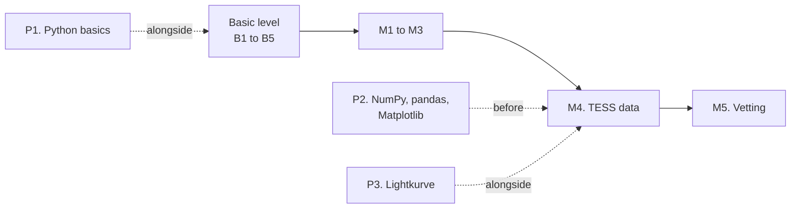

# Programming track

<p class="meta">Parallel track · from the basic to the intermediate level · about 30 to 35 hours in total</p>

This track teaches Python, the programming language PlanetHunter is written in. It is not a generic computer course: every example is about stars, transits and light curves. You learn to program and, at the same time, review the science from the lessons.

!!! abstract "By the end of the track you will be able to"
    - Write and run small Python programs on your Windows computer.
    - Simulate a light curve, read the ExoFOP TOI table and make plots.
    - Download real TESS data with the Lightkurve library and measure a transit.
    - Open the files PlanetHunter writes (Parquet and a DuckDB database) and ask them questions.

## Why programming helps

You can use PlanetHunter without programming. The commands are in the [lab](../lab/using-planethunter.md). So why learn Python?

- **So you do not depend on a black box.** When the system says "depth 10,583 ppm", you can redo the calculation and check it.
- **To ask questions the system does not ask.** For example: "how many sector 69 candidates have a period shorter than 1 day?". One line of code answers it.
- **To understand the vetting tests.** Each test is a Python function a few lines long. Reading the code, you see exactly what it measures.
- **To contribute.** Changing a limit or creating a new test means touching the code and measuring the effect.

An analogy: PlanetHunter is a car. You can drive it without knowing mechanics. But someone who understands the engine can tell when a noise is normal and when it is a fault.

## How the track runs alongside the levels

The track runs in parallel with the science track. You do not need to finish it before starting the course.

| Lesson | When to do it | Why |
|---|---|---|
| [P1. Python basics](p1-python-basics.md) | Alongside the basic level (optional) | You practice with the calculations from B1 and B2: depth, ppm, planet radius |
| [P2. NumPy, pandas and Matplotlib](p2-numpy-pandas-matplotlib.md) | After the basic level, **before M4** | M4 uses arrays, tables and plots all the time |
| [P3. Lightkurve in practice](p3-lightkurve-in-practice.md) | **Alongside M4** | It is the hands-on part of M4: real TESS data and PlanetHunter data |



In the study plan, programming is optional at the basic level and required from the intermediate level on.

## The lessons

- **[P1. Python basics](p1-python-basics.md)**: variables, lists, dictionaries, loops and functions, with transit calculations. About 10 hours.
- **[P2. NumPy, pandas and Matplotlib](p2-numpy-pandas-matplotlib.md)**: simulate a light curve, read the TOI list and make plots. About 12 hours.
- **[P3. Lightkurve in practice](p3-lightkurve-in-practice.md)**: measure the planet WASP-18 b with real data and query the PlanetHunter database. About 10 hours.

## Setting up your computer (Windows 11 and VS Code)

You will install three things: **uv** (a Python manager), **Python 3.12** and, if you do not have it yet, **Git**. You already have VS Code.

### Step 1. Open a terminal in VS Code

A **terminal** is a window where you type commands instead of clicking. In VS Code, use the menu **Terminal > New Terminal** or the shortcut ++ctrl+grave++. A panel appears at the bottom with something like `PS C:\Users\you>`. That "PS" means PowerShell, the default Windows terminal.

### Step 2. Install uv

**uv** installs Python, creates an isolated environment for each project and downloads the libraries. It is what PlanetHunter uses. Type in the terminal:

```powershell
winget install --id=astral-sh.uv -e
```

If `winget` does not exist on your computer, use the official installer:

```powershell
powershell -ExecutionPolicy ByPass -c "irm https://astral.sh/uv/install.ps1 | iex"
```

**Close the terminal and open a new one.** Windows only sees new programs in new terminals. Then check:

```powershell
uv --version
```

You should see something like `uv 0.x.y`. The exact number does not matter.

### Step 3. Install Python 3.12

uv installs Python itself:

```powershell
uv python install 3.12
uv python list
```

The list should show a line with `cpython-3.12`. Done. You do not need to download anything from python.org.

!!! note "Why 3.12 and not the newest version?"
    PlanetHunter requires Python 3.12 (see `requires-python` in the `pyproject.toml` file). Some astronomy libraries take a while to catch up with new versions. Using the same version avoids surprises.

### Step 4. Install Git (if you do not have it yet)

**Git** keeps the history of changes to a project. You will need it to download PlanetHunter.

```powershell
winget install --id Git.Git -e
git --version
```

### Step 5. Install the Python extension in VS Code

In VS Code, click the icon with little squares on the left (Extensions), search for **Python** (author: Microsoft) and click **Install**. It colors the code, points out errors and lets you run files with a button.

### Step 6. Create a study folder

Keep your exercises in a folder separate from PlanetHunter. That way you do not mix your experiments with the project's code.

```powershell
cd ~
uv init --python 3.12 exoplanet-studies
cd exoplanet-studies
uv add numpy pandas matplotlib
```

What each line does:

1. `cd ~` goes to your user folder.
2. `uv init` creates the `exoplanet-studies` folder with a `pyproject.toml` file (the project's "ID card") and a few helper files. Depending on your uv version, a `main.py` file or a `src` folder also appears. You can ignore them.
3. `uv add` installs the libraries for lesson P2 in an environment just for this project, the `.venv` folder.

In lesson P3 you will add more libraries with `uv add lightkurve pyarrow duckdb`.

Open the folder in VS Code: **File > Open Folder** and choose `exoplanet-studies`. Then press ++ctrl+shift+p++, type **Python: Select Interpreter** and choose the one with `.venv` in its path.

## How to run a script

A **script** is a text file with the `.py` extension containing Python instructions. In VS Code, create a file called `hello.py` inside the study folder with this content:

```python
# My first script
print("Hello! I am going to look for planets.")
depth_ppm = 84
print("Earth passing in front of the Sun blocks", depth_ppm, "parts per million of its light.")
```

Save it (++ctrl+s++) and run it in the terminal, from inside the study folder:

```powershell
uv run python hello.py
```

`uv run` makes sure the Python used is the one in the project's environment, with the libraries you installed. Clicking the triangle ("Run Python File") in the top right corner of VS Code also works, as long as you chose the `.venv` interpreter in step 6.

!!! warning "Common problems"
    - **"uv is not recognized as the name of a cmdlet"**: close and reopen the terminal. If it persists, restart VS Code.
    - **"No such file or directory"**: you are in the wrong folder. Use `cd` to go into the script's folder and `ls` to see the files.
    - **Strange characters in the output**: it is only how the terminal displays them. The data do not change.
    - **Decimal comma**: in Python, numbers use a decimal point. Write `3.7`, never `3,7`.

## Recommended companion course

If you have never programmed, I recommend **Curso em Vídeo — Python**, by teacher Gustavo Guanabara. It is free, on YouTube and on the Curso em Vídeo website, and has exercises with video solutions. It is in Portuguese; if you prefer English, the official Python tutorial (docs.python.org) covers the same ground. Curso em Vídeo is split into three "worlds":

| Curso em Vídeo world | Goes with |
|---|---|
| World 1 (fundamentals) | Lesson P1, first half |
| World 2 (conditions and loops) | Lesson P1, second half |
| World 3 (lists, dictionaries, functions, modules) | End of P1 and lesson P2, before M4 |

The lessons in this track do not replace the course: they show how to use what it teaches in the context of exoplanets.

!!! tip "In the tool"
    All of PlanetHunter is Python. The command-line commands are in `src/planethunter/cli.py`. When you finish P3, open that file: you will recognize functions, lists, dictionaries and pandas tables in almost every line.

## How to know you have finished the track

You are done when you can, without help:

1. Write a function that takes a depth in ppm and a star radius and returns the planet radius in Earth radii.
2. Read the ExoFOP TOI CSV and count how many are in each disposition (CP, KP, PC, FP...).
3. Download a target's light curve with Lightkurve, find the period with BLS and measure the depth.
4. Query all the signals of a star in the `data/planethunter.duckdb` database.

## Track checklist

- [ ] I installed uv and Python 3.12 and checked the versions
- [ ] I created the `exoplanet-studies` folder and ran `hello.py`
- [ ] I finished lesson P1
- [ ] I finished lesson P2 before starting M4
- [ ] I finished lesson P3 alongside M4

## Going further

- Curso em Vídeo — Python (Gustavo Guanabara). The best free starting point in Portuguese for people who have never programmed.
- NumPy documentation, "absolute beginners" section ([numpy.org](https://numpy.org/doc/stable/user/absolute_beginners.html)). Useful as a reference during P2.
- Official Lightkurve tutorials ([lightkurve.github.io](https://lightkurve.github.io/lightkurve/tutorials/index.html)). The basis of lesson P3 and module M4.
