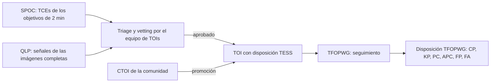

# A2. Cómo hacen vetting las misiones

Nivel avanzado · semanas 3–6 · cerca de 16 horas

!!! abstract "En esta lección vas a aprender"
    - Qué calcula el Data Validation de Kepler y de TESS para cada señal (Twicken et al. 2018).
    - Cómo decide el Robovetter de Kepler DR25 y, sobre todo, cómo mide su propia confiabilidad (Thompson et al. 2018).
    - Cómo nace un TOI y quién decide qué es (Guerrero et al. 2021).
    - Qué es el catálogo de binarias eclipsantes de TESS (Prša et al. 2022) y el bug real que causó en PlanetHunter.
    - Cómo funcionan la imagen de diferencia y los centroides, y el emparejamiento tránsito a tránsito que nació del caso HD 23472.

PlanetHunter no inventó el vetting. Casi todas sus pruebas tienen un antecesor en los pipelines de las misiones Kepler y TESS. Estudiar esos antecesores sirve para dos cosas: entender **por qué** existe cada prueba y ver **qué falta todavía** en el proyecto.

## 1. Data Validation: la batería de diagnósticos

El pipeline científico de Kepler, y después el de TESS (operado por el **SPOC**, Science Processing Operations Center), tiene dos etapas principales. La primera, la búsqueda, produce **TCEs** (Threshold Crossing Events): señales periódicas que superaron un límite de detección. La segunda, el **Data Validation** (DV), ajusta un modelo de tránsito a cada TCE y ejecuta una batería de diagnósticos. Twicken et al. (2018), *PASP* 130, 064502, describen la arquitectura del DV de Kepler. El SPOC heredó esa arquitectura para TESS, y los informes DV de cada TCE de TESS son públicos en MAST y están enlazados en las páginas de cada objetivo en ExoFOP.

Los principales diagnósticos del DV:

| Diagnóstico | Pregunta | Antecesor de qué prueba de PlanetHunter |
|---|---|---|
| Profundidad impar/par | ¿Los tránsitos alternos tienen la misma profundidad? | `odd_even` |
| Secundario débil | ¿Hay una caída en otra fase? | `secondary`, `secondary_scan` |
| Discriminación de binaria por el período | ¿Otro TCE de la misma estrella tiene período igual o múltiplo? | `independence` (en parte) |
| Movimiento del centroide | ¿El centro de luz de la apertura se desplaza durante el tránsito? | `centroid` (MOM_CENTR) |
| Centroide de la imagen de diferencia | ¿Dónde está la fuente de lo que se apagó? | `tpf_difference_image` |
| Fantasma óptico | ¿La señal es más fuerte en el halo alrededor de la estrella que en el núcleo de la apertura? | no tiene |
| Prueba de bootstrap | ¿Cuál es la probabilidad de que el ruido por sí solo produzca esa SNR? | parcialmente, por el piso de ruido en `other_sectors` y las corridas nulas |
| Contaminación por "rolling band" | ¿Los tránsitos coinciden con un patrón de ruido electrónico conocido del detector? | no tiene (es específico de Kepler) |

El DV **no decide**. Produce números y gráficos para que alguien decida. En Kepler, esa decisión fue primero humana y después automatizada.

## 2. El Robovetter de Kepler DR25

Thompson et al. (2018), *ApJS* 235, 38, presentan el catálogo final de Kepler (DR25), con cerca de 4 000 candidatos a planeta. El corazón del artículo es el **Robovetter**: un árbol de decisión que lee los diagnósticos de cada TCE y asigna una de cuatro marcas de falso positivo:

- **NT** (Not Transit-like): no parece un tránsito. Variabilidad, sistemático, forma extraña.
- **SS** (Stellar eclipse): eclipse de una estrella. Secundario significativo, impar/par diferente, forma de V.
- **CO** (Centroid Offset): la fuente está desplazada respecto al objetivo.
- **EC** (Ephemeris match indicates Contamination): el período y la época coinciden con los de otra estrella conocida del campo, lo que indica contaminación.

Sin ninguna marca, el TCE se convierte en candidato.

### La lección más importante del Robovetter

No son las pruebas. Es la **medición**. El equipo de Kepler midió dos cosas que todo sistema de vetting debería medir:

1. **Completitud del vetting**: inyectaron tránsitos sintéticos en los píxeles, ejecutaron el pipeline completo y contaron cuántos aprobó el Robovetter.
2. **Confiabilidad**: crearon falsas alarmas a propósito, **invirtiendo** las curvas de luz (las caídas se vuelven subidas y viceversa) y **barajando** el orden de los datos en el tiempo. Cualquier "tránsito" encontrado en esas curvas es, por construcción, falso. La fracción de ellos que aprueba el Robovetter estima cuántos falsos siguen contaminando el catálogo.

Con eso, cada candidato recibió un **score de disposición**: la fracción de veces que pasó cuando se perturbaron los límites del Robovetter. Es una idea parecida al score de PlanetHunter, pero medida, no solo definida.

!!! info "Curvas invertidas en PlanetHunter"
    PlanetHunter mide el vetting con falsos positivos reales (FP/FA del TFOPWG) y, desde el 2026-10-10, también con corridas nulas al estilo de Kepler: `planethunter search --null inverted` pone el flujo de cabeza y `--null scrambled` desplaza en el tiempo cada órbita de datos. Toda señal que producen es una falsa alarma, sin necesidad de etiqueta. Medir cuántas de ellas aprueba el vetting es un buen proyecto tuyo para la lección A5.

## 3. El catálogo de TOIs

Guerrero et al. (2021), *ApJS* 254, 39, describen cómo nacen los **TOIs** (TESS Objects of Interest) en la misión principal (sectores 1 a 26), con más de 2 200 objetos. El flujo, simplificado:

Dos detalles te importan:

- Hay **dos disposiciones** diferentes. La **TESS Disposition** la asigna el equipo que crea el TOI (por ejemplo, PC para candidato, EB para binaria). La **TFOPWG Disposition** la asigna el grupo de seguimiento después de observaciones desde tierra: CP (planeta confirmado), KP (planeta ya conocido), PC (todavía candidato), APC (candidato ambiguo), FP (falso positivo), FA (falsa alarma). El benchmark del proyecto usa la del TFOPWG cuando existe (`benchmark.py`, función `build`).
- Los **CTOIs** entran en el mismo flujo. El equipo puede promoverlos a TOI. Es el camino que vas a preparar en la lección A6.

## 4. El catálogo de binarias de TESS y el bug de los hot Jupiters

Prša et al. (2022), *ApJS* 258, 16, publicaron el catálogo de binarias eclipsantes de TESS para los sectores 1 a 26: cerca de 4 600 sistemas, con período, época y un parámetro de morfología (qué tan "separadas" o "en contacto" están las estrellas). PlanetHunter mantiene un espejo de ese catálogo para el crossmatch.

El bug real: en la primera calibración en el sector 69, **9 señales** coincidieron con el catálogo de binarias y se clasificaron como `KNOWN_FP`. Cuando alguien las miró una por una, eran **WASP-18 b, WASP-100 b, HATS-16 b** y otros **planetas confirmados**, todos hot Jupiters. Los planetas gigantes muy cercanos a su estrella producen tránsitos profundos y, a veces, ocultaciones visibles. Un catálogo construido para encontrar eclipses, con criterios automáticos y revisión visual, inevitablemente atrapa algunos de ellos.

La corrección (en `crossmatch/core.py`, función `_priority`) define un **orden de evidencia** cuando varios objetos coinciden en la misma estrella:

1. Planeta confirmado (Exoplanet Archive, exoplanet.eu, Kepler o K2, o TFOPWG CP/KP).
2. Disposición FP/FA del TFOPWG.
3. TOI.
4. CTOI.
5. Candidato publicado (listas como DIAmante, DTARPS, LEO-Vetter, ExoMiner++ y los candidatos de Kepler/K2): clase `KNOWN_PUBLISHED`.
6. Catálogo de binarias (Prša et al. 2022 y el catálogo "TESS Ten Thousand" de Kostov et al. 2025).

Primero se reúnen todos los objetos que coinciden en la estrella, y solo después se aplica el orden. La auditoría del 2026-10-10 trajo dos reglas más. Una binaria (fila de catálogo o disposición FP) coincide con **cualquier** alias, incluidos 2P y P/2, y da `KNOWN_FP`: la excepción para planetas con períodos casi resonantes no vale para binarias. Y una fila del catálogo de binarias que en realidad es el propio planeta conocido de la estrella (como WASP-173 A b) ya no marca la estrella como anfitriona de una binaria.

La lección va más allá del catálogo: **ningún catálogo es la verdad**. Cada uno se hizo con un objetivo, por un método, con una tasa de error. Cuando dos catálogos no coinciden, la regla de prioridad tiene que reflejar qué evidencia es más fuerte. Una confirmación por velocidad radial pesa más que una clasificación automática por forma.

## 5. Lado a lado

| Prueba | DV / Robovetter | Equipo de TOIs | PlanetHunter |
|---|---|---|---|
| Fuerza de la señal | Límite de SNR en la búsqueda (TPS) | Límite de SNR | `sde` ≥ 9, `snr` ≥ 7,1 (veto) |
| Número de tránsitos | ≥ 2 en la búsqueda | ≥ 2 (monotránsitos aparte) | `n_transits` ≥ 2 (veto) |
| Impar/par | DV, Robovetter SS | Sí | `odd_even` (falla a 3σ, veto a 5σ) |
| Secundario | DV, Robovetter SS | Sí | `secondary` (veto solo si ≥ 10 % del primario), `secondary_scan` |
| Forma de V | Robovetter SS | Visual | `shape` (`v_shape_max` 0,35, falla dura); `kdr25_grazing` (k + b > 1,04, el corte del DR25, falla leve) |
| Radio inverosímil | Sí | Sí | `radius` (falla 22,4 R⊕; veto 33,6 R⊕ solo con una estrella confiable y otro indicio de binaria) |
| Duración × densidad | Parcial | Visual | `duration` (0,15 a 1,67 × lo previsto) |
| Centroide | DV, Robovetter CO | Sí | `centroid` offline, `tpf_difference_image` |
| Vecinos y dilución | Parcial | Gaia | `gaia_neighbors` (modelo de PSF sobre la apertura real) |
| Contaminación por efeméride | Robovetter EC | Sí | crossmatch `NEARBY_KNOWN` (hasta 2′), tránsito a tránsito y señales compartidas en la corrida |
| Ruido rojo | — | S/N_pink ≥ 9 (QLP) | `snr_pink` |
| Sistemáticos del instrumento | Rolling band, fantasma | Visual | `edges_dumps` |
| Otros sectores / trimestres | Consistencia entre trimestres | Multisector | `other_sectors`, con búsqueda a ciegas |
| Probabilidad de FP | Validación estadística aparte | Seguimiento | `fpp_triceratops` |
| Confiabilidad medida | Curvas invertidas y barajadas | Seguimiento desde tierra | FPs del TFOPWG en los sectores 69 y 107; corridas nulas invertidas y barajadas |

Lo que salta a la vista en la tabla: PlanetHunter cubre la mayoría de las pruebas clásicas, pero **no tiene** prueba de fantasma óptico ni prueba de bootstrap formal, y sus corridas nulas son nuevas y todavía no se usan para reportar una cifra de confiabilidad. Son candidatos naturales para mejoras, y la autoevaluación te va a pedir que propongas una.

## 6. Imagen de diferencia y centroides

El píxel de TESS mide 21″. Dentro de la apertura de un objetivo caben varias estrellas. La pregunta "¿de qué estrella viene la caída?" es, en muchos casos, la más importante del vetting.

### Movimiento del centroide (offline)

El SPOC registra, para cada cadencia, el **centroide** (centro de luz ponderado) de la apertura, en las columnas MOM_CENTR. Si la caída viene del objetivo, el centroide casi no se mueve. Si viene de un vecino, el centro de luz se desplaza **en dirección opuesta** al vecino durante el tránsito.

El desplazamiento por sí solo engaña: una caída profunda en un vecino débil y una caída poco profunda en un vecino brillante pueden dar el mismo movimiento. El proyecto usa la **distancia implícita de la fuente**:

$$
d_\text{fuente} \approx \frac{\Delta x}{\delta} ,
$$

el desplazamiento dividido entre la profundidad fraccional. La prueba `centroid` solo falla si el desplazamiento es mayor que 3σ **y** la fuente implícita está a más de 1 píxel (`centroid_max_offset_px`). Esta regla nació de una medición: con el criterio solo de significancia, 11 de 41 planetas confirmados fallaban, y todos tenían una fuente implícita de hasta 0,88 px.

Tres refinamientos de la auditoría del 2026-10-10:

- **La profundidad en la apertura.** La profundidad del PDCSAP está corregida por contaminación, pero el centroide MOM_CENTR no. La profundidad correcta en la fórmula es $\delta_\text{ap} = \text{CROWDSAP} \times \delta$.
- **Un error empírico.** El error que suponía ruido blanco hacía que épocas aleatorias fuera del tránsito "fallaran" entre el 2 % y el 47 % de las veces, frente al 1 % esperado. Ahora la misma medida se hace en 200 épocas falsas fuera del tránsito, y su dispersión es el error de una época. Cada sector se evalúa por separado, porque la orientación de los píxeles del detector cambia entre sectores.
- **Saber cuándo no decidir.** Las estrellas saturadas (Tmag < 7) y los sectores con menos de 3 tránsitos dan "sin datos" (Kostov et al. 2019).

### Imagen de diferencia (con red, por candidato)

La prueba `tpf_difference_image` descarga el archivo de píxeles (TPF) del objetivo y hace lo siguiente:

1. Promedio de las imágenes **fuera** del tránsito (entre 1 y 3 duraciones del centro).
2. Promedio de las imágenes **dentro** del tránsito (hasta 0,4 duraciones del centro).
3. **Diferencia** = fuera − dentro. Lo que se apagó aparece brillante.
4. Centroide de la diferencia comparado con la **posición de catálogo** del objetivo (la posición del TIC, época 2000, llevada con el movimiento propio de la estrella hasta la fecha del TPF).
5. Incertidumbre: la dispersión de los centroides calculados tránsito a tránsito, dividida entre la raíz del número de tránsitos (necesita al menos 3).

Falla si el desplazamiento supera 1 píxel y es significativo (3σ). Es una **falla dura**: por sí sola, reprueba la señal. Con menos de 3 tránsitos no hay estimación del error, y un desplazamiento mayor a 1 píxel da "sin datos" en lugar de una falla. La primera versión comparaba el centroide de la diferencia con el centroide fuera del tránsito; Bryson et al. (2013) lo comparan con la posición de catálogo. Con la referencia antigua, en 10 de 20 fallas del sector 107 el centroide de la diferencia estaba a menos de 1 píxel de la posición del TIC. En el dossier, la `x` roja (centroide de la diferencia) debe caer dentro del círculo naranja (posición del TIC); la `+` blanca marca el centroide fuera del tránsito. En la primera tanda real de 2 164 estrellas, la señal 1528 fue rechazada en esta prueba.

El método profesional (Bryson et al. 2013) ajusta a la imagen de diferencia el modelo de la respuesta del instrumento a una estrella puntual (la PRF), más preciso con vecinos cercanos. El centroide ponderado del proyecto es una aproximación deliberadamente simple.

### Del centroide a los vecinos Gaia

La prueba no logra separar fuentes más cercanas que su propia incertidumbre. El proyecto define un **radio de exclusión** igual a 3 veces el menor error de centroide (mínimo de 0,3 px). Después, la prueba `gaia_neighbors` lista las estrellas de Gaia DR3 hasta 2,5 píxeles y, para cada una, calcula la profundidad que necesitaría tener para producir la señal por sí sola. Usa la fórmula de triceratops (Giacalone et al. 2021):

$$
\delta_\text{necesaria} = \delta_\text{obs} \times \frac{F_\text{objetivo,ap}}{F_\text{vecino,ap}}, \qquad F_\text{ap} = 10^{-0,4\,T} \times (\text{fracción de la PSF de la estrella dentro de la apertura}) .
$$

$T$ es la magnitud TESS (convertida a partir de la $G$ de Gaia y el color cuando hace falta), y la PSF se modela como una gaussiana de 0,75 px sobre los píxeles reales de la apertura. La profundidad observada es la del PDCSAP, ya corregida por dilución, así que se refiere a la luz del propio objetivo. Por eso en el numerador va el flujo del objetivo, y no el flujo total; la primera versión usaba el flujo total y sobreestimaba la profundidad necesaria.

Por encima de 100 %, es imposible. Un vecino posible **dentro** del radio de exclusión sigue siendo plausible, y la prueba termina con "requiere imagen": solo una imagen de alta resolución lo resuelve. Y si la imagen de diferencia muestra un desplazamiento significativo y un vecino capaz de producir la caída está a menos de 1 píxel del centroide de la diferencia, la prueba falla: el culpable tiene nombre.

## 7. Emparejamiento tránsito a tránsito: el caso HD 23472

HD 23472 tiene cinco planetas conocidos. En un único sector, el TLS vio un tránsito del planeta b y uno del planeta c y "encontró" un planeta de **10,29 días**. El crossmatch por período no lo atrapó: 10,29 días no es el período de ningún planeta conocido, ni un alias. La señal llegó a P1. Lo mismo pasó con TOI-703 (.01 + .02 convertidos en 11,40 d) y GJ 143 (8,80 d).

La corrección, en `crossmatch/core.py` (función `explain_transits`), pregunta para **cada tránsito observado**: ¿algún objeto conocido de la estrella predice un evento aquí?

- Para cada objeto, propaga la efeméride hasta la época del tránsito: $n = \text{round}[(t - T_0)/P]$, previsto $= T_0 + nP$.
- Tolerancia: el mayor entre la mitad de la duración y 1 hora, más 3 veces la incertidumbre propagada, $3\,|n|\,\sigma_P$. Cuando un catálogo no da $\sigma_P$, se supone $10^{-4} P$ en lugar de cero.
- Los objetos cuya incertidumbre propagada a $3\sigma$ supera 0,25 días (o 0,1 P) se ignoran: su efeméride ya no sirve.
- También prueba la fase 0,5, porque muchos TOIs y CTOIs son binarias y el "tránsito" puede ser el eclipse secundario. No para los planetas confirmados, que no tienen un eclipse secundario capaz de pasar por tránsito.

La primera versión clasificaba la señal como conocida si **al menos el 50 %** de sus tránsitos quedaban explicados. Después de esa corrección, los 3 candidatos `NEW` que pasaban el embudo en el benchmark bajaron a **0**. Todos eran falsos.

Pero la auditoría encontró la regla demasiado permisiva: con ventanas de hasta ± (duración + 1 día), la fase 0,5 para todos los objetos y solo dos tránsitos, "explicaba" señales aleatorias el 36 % de las veces (del 80 % al 87 % para períodos conocidos por debajo de 2 días). La regla actual agrega una prueba de **azar**. Si las ventanas de los objetos conocidos cubren una fracción $f$ del tiempo, la probabilidad de que $k$ o más de los $n$ tránsitos caigan dentro de ellas por suerte es binomial:

$$
P(X \geq k) = \sum_{j=k}^{n} \binom{n}{j} f^{j} (1-f)^{n-j} .
$$

La señal es conocida (`match_type = transit_times`) solo si al menos el 50 % de los tránsitos quedan explicados **y** esa probabilidad es menor que 1 %. La tasa medida de coincidencias por azar bajó a entre 0,3 % y 1,3 %. Los casi aciertos (entre 1 % y 10 %) siguen como `NEW`, con la nota `partial_known_transit_coincidence`, y no pueden pasar de P2.

### Más allá de una estrella: picos de época y señales compartidas

Algunas señales falsas solo aparecen cuando miras juntas todas las estrellas de una corrida (`crossmatch/runlevel.py`):

- **Picos de época.** Un evento del telescopio en un momento dado pone un "tránsito" en muchas estrellas sin relación a la vez. El proyecto cuenta, en intervalos de 0,25 días, cuántas estrellas distintas tienen un tránsito ahí, y marca los intervalos con muchas más de las que el azar permite. En el sector 107, esta verificación marcó cientos de señales `NEW`. Una señal con la mitad o más de sus tránsitos en picos (`epoch_spike_frac` ≥ 0,5) no recibe alerta.
- **Señales compartidas.** El mismo período (o 2P, P/2) y el mismo instante de tránsito en otro objetivo a menos de 2′ significa una sola señal vista a través de dos aperturas. La estrella que realmente puede producir la caída, y cuya apertura pierde más luz, es la `source` (como máximo P2); la otra es la `victim` (sin alerta). Dos entradas a menos de 2″ una de otra son un `duplicate`: el TIC partió una estrella en dos (Paegert et al. 2021).

!!! tip "En la herramienta"
    - Las pruebas básicas están en `src/planethunter/vetting/basic.py`; las profundas (imagen de diferencia, vecinos Gaia, otros sectores, SIMBAD, binarias de Gaia, FPP), en `src/planethunter/vetting/deep.py`.
    - La prioridad entre catálogos y el emparejamiento tránsito a tránsito están en `src/planethunter/crossmatch/core.py`; los picos de época y las señales compartidas, en `src/planethunter/crossmatch/runlevel.py`.
    - En el dossier: sección 7 (imagen de diferencia) y sección 9 (crossmatch, con el tipo de emparejamiento y la antigüedad de cada espejo).
    - Ejecuta `uv run planethunter vet-deep <run_id>` para ver la imagen de diferencia y los vecinos de candidatos reales.

!!! example "Ejercicio 1. ¿Qué vecino puede ser la fuente?"
    Un candidato tiene una profundidad de 2 000 ppm (ya corregida por dilución). El objetivo tiene $T = 10{,}0$. Hay dos vecinos Gaia: A con $T = 14{,}0$ y B con $T = 18{,}0$. Para simplificar, supón que toda la luz de las tres estrellas cae dentro de la apertura (fracción de PSF 1 para todas). ¿Cuál de ellos podría producir la señal por sí solo?

    ??? success "Ver respuesta"
        1. Flujo de A relativo al objetivo: $10^{-0,4 \times 4} = 10^{-1,6} \approx 0{,}0251$. De B: $10^{-0,4 \times 8} = 10^{-3,2} \approx 0{,}000631$.
        2. A necesitaría $0{,}002 / 0{,}0251 \approx 0{,}080$, es decir, **8,0 %**. Una binaria eclipsante lo logra con facilidad. **A es posible.**
        3. B necesitaría $0{,}002 / 0{,}000631 \approx 3{,}17$, es decir, **317 %**. Imposible: una estrella no puede perder más que todo su brillo. **B queda descartado.**
        4. Si A está dentro del radio de exclusión del centroide, la prueba termina con "requiere imagen".
        5. En la vida real, un vecino en el borde de la apertura solo pone dentro de ella una parte de su luz. Eso baja $F_\text{vecino,ap}$ y sube la profundidad que necesitaría: un vecino a 2 píxeles es mucho más difícil de culpar que uno en el mismo píxel.

!!! example "Ejercicio 2. ¿De quién es el tránsito?"
    Una estrella tiene un planeta conocido con $P = 17{,}667$ d, $T_0 = 1400{,}000$ BTJD, $\sigma_P = 0{,}0005$ d (efeméride hipotética). El sistema detectó un tránsito de 3,6 h (0,15 d) en 3184,400 BTJD. ¿Este tránsito se explica por el planeta conocido?

    ??? success "Ver respuesta"
        1. $n = \text{round}[(3184{,}400 - 1400{,}000)/17{,}667] = \text{round}(101{,}0) = 101$.
        2. Previsto: $1400{,}000 + 101 \times 17{,}667 = 3184{,}367$ BTJD. Diferencia: $0{,}033$ d.
        3. Incertidumbre propagada: $3 \times 101 \times 0{,}0005 = 0{,}152$ d. Por debajo de 0,25 días (y de $0{,}1 P = 1{,}77$ d), la efeméride es válida.
        4. Tolerancia: $\max(0{,}15/2;\ 1/24) + 0{,}152 = 0{,}075 + 0{,}152 = 0{,}227$ d.
        5. $0{,}033 < 0{,}227$: **sí**, el tránsito queda explicado. Si la mitad o más de los tránsitos de la señal se explican así, **y** la probabilidad binomial de tantas coincidencias por azar es menor que 1 %, se clasifica como conocida.

!!! example "Ejercicio 3. Centroide significativo, pero inocente"
    El centroide del objetivo se desplaza $0{,}0020$ px durante un tránsito de profundidad $0{,}005$ (5 000 ppm), con una significancia de 6σ. Otra señal: desplazamiento de $0{,}010$ px, profundidad $0{,}002$, significancia 4σ. ¿Cuál falla en la prueba `centroid`?

    ??? success "Ver respuesta"
        Supón CROWDSAP = 1 (sin contaminación), así que la profundidad en la apertura es igual a la profundidad.

        1. Primera señal: fuente implícita $0{,}0020 / 0{,}005 = 0{,}4$ px. Significativa, pero por debajo de 1 px. **Pasa.** Es el comportamiento típico de un planeta real en una estrella con vecinos débiles.
        2. Segunda: $0{,}010 / 0{,}002 = 5$ px, o cerca de 105″. Significativa (4σ > 3σ) **y** por encima de 1 px. **Falla.**
        3. Moraleja: la significancia dice si el movimiento es real; la distancia implícita dice si importa.

## Checklist de la lección

- [ ] Leí Twicken et al. (2018) y sé listar cinco diagnósticos del DV.
- [ ] Leí Thompson et al. (2018) y sé explicar las marcas NT, SS, CO, EC y el uso de curvas invertidas y barajadas.
- [ ] Leí Guerrero et al. (2021) y sé la diferencia entre TESS Disposition y TFOPWG Disposition.
- [ ] Sé contar el bug de los hot Jupiters en el catálogo de binarias y justificar el orden de prioridad del crossmatch.
- [ ] Sé calcular la distancia implícita de la fuente y la profundidad necesaria en un vecino.
- [ ] Sé explicar el emparejamiento tránsito a tránsito con el caso HD 23472, y por qué necesita una prueba de azar.

## Para ir más allá

- Twicken et al. (2018), *Publications of the Astronomical Society of the Pacific* 130, 064502. La arquitectura del Data Validation; lee la sección de diagnósticos con los informes DV de un TOI real abiertos al lado.
- Thompson et al. (2018), *The Astrophysical Journal Supplement Series* 235, 38. El DR25 y el Robovetter; la parte sobre la confiabilidad medida es la más importante para quien construye sistemas.
- Guerrero et al. (2021), *The Astrophysical Journal Supplement Series* 254, 39. El proceso que transforma señales en TOIs y el papel de los CTOIs.
- Prša et al. (2022), *The Astrophysical Journal Supplement Series* 258, 16. El catálogo de binarias de TESS; útil para entender el parámetro de morfología y los límites de una clasificación automática.
- Bryson et al. (2013), *Publications of the Astronomical Society of the Pacific* 125, 889. Cómo identificar falsos positivos de fondo con imágenes de diferencia y ajuste de PRF.
- Coughlin et al. (2014), *The Astronomical Journal* 147, 119. Emparejamiento de efemérides en el campo de Kepler: cientos de candidatos eran contaminación de otras estrellas. La base de la marca EC y de `NEARBY_KNOWN`.
