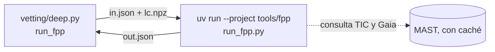

# A3. Probabilidad de falso positivo

Nivel avanzado · semanas 6–8 · cerca de 12 horas

!!! abstract "En esta lección vas a aprender"
    - El razonamiento bayesiano detrás de una probabilidad de falso positivo, sin necesidad de cálculo avanzado.
    - Qué propuso Morton (2012) con vespa y qué cambiaron Giacalone et al. (2021) con triceratops.
    - El significado de cada escenario (TP, EB, PEB, PTP, STP, SEB, DTP, BEB, NTP, NEB...) y cómo se calculan el FPP y el NFPP.
    - Por qué existen los umbrales 0,015 y $10^{-3}$ y por qué un FPP bajo **no** exime de una imagen de alta resolución.
    - Cómo PlanetHunter ejecuta triceratops en un entorno aislado y qué enseña el caso real de WASP-100 b (FPP 0,35).

Hasta aquí, cada prueba del vetting respondió "sí" o "no" a una pregunta. Pero la pregunta que realmente importa es otra: **dado todo lo que sé, ¿qué probabilidad hay de que esto sea un planeta?** Responderla exige combinar lo que muestran los datos con lo que se sabe sobre la población de estrellas y planetas. Ese es el terreno de la estadística bayesiana.

## 1. Bayes en lenguaje sencillo

Imagina un examen médico que acierta el 95 % de las veces. Tu resultado salió positivo. ¿Qué probabilidad hay de que tengas la enfermedad? La respuesta depende de qué tan **común** es la enfermedad. Si solo una persona de cada mil la tiene, la mayoría de los positivos son falsas alarmas, incluso con un buen examen.

Con las señales de tránsito pasa lo mismo. La pregunta "¿esto es un planeta?" depende de dos cosas:

1. **Qué tan bien reproduce los datos cada explicación** (la forma del tránsito, la profundidad, la ausencia de secundario). Esto se llama **verosimilitud** (likelihood).
2. **Qué tan común es cada explicación antes de mirar los datos**: cuántas estrellas tienen planetas de ese tamaño, cuántas son binarias, cuántas estrellas de fondo caben en el píxel. Esto se llama **probabilidad a priori** (prior).

El teorema de Bayes junta las dos. Para cada escenario $j$:

$$
P(\text{escenario}_j \mid \text{datos}) = \frac{P(\text{datos} \mid \text{escenario}_j)\; P(\text{escenario}_j)}{\sum_k P(\text{datos} \mid \text{escenario}_k)\; P(\text{escenario}_k)} .
$$

En palabras: multiplica "qué tan bien explica" por "qué tan común es", hazlo para todos los escenarios y divide cada resultado entre la suma, para que las probabilidades sumen 1.

La **probabilidad de falso positivo** (FPP) es simplemente la suma de las probabilidades de todos los escenarios que **no** son "planeta en el objetivo".

## 2. Morton (2012) y vespa

Morton (2012), *The Astrophysical Journal* 761, 6, convirtió esta idea en un procedimiento automático, implementado en el programa **vespa**. Los escenarios considerados:

- **Planeta** transitando el objetivo.
- **EB**: el propio objetivo es una binaria eclipsante.
- **HEB**: el objetivo forma parte de un sistema triple jerárquico, y un par de estrellas eclipsantes está diluido por la luz de la estrella principal.
- **BEB**: una binaria eclipsante de fondo, no resuelta, dentro de la apertura.
- Versiones con **período doble** de las binarias (eclipses primario y secundario iguales, que parecen tránsitos de período $P$).

Para cada escenario, vespa simula una población realista (estrellas de fondo de un modelo de la Galaxia, estadística de binarias, tasas de ocurrencia de planetas), genera la curva de tránsito que produciría cada miembro y compara la **forma** con la observada, resumida por profundidad, duración total y duración del ingreso. Las restricciones externas, como una imagen de alta resolución que excluye compañeras por encima de cierto brillo, recortan partes de la población.

El método hizo posible **validar** planetas sin medir la masa. Morton et al. (2016), *ApJ* 822, 86, aplicaron el enfoque a todo el catálogo de Kepler y validaron cerca de 1 280 planetas con FPP por debajo del 1 %. "Validado", aquí, tiene un sentido preciso: la probabilidad de cualquier explicación alternativa es muy baja. No es "confirmado", que exige una medición independiente, en general de la masa.

## 3. Triceratops: vespa adaptado al píxel de TESS

Giacalone et al. (2021), *The Astronomical Journal* 161, 24, crearon **triceratops** para TESS. La diferencia central: con píxeles de 21″, la pregunta "¿qué estrella vecina conocida está produciendo la señal?" se vuelve protagonista. Triceratops:

1. Consulta el TIC y Gaia para listar las estrellas alrededor del objetivo.
2. Usa los **píxeles de la apertura** del sector para calcular cuánta luz de cada estrella cae dentro de ella.
3. Calcula, para cada estrella, la profundidad que necesitaría tener para producir la señal (la misma cuenta de la prueba `gaia_neighbors` de la lección A2).
4. Para cada escenario, sortea muchos conjuntos de parámetros plausibles, genera el modelo de curva, lo compara con la curva plegada observada y calcula la probabilidad.

### Los escenarios

| Sigla | Qué sucede | ¿Planeta en el objetivo? |
|---|---|---|
| **TP** | Planeta transitando el objetivo, sin compañera | Sí |
| **EB**, EBx2P | El objetivo es una binaria eclipsante (x2P: el período real es el doble, eclipses iguales) | No |
| **PTP** | Planeta transitando el objetivo, que tiene una compañera ligada no resuelta que diluye la luz | Sí |
| **PEB**, PEBx2P | El objetivo tiene una compañera ligada no resuelta, y el propio objetivo es eclipsado por otra estrella | No |
| **STP** | Planeta transitando la **compañera** ligada no resuelta | No (el planeta existe, pero en la otra estrella, y su radio está mal) |
| **SEB**, SEBx2P | La compañera ligada no resuelta es una binaria eclipsante | No |
| **DTP** | Planeta transitando el objetivo, diluido por una estrella de fondo no resuelta | Sí |
| **DEB**, DEBx2P | El objetivo es una binaria eclipsante, diluida por una estrella de fondo | No |
| **BTP** | Planeta transitando una estrella de fondo no resuelta | No |
| **BEB**, BEBx2P | Una estrella de fondo no resuelta es una binaria eclipsante | No |
| **NTP** | Planeta transitando una estrella **vecina conocida** (resuelta en Gaia) | No |
| **NEB**, NEBx2P | Una vecina conocida es una binaria eclipsante | No |

Las letras ayudan a memorizar: **P** de primaria (el objetivo en un sistema no resuelto), **S** de secundaria (la compañera), **D** de diluido, **B** de fondo (background), **N** de vecina (nearby).

### FPP y NFPP

$$
\text{FPP} = 1 - \left(P_\text{TP} + P_\text{PTP} + P_\text{DTP}\right),
\qquad
\text{NFPP} = P_\text{NTP} + P_\text{NEB} + P_\text{NEBx2P} .
$$

El **FPP** es la probabilidad de que no sea un planeta en el objetivo. El **NFPP** (nearby FPP) es la parte del FPP que proviene de vecinas **conocidas y resueltas**. La distinción importa: un NFPP alto señala a un culpable concreto, que se puede verificar con imagen de diferencia o con fotometría desde tierra de la vecina.

### Los umbrales

- **FPP < 0,015 y NFPP < $10^{-3}$**: el nivel que Giacalone et al. proponen para la **validación estadística**. Los autores calibraron estos valores con TOIs de disposición conocida.
- **FPP < 0,5**: "candidato plausible", más probablemente planeta que no.
- **NFPP > 0,1**: "probable falso positivo de una vecina".
- Estas clases solo valen donde los autores las calibraron: planetas menores que 8 R⊕, SNR de al menos 15 y datos de 2 minutos. Para los datos de imágenes completas de 30 minutos no hay una región de validación confiable.

En PlanetHunter (función `fpp_test` en `vetting/deep.py`):

| Condición | Efecto |
|---|---|
| FPP < 0,5 y NFPP ≤ 0,1 | La prueba pasa |
| FPP ≥ 0,5, o NFPP > 0,1 | **Falla dura**: por sí sola, reprueba la señal (peso 0,3 en el score) |
| NFPP > 0,5 | **Veto**: una vecina conocida es la fuente más probable |
| FPP < 0,015 y NFPP < 0,001 | Nota "nivel de validación (exige imagen de alta resolución)" |
| Rp ≥ 8 R⊕, SNR < 15 o datos más gruesos que 2 min | Nota "fuera de la región de validación" |

La severidad lee los mismos números (`alerts/severity.py`). **P0** exige vetting profundo completo (imagen de diferencia y vecinos Gaia aprobados, FPP calculado) con FPP < 0,1, NFPP < 0,001 y la región de validación de arriba (Rp < 8 R⊕, SNR ≥ 15, datos de 2 minutos). FPP < 0,1 es una elección del proyecto, entre "plausible" (0,5) y "validado" (0,015). Todo lo que no se puede verificar limita la señal a P1, y NFPP > 0,1 la limita a P2.

## 4. Ejemplo real: WASP-100 b

El proyecto ejecutó triceratops en el planeta confirmado **WASP-100 b** (TIC 38846515), con datos del sector 69, profundidad de cerca de 7 500 ppm y período de 2,848 días. Resultado, guardado en la caché del vetting:

| Escenario | Probabilidad |
|---|---|
| TP | 0,541 |
| PEB | 0,347 |
| PTP | 0,112 |
| SEB | 0,0001 |
| DTP | ~$2 \times 10^{-9}$ |

**FPP = 0,35. NFPP ≈ $10^{-109}$**, prácticamente cero.

Un planeta confirmado, con FPP del 35 %. ¿Cómo interpretarlo?

1. **Ninguna vecina conocida es sospechosa** (NFPP despreciable). La señal está en el objetivo o en algo no resuelto junto a él.
2. **El competidor es el PEB**: el objetivo tendría una compañera ligada no resuelta, y él mismo sería eclipsado por una estrella pequeña. Con un tránsito profundo y solo fotometría de TESS, esta explicación reproduce la forma razonablemente bien.
3. **Qué derribaría al PEB**: una imagen de alta resolución que excluya compañeras cercanas (triceratops acepta la **curva de contraste** de esa imagen como entrada), y la velocidad radial, que midió la masa planetaria de WASP-100 b. Ninguna de las dos entró en el cálculo.

La lección: **el FPP mide lo que los datos proporcionados permiten excluir**, no la verdad. Un planeta real puede tener un FPP intermedio cuando faltan observaciones que eliminen escenarios. Por eso el FPP es una de las últimas pruebas, no el juez final.

En la misma línea, dos señales de una prueba del proyecto en el sector 107 muestran el otro lado:

- **Señal 4053** (TIC 139552249): NTP en una vecina (TIC 139552250) con 0,68; TP 0,28. FPP 0,68, **NFPP 0,68**. Veto: la señal probablemente viene de la vecina.
- **Señal 4278** (TIC 146320921): SEB 0,32, NEB 0,25, TP 0,21, STP 0,13. FPP 0,74, NFPP 0,25. Reprobada en el FPP (FPP ≥ 0,5, y NFPP por encima de 0,1), pero sin veto: los escenarios son variados y ningún culpable domina.

## 5. Por qué un FPP bajo no exime de una imagen de alta resolución

Esta es la idea peor comprendida de la validación estadística. Cuatro razones:

1. **Las priors de compañeras no resueltas son grandes.** Cerca de la mitad de las estrellas de tipo solar tienen compañeras. Sin imagen, el modelo tiene que considerar compañeras a cualquier separación por debajo de la resolución de TESS. Una curva de contraste elimina buena parte de ese espacio, y es exactamente eso lo que mueve el FPP de "bajo" a "validable".
2. **El modelo solo conoce los escenarios que enumera.** Los sistemáticos del instrumento, la variabilidad estelar y los errores de detrending no están entre los escenarios. Triceratops supone que la señal es astrofísica y que viene de alguna estrella. Por eso pruebas como `other_sectors` y `edges_dumps` tienen que ir antes.
3. **Los parámetros estelares pueden estar mal.** Un radio estelar erróneo en el TIC cambia la profundidad esperada, la duración esperada y la plausibilidad de cada escenario.
4. **Es la regla de la propia literatura.** Giacalone et al. recomiendan el umbral de validación junto con una imagen de alta resolución, y los trabajos de validación con triceratops en general presentan la curva de contraste.

Por eso la nota de PlanetHunter dice "nivel de validación (exige imagen de alta resolución)". Ni siquiera un FPP de 0,001 autoriza a nadie a llamar al candidato planeta validado sin esa observación.

## 6. Cómo ejecuta el proyecto triceratops

Triceratops exige versiones antiguas de bibliotecas numéricas (NumPy 1.26, SciPy 1.13). El entorno principal de PlanetHunter usa TLS 2.0, que depende de NumPy 2. Las dos cosas no pueden convivir en el mismo entorno.

La solución es un **entorno aislado** en `tools/fpp/`, con su propio `pyproject.toml` (triceratops 1.1.0, `numpy<2`, lightkurve). La comunicación entre los dos entornos se hace mediante archivos:

1. El código principal pliega la curva de luz en el período, recorta 2,5 duraciones alrededor del tránsito y guarda fase, flujo y error en un archivo `lc.npz`. La curva es la misma que usa el vetting: cada sector aplanado de nuevo con los tránsitos enmascarados.
2. Guarda `in.json` con el TIC, los sectores, la profundidad (fracción), el período, los píxeles de la apertura de cada sector, el número de sorteos, el número de repeticiones y el tiempo de exposición real de los datos.
3. Llama a `uv run --project tools/fpp python tools/fpp/run_fpp.py in.json out.json` como subproceso, con un tiempo límite de 1 800 s por repetición (`fpp_timeout_s`).
4. El script del entorno aislado ejecuta `calc_depths` y `calc_probs` **3 veces** (`fpp_repeats`) y guarda `out.json` con la media y la dispersión del FPP y del NFPP, y los cinco escenarios más probables. Giacalone et al. repiten cada caso 20 veces; 3 repeticiones dan una media y una dispersión a un costo soportable.
5. El error de flujo que recibe triceratops es la dispersión **medida** del flujo fuera del tránsito (1,4826 × MAD) cuando es mayor que las barras de error del pipeline. En la auditoría, los cuatro candidatos con FPP = 1,000 tenían una dispersión real de 2 a 46 veces mayor que el error del pipeline: al modelo se le decía que los datos eran más limpios de lo que eran.
6. Cualquier error se convierte en `"ok": false` con el mensaje, y lo mismo pasa con las ejecuciones que no aportan información: una estrella sin masa, radio, temperatura o paralaje en el catálogo, o una ejecución "degenerada" en la que todos los sorteos eran geométricamente imposibles. El código principal **nunca se cae** por culpa del FPP. Sin resultado, la prueba queda "sin datos", el campo `deep_pending` registra `fpp_triceratops` y el candidato no puede llegar a P0.

Costo: con $10^5$ sorteos (`fpp_draws`), cerca de **6 minutos por repetición** en WASP-100 b, o sea, unos 18 minutos por candidato. Por eso el FPP solo se ejecuta para quienes pasaron todo el resto del vetting.

!!! tip "En la herramienta"
    - `uv run planethunter vet-deep <run_id>` ejecuta el FPP para los candidatos que pasaron el vetting básico y el profundo.
    - Configuración: `fpp_enabled`, `fpp_draws`, `fpp_repeats`, `fpp_timeout_s` y los límites `fpp_max`, `fpp_nfpp_fail` y `fpp_nfpp_veto` en `config/thresholds.yaml`.
    - Las entradas y salidas quedan en `data/cache/fpp/sig<signal_id>/`. Abre el `out.json` para ver los escenarios.
    - En el dossier, la fila `fpp_triceratops` de la tabla de vetting muestra el FPP y el NFPP (media y dispersión de las repeticiones), el nivel, si la señal está dentro de la región de validación y los tres escenarios principales.

!!! example "Ejercicio 1. Calcula el FPP de WASP-100 b"
    Usando la tabla de la sección 4, calcula el FPP y el NFPP y clasifica el resultado según los umbrales del proyecto.

    ??? success "Ver respuesta"
        1. Escenarios de planeta en el objetivo: TP 0,541 + PTP 0,112 + DTP ~0 = 0,653.
        2. FPP = 1 − 0,653 = **0,347**.
        3. Ningún escenario N aparece entre los principales; NFPP ≈ $10^{-109}$, por debajo de $10^{-3}$.
        4. FPP < 0,5 y NFPP ≤ 0,1: **la prueba pasa**, "candidato plausible". Pero FPP ≥ 0,1: no permitiría P0. Y está lejos de 0,015: no alcanza el nivel de validación. (Además, WASP-100 b es un gigante, mayor que 8 R⊕: fuera de la región donde se calibraron estos niveles).
        5. El escenario a atacar es el PEB. Observación recomendada: imagen de alta resolución (para excluir una compañera ligada) y velocidad radial.

!!! example "Ejercicio 2. Bayes con números de juguete"
    Los números siguientes son **ilustrativos**, no del proyecto. En un grupo de señales, antes de mirar la forma, el 20 % son planetas, el 50 % binarias en el objetivo y el 30 % binarias de fondo. La forma observada (fondo plano, sin secundario) tiene verosimilitud 0,8 bajo "planeta", 0,05 bajo "binaria en el objetivo" y 0,3 bajo "binaria de fondo". (a) ¿Cuál es el FPP? (b) Una imagen de alta resolución excluye el 90 % de las binarias de fondo posibles. ¿Cuál es el nuevo FPP?

    ??? success "Ver respuesta"
        (a) Productos verosimilitud × prior: planeta $0{,}8 \times 0{,}2 = 0{,}16$; binaria en el objetivo $0{,}05 \times 0{,}5 = 0{,}025$; fondo $0{,}3 \times 0{,}3 = 0{,}09$. Suma $0{,}275$. P(planeta) $= 0{,}16/0{,}275 \approx 0{,}58$. **FPP ≈ 0,42.**

        (b) La prior del fondo baja de 0,30 a 0,03. Fondo: $0{,}3 \times 0{,}03 = 0{,}009$. Suma $0{,}16 + 0{,}025 + 0{,}009 = 0{,}194$. P(planeta) $\approx 0{,}82$. **FPP ≈ 0,18.**

        La imagen no cambió la curva de luz. Cambió lo que es posible. Ese es exactamente el papel de la curva de contraste en triceratops.

!!! example "Ejercicio 3. FPP en un planeta y en un falso positivo (práctica)"
    Elige un planeta confirmado y un TOI con disposición FP del TFOPWG en el sector 69 (la lista sale de `uv run planethunter benchmark build 69 --kind fp`, guardada en `data/benchmark/`). Arma el `in.json` como se describe en la sección 6 y ejecuta el script aislado. Compara los escenarios dominantes.

    ??? success "Ver respuesta"
        No hay una respuesta única, pero el patrón esperado es:

        - En el planeta: TP y PTP suman la mayor parte; el competidor principal tiende a ser PEB o SEB (compañera no resuelta), como en WASP-100 b. NFPP muy bajo.
        - En el falso positivo: dominan los escenarios EB, NEB o SEB. Si es NEB, revisa la vecina señalada en la imagen de diferencia: el centroide debería desplazarse en su dirección.
        - Anota el tiempo de ejecución y el número de sorteos. Ejecútalo dos veces (los sorteos son aleatorios en cada ejecución): si el FPP varía mucho, el número de sorteos es demasiado pequeño para ese caso.
        - Escribe en tu cuaderno: ¿qué observación cambiaría el resultado de cada uno?

## Checklist de la lección

- [ ] Sé explicar el teorema de Bayes con el ejemplo del examen médico y con escenarios de tránsito.
- [ ] Leí Morton (2012) y sé enumerar los escenarios de vespa.
- [ ] Leí Giacalone et al. (2021) y sé el significado de cada sigla de la tabla de escenarios.
- [ ] Sé calcular el FPP y el NFPP a partir de una lista de escenarios.
- [ ] Sé dar cuatro razones por las cuales un FPP bajo no exime de una imagen de alta resolución.
- [ ] Sé describir cómo el proyecto ejecuta triceratops en `tools/fpp` y qué sucede cuando falla.
- [ ] Ejecuté el FPP en al menos un objetivo y anoté los escenarios.

## Para ir más allá

- Morton (2012), *The Astrophysical Journal* 761, 6. El método de validación estadística; lee la sección que define los escenarios y las figuras de forma del tránsito.
- Giacalone et al. (2021), *The Astronomical Journal* 161, 24. Triceratops; lee la tabla de escenarios y la calibración de los umbrales.
- Morton et al. (2016), *The Astrophysical Journal* 822, 86. La aplicación masiva a Kepler; muestra qué significa "validado" en la práctica.
- Torres et al. (2011), *The Astrophysical Journal* 727, 24. El método BLENDER, aplicado a Kepler-9 d; otra escuela de validación estadística, más detallada y más costosa.
- Lissauer et al. (2012), *The Astrophysical Journal* 750, 112. Por qué los candidatos en sistemas con varios planetas son casi siempre planetas; un "bono de multiplicidad" que entra como prior en las validaciones.
- Sivia, *Data Analysis: A Bayesian Tutorial* (Oxford University Press, 2.ª ed., 2006). Introducción breve y clara a la estadística bayesiana para quienes vienen de las ciencias exactas.
