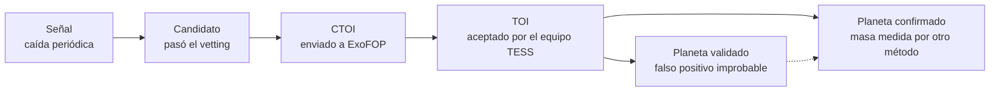

# B3. El telescopio TESS

<p class="meta">Nivel básico · semana 4 · unas 4 horas</p>

!!! abstract "En esta lección vas a aprender"
    - Qué es TESS, qué observa y por qué divide el cielo en sectores de unos 27 días.
    - Qué son las cámaras, las cadencias (20 s, 2 min, 200 s) y la zona de visión continua.
    - Por qué el píxel de TESS es grande (21 segundos de arco) y el problema que eso causa.
    - Dónde están los datos (MAST) y qué son TIC y Tmag.
    - Qué son TOI, CTOI y TFOPWG, y el camino de una señal hasta convertirse en planeta confirmado.

## Qué es TESS

**TESS** (*Transiting Exoplanet Survey Satellite*, satélite de búsqueda de exoplanetas en tránsito) es un telescopio espacial de la NASA, operado en colaboración con el MIT, lanzado en abril de 2018. Su función es una sola: medir, con mucha precisión y durante semanas seguidas, el brillo de muchas estrellas, para encontrar tránsitos.

Su antecesor, el telescopio Kepler, miró fijamente **una** región pequeña del cielo durante cuatro años. Encontró miles de planetas, pero la mayoría alrededor de estrellas débiles y lejanas, difíciles de estudiar con otros telescopios. TESS hace lo contrario: observa **casi todo el cielo**, priorizando estrellas brillantes y cercanas. Los planetas de estrellas brillantes son más fáciles de confirmar y de estudiar después.

Los datos de TESS son **públicos**. Cualquier persona puede descargarlos y analizarlos. Eso es lo que hace PlanetHunter.

## Cámaras y sectores

TESS tiene **cuatro cámaras** idénticas, alineadas una al lado de otra. Cada una ve un cuadrado de 24° × 24° del cielo. Juntas, cubren una franja de 24° × 96°, que va desde cerca de la **eclíptica** (el plano en el que la Tierra y los demás planetas orbitan el Sol) hasta el polo de la eclíptica. Para darte una idea: 24° es unas 48 veces el diámetro de la Luna llena.

El telescopio se queda quieto mirando esa franja durante unos **27 días**. Ese bloque de observación se llama **sector**. Después gira y pasa a la franja vecina, como los gajos de una naranja.

```
              polo de la eclíptica
                     *
                  /  |  \
               /     |     \       cada gajo = 1 sector (~27 días)
            /   s3   |  s4    \    los gajos se superponen cerca del polo
         /     s2    |     s5   \
       /  s1         |        s6  \
      ---------------+-------------  eclíptica (plano de las órbitas)
```

¿Por qué 27 días? La órbita de TESS alrededor de la Tierra es muy alargada y dura **13,7 días**. Un sector son dos órbitas. En cada paso cerca de la Tierra, el telescopio envía los datos por radio, lo que causa una **pausa corta a mitad de cada sector**. Vas a ver ese hueco en las curvas de luz.

En la misión principal (2018 a 2020), TESS cubrió el hemisferio sur del cielo el primer año y el norte el segundo, 13 sectores por año. Después vinieron misiones extendidas, que vuelven a las mismas regiones. En 2026 TESS ya superó los 100 sectores y cubrió casi todo el cielo varias veces. Este curso usa como ejemplo el **sector 69**, que el proyecto analizó en detalle.

## La zona de visión continua

Fíjate en el dibujo: todos los gajos se encuentran cerca del **polo de la eclíptica**. Las estrellas que están a menos de unos 12° de cada polo caen en todos los sectores de ese año. Esa región se llama **zona de visión continua** (CVZ, del inglés *continuous viewing zone*).

Las estrellas de la zona de visión continua se observan durante casi un año seguido en cada pasada. Eso permite encontrar planetas de período largo. En el sector 69, el proyecto midió estrellas de la zona de visión continua del polo sur con **10 a 22 sectores** de datos.

Hay una consecuencia útil, que aparece en el vetting (verificación): si una estrella tiene 15 sectores de datos y una señal "nueva" y profunda aparece en solo uno de ellos, casi seguro es un defecto de ese sector. Un planeta de verdad aparecería en todos.

## Cadencias: cada cuánto tiempo se mide

La **cadencia** es el intervalo entre dos medidas de brillo seguidas. TESS toma fotos continuamente, pero no envía todo a la Tierra: no hay ancho de banda de radio para eso. Entonces los datos llegan en productos distintos:

| Producto | Cadencia | Qué estrellas |
|---|---|---|
| Curvas de luz de 20 segundos | 20 s | una selección pequeña, de estrellas brillantes o de interés especial (desde 2020) |
| Curvas de luz de 2 minutos | 2 min | unas 20 000 estrellas por sector, elegidas antes de la observación |
| Imágenes completas (FFI) | 30 min (2018–2020), 10 min (2020–2022), **200 s** (desde 2022) | todas las estrellas en el campo de las cámaras |

Las **FFI** (*full-frame images*, imágenes del cuadro completo) contienen millones de estrellas, pero con una cadencia más lenta y sin tratamiento individual. Las curvas de 2 minutos son las más limpias y las que usa PlanetHunter hoy. La búsqueda en FFI, que alcanza estrellas más débiles, está en el plan del proyecto.

Una cadencia más corta muestra mejor la forma del tránsito (entrada y salida). Una cadencia más larga cubre más estrellas. Es un compromiso.

## El píxel de 21 segundos de arco

Para medir tamaños en el cielo, los astrónomos usan ángulos. Un grado tiene 60 **minutos de arco** (′), y un minuto tiene 60 **segundos de arco** (″). La Luna llena mide alrededor de medio grado, o 1 800″.

Cada píxel de las cámaras de TESS cubre **21″ × 21″** del cielo. Es un píxel enorme: los telescopios en tierra, con buena atmósfera, separan estrellas que están a alrededor de 1″ una de otra. TESS se diseñó así a propósito, para ver un campo gigantesco de una vez.

La consecuencia es seria: **varias estrellas caben en el mismo píxel**. La luz de una estrella también se reparte en algunos píxeles vecinos. Entonces, cuando baja el brillo medido "del objetivo", la caída puede venir de **otra estrella** mezclada en la misma región. Esto se llama **contaminación** o **blend** (mezcla). Es una de las grandes fuentes de falsos positivos, y la vas a estudiar en la lección B4.

!!! info "Dato curioso"
    TESS observa en el rojo y en el infrarrojo cercano (de 600 a 1 000 nanómetros). Eso favorece a las enanas rojas, que brillan más en esos colores. Como viste en la lección B2, las estrellas pequeñas son justamente las mejores para encontrar planetas pequeños.

## Dónde están los datos: MAST, TIC y Tmag

Los datos de TESS están en **MAST** (*Mikulski Archive for Space Telescopes*), el archivo público de la NASA para telescopios espaciales. Ahí están las curvas de luz ya procesadas por el equipo de la misión (el pipeline **SPOC**, para las curvas de 2 minutos) y por otros grupos (como **QLP**, para las imágenes completas).

Cada estrella tiene un número en el **TIC** (*TESS Input Catalog*), un catálogo con más de 1700 millones de objetos armado antes del lanzamiento. El número TIC es el "documento de identidad" de la estrella. Ejemplo: **TIC 261136679** es la estrella Pi Mensae, que vas a analizar en la lección B5. El TIC también guarda estimaciones del radio, la masa y la temperatura de cada estrella, que PlanetHunter usa para calcular el radio del planeta.

El brillo de cada estrella en el TIC se da en **Tmag**, la magnitud en la "regla" de TESS. La escala de magnitudes es antigua e invertida:

- **Número menor = estrella más brillante.** Tmag 6 es muy brillante; Tmag 13 es débil.
- La escala es multiplicativa: **5 magnitudes = 100 veces** en brillo. 1 magnitud ≈ 2,5 veces.

Una estrella más brillante significa más luz llegando al detector y, por lo tanto, **menos ruido relativo**. Un tránsito de 300 ppm se ve bien en una estrella de Tmag 6 y se pierde en el ruido en una de Tmag 13.

El tiempo en los archivos de TESS se da en **BTJD** (*Barycentric TESS Julian Date*): días contados a partir de una fecha de referencia, corregidos al centro de masa del Sistema Solar. En la práctica, es "días desde el inicio de la era TESS", con decimales. Todos los tiempos de PlanetHunter están en BTJD.

## De la señal al planeta confirmado

El equipo de TESS corre sus propios pipelines sobre todos los datos. Cuando una señal pasa sus pruebas y una revisión humana, recibe un número **TOI** (*TESS Object of Interest*, objeto de interés de TESS). Ejemplo: TOI-144.01 es la señal de Pi Men c. El ".01" indica el primer candidato de esa estrella.

Personas de fuera del equipo (grupos de investigación, aficionados, tú en el futuro) pueden enviar sus propios candidatos a **ExoFOP**, el portal de seguimiento de la misión. Esos se convierten en **CTOI** (*Community TOI*). Un buen CTOI puede ser promovido a TOI.

Los TOI son seguidos por el **TFOP** (programa de observaciones de seguimiento de TESS), una red de astrónomos con telescopios en tierra. El grupo de trabajo **TFOPWG** registra la situación de cada TOI:

| Código | Significa |
|---|---|
| PC | candidato a planeta (*planet candidate*) |
| APC | candidato ambiguo |
| CP | planeta confirmado a partir de TESS |
| KP | planeta ya conocido antes de TESS |
| FP | falso positivo (no es un planeta) |
| FA | falsa alarma (ruido o defecto, no es una señal astrofísica) |

El camino completo, con el vocabulario que usa este curso:



Un **planeta validado** es aquel en el que un análisis estadístico, junto con imágenes de alta resolución tomadas por otros telescopios, muestra que la probabilidad de que sea un falso positivo es muy pequeña. Un **planeta confirmado** tiene evidencia independiente, en general la masa medida por velocidad radial. Cada paso exige más evidencia, y los últimos exigen otros telescopios. Por eso PlanetHunter **nunca** llama "descubrimiento" a un candidato.

En 2026, los catálogos que PlanetHunter replica localmente tienen unos 8 100 TOI, 5 100 CTOI y 6 400 planetas confirmados.

!!! tip "En la herramienta"
    - **Ingesta:** `uv run planethunter ingest sector 69 --limit 2000` descarga curvas de 2 minutos de MAST y las guarda en Parquet, en carpetas como `data/parquet/sector=0069/author=SPOC/`. El `author=SPOC` indica qué pipeline produjo la curva.
    - **TIC y Tmag:** la columna `tmag` de la lista de candidatos es el Tmag. Por debajo de 10 es brillante, más fácil de confirmar con otros telescopios. El dossier muestra el TIC y un enlace directo a la página de la estrella en ExoFOP.
    - **Píxel de 21″:** el crossmatch identifica la estrella por el número TIC o por la posición hasta **21″** (un píxel) y busca objetos conocidos vecinos hasta **120″**. Esos valores están en `config/thresholds.yaml` (`host_radius_arcsec` y `nearby_radius_arcsec`).
    - **TOI y CTOI:** `uv run planethunter mirrors sync` descarga las listas de TOI y CTOI de ExoFOP, con la decisión del TFOPWG. Una señal que coincide con un TOI se vuelve `KNOWN_TOI`; con un TOI marcado FP, se vuelve `KNOWN_FP`.

!!! example "Ejercicio 1"
    La Luna llena mide unos 1 800″ de diámetro. ¿Cuántos píxeles de TESS ocuparía, de punta a punta? ¿Y cuántos píxeles caben en el radio de 120″ que usa el crossmatch para buscar vecinos?

    ??? success "Ver respuesta"
        Luna: $1\,800 / 21 \approx 86$ píxeles de diámetro. Toda la Luna llena cabría en un cuadrado de unos 86 × 86 píxeles, es decir, en poco más de 7 000 píxeles.

        Vecinos: $120 / 21 \approx 5{,}7$ píxeles de radio. PlanetHunter busca objetos conocidos en un círculo de casi 6 píxeles alrededor del objetivo, porque la luz de una estrella se reparte en varios píxeles y un vecino a unos pocos píxeles de distancia todavía puede contaminar la medida.

!!! example "Ejercicio 2"
    ¿Cuántas veces es más brillante una estrella de Tmag 6 que una de Tmag 13? ¿Por qué importa eso para encontrar planetas?

    ??? success "Ver respuesta"
        La diferencia es de 7 magnitudes. Cada 5 magnitudes son 100 veces. Cada magnitud es unas 2,512 veces.

        $$ 2{,}512^{7} \approx 630 $$

        Otra forma: 5 magnitudes dan 100×, y las 2 restantes dan $2{,}512^2 \approx 6{,}3$×. Entonces $100 \times 6{,}3 = 630$.

        La estrella de Tmag 6 es unas **630 veces más brillante**. Más luz significa menos ruido relativo en cada medida, así que los tránsitos poco profundos se vuelven visibles. Además, los planetas de estrellas brillantes son mucho más fáciles de confirmar con velocidad radial.

!!! example "Ejercicio 3"
    Clasifica cada caso en la escala señal → candidato → CTOI → TOI → validado → confirmado.

    1. PlanetHunter encontró una caída periódica, pero todavía no pasó por el vetting.
    2. Un grupo envió a ExoFOP un candidato que encontró en los datos de TESS.
    3. A un TOI le midieron la masa por velocidad radial con un telescopio en Chile.
    4. Un TOI con situación "PC" en el TFOPWG.

    ??? success "Ver respuesta"
        1. **Señal.** Todavía no pasó por ninguna prueba de falso positivo.
        2. **CTOI.** Lo envió la comunidad; puede convertirse en TOI si el equipo lo acepta.
        3. **Planeta confirmado.** La masa medida por otro método es evidencia independiente.
        4. **TOI** con situación de candidato a planeta. Todavía no es planeta validado ni confirmado.

## Checklist de la lección

- [ ] Sé qué es TESS y en qué se diferencia de Kepler.
- [ ] Sé qué es un sector (~27 días, dos órbitas de 13,7 días) y por qué hay un hueco en el medio.
- [ ] Sé qué son las cuatro cámaras y la franja de 24° × 96°.
- [ ] Sé qué es la zona de visión continua y por qué tiene muchos sectores de datos.
- [ ] Sé la diferencia entre curvas de 20 s, 2 min e imágenes completas (FFI, 200 s).
- [ ] Sé explicar el píxel de 21″ y por qué mezcla la luz de varias estrellas.
- [ ] Sé qué son MAST, TIC, Tmag y BTJD.
- [ ] Sé qué son TOI, CTOI, TFOPWG y el camino hasta planeta confirmado.
- [ ] Hice los tres ejercicios sin mirar la respuesta.

## Para ir más allá

- Ricker et al. (2015), "Transiting Exoplanet Survey Satellite (TESS)", *Journal of Astronomical Telescopes, Instruments, and Systems* 1, 014003. La descripción oficial de la misión. Lee el resumen y mira las figuras del campo de visión y de la estrategia de sectores.
- Página de la misión TESS en el sitio de la NASA (nasa.gov) y la guía de TESS en HEASARC (heasarc.gsfc.nasa.gov). Explican sectores, cámaras, cadencias y productos de datos.
- Stassun et al. (2019), "The Revised TESS Input Catalog and Candidate Target List", *The Astronomical Journal* 158, 138. Cómo se armó el TIC y de dónde vienen el radio y la masa de las estrellas. Basta con la introducción.
- Guerrero et al. (2021), "The TESS Objects of Interest Catalog from the TESS Prime Mission", *The Astrophysical Journal Supplement Series* 254, 39. Cómo el equipo de TESS crea y da seguimiento a los TOI. Vuelve a él en el nivel avanzado.
- [ExoFOP-TESS](https://exofop.ipac.caltech.edu/tess/). Ábrelo y busca "261136679" para ver la página de Pi Mensae, con los TOI y las notas de la comunidad.
