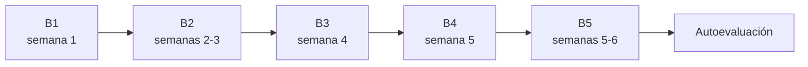

# Nivel básico: entender qué estamos buscando

Nivel básico · unas 6 semanas · de 4 a 6 horas por semana

Este es el punto de partida. No necesitas saber nada de astronomía, física ni programación. El objetivo es construir **intuición**: al final, mirar una curva de luz no debería parecerte un garabato, y la frase "la señal tiene 300 ppm y un período de 6,27 días" debería tener sentido de inmediato.

!!! abstract "Al terminar el nivel básico vas a poder"
    - Explicar qué es una estrella, qué es un exoplaneta y cómo se encuentran planetas que nadie puede ver.
    - Explicar el método de tránsito y calcular, con papel y lápiz, cuánto cae la luz de una estrella cuando un planeta pasa delante de ella.
    - Decir qué observa el telescopio TESS, por qué divide el cielo en sectores y por qué su píxel grande causa problemas.
    - Reconocer las principales imitaciones de planeta: binarias eclipsantes, estrellas vecinas y defectos del telescopio.
    - Ejecutar PlanetHunter sobre un planeta conocido, abrir el dossier generado y encontrar en él el período, la profundidad y los tránsitos.

## Las lecciones

| Lección | Semana | En una frase |
|---|---|---|
| [B1. Cielo, estrellas y planetas](b1-sky-stars-planets.md) | 1 | Qué son las estrellas y los exoplanetas, las unidades que usa el área y los cuatro métodos para encontrar planetas. |
| [B2. El método de tránsito](b2-transit-method.md) | 2–3 | Por qué cae la luz cuando un planeta pasa delante de la estrella, y cuánto cae. |
| [B3. El telescopio TESS](b3-tess-telescope.md) | 4 | Cómo observa TESS el cielo, dónde están los datos y quién decide qué se convierte en planeta. |
| [B4. Por qué casi toda señal es falsa](b4-false-positives.md) | 5 | Las imitaciones de planeta más comunes y tres historias reales del sector 69. |
| [B5. Práctica con ojos humanos](b5-human-eye-practice.md) | 5–6 | Entrenar el ojo en Planet Hunters TESS y leer, paso a paso, el dossier de Pi Men c. |
| [Autoevaluación](assessment.md) | 6 | Diez preguntas para saber si estás listo para el nivel intermedio. |

## Cuánto tiempo toma

El plan supone **de 4 a 6 horas por semana**, durante unas **6 semanas**. Cada lección toma de 3 a 5 horas, contando lectura, ejercicios y la parte práctica. Si tienes menos tiempo, ve más despacio: el ritmo importa menos que la constancia.

!!! note "¿Y la programación?"
    En el nivel básico, la [ruta de programación](../programming/index.md) es opcional. Si te da el tiempo, haz la lección P1 (Python básico) en paralelo. A partir del nivel intermedio pasa a ser necesaria.

## Lo que vas a necesitar

- Papel, lápiz y una calculadora (la del celular sirve).
- Un navegador, para el [simulador de tránsito](../lab/transit-simulator.md) y para Planet Hunters TESS.
- Para la lección B5: PlanetHunter instalado (`uv sync` en la carpeta del proyecto) y conexión a internet para descargar los datos de TESS. El paso a paso está en la lección y en el [manual práctico](../lab/using-planethunter.md).

!!! warning "Una regla de vocabulario desde el primer día"
    En este curso, y en PlanetHunter, nada se llama "descubrimiento". Una señal se convierte en **candidato**, después puede convertirse en **CTOI**, **TOI**, **planeta validado** y, por último, **planeta confirmado**. Cada paso exige más evidencia. Vas a entender por qué en la lección B3.

## Cómo saber que terminaste

Terminaste el nivel básico cuando:

1. Marcaste todos los elementos de las listas de verificación de las lecciones B1 a B5.
2. Hiciste la [autoevaluación](assessment.md) **sin consultar** y acertaste al menos **5 de las 6 preguntas principales**.

Si fallas más de una, vuelve a las lecciones indicadas en las respuestas e inténtalo de nuevo después de unos días. Cuando apruebes, sigue al [nivel intermedio](../intermediate/index.md).

Los términos nuevos aparecen en el [glosario](../glossary.md).
