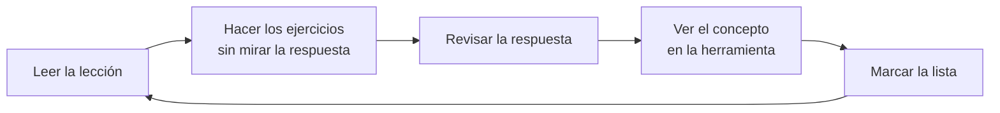

# Cómo estudiar en este curso

5 minutos de lectura

## Ritmo

- **De 4 a 6 horas por semana** es el ritmo para el que se pensaron los plazos. Más despacio también funciona: lo importante es la constancia.
- Prefiere **sesiones cortas y frecuentes** (40–60 minutos, 4–5 veces por semana) a una maratón el fin de semana.

## El ciclo de cada lección

1. **Lee** con calma. Los términos nuevos están en el [glosario](glossary.md).
2. **Ejercicios**: intenta resolverlos antes de abrir "Ver respuesta". Equivocarte y entender por qué enseña más que acertar a la primera.
3. **En la herramienta**: cada lección tiene un recuadro que dice dónde aparece el concepto en PlanetHunter. Ábrelo y míralo con tus propios ojos.
4. **Lista de verificación**: marca lo que completaste. El progreso aparece en la [página de inicio](index.md).

## Rutas en paralelo

| Semana | Ciencia | Programación |
|---|---|---|
| 1–6 | Nivel básico (B1–B5) | P1. Python básico (opcional, pero recomendado) |
| 7–16 | Nivel intermedio (M1–M5) | P2 antes de M4; P3 junto con M4 |
| 17 en adelante | Nivel avanzado (A1–A6) | Usar el código de PlanetHunter |

## Cómo saber si puedes avanzar

Cada nivel termina con una **autoevaluación**. Responde sin consultar. Si aciertas el mínimo indicado, sigue adelante. Si no, vuelve a las lecciones de las preguntas que fallaste.

## Consejos

- **Cuaderno de revisiones.** Anota cada candidato que revises: qué viste, qué decidiste y por qué.
- **Desconfía de las señales demasiado bonitas.** La historia más importante del proyecto es la de señales perfectas que eran falsas.
- **Entrena el ojo.** El proyecto [Planet Hunters TESS](https://www.zooniverse.org/projects/nora-dot-eisner/planet-hunters-tess) en Zooniverse es el mejor entrenamiento para reconocer tránsitos en curvas reales.
- **No leas artículos científicos de principio a fin al comienzo.** Primero el resumen, las figuras y la conclusión.
