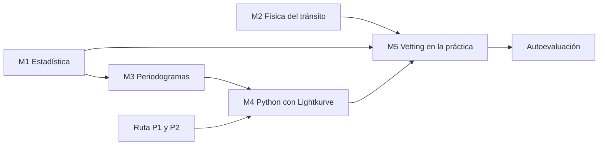

# Nivel intermedio: entender cómo decide la herramienta

Nivel intermedio · unas 10 semanas · de 4 a 6 horas por semana

En el nivel básico aprendiste a reconocer un tránsito, sabes qué es TESS y por qué una binaria eclipsante engaña. Ahora la pregunta cambia. Ya no es "¿qué estamos buscando?", sino "¿**cómo decide PlanetHunter** si una señal merece atención?".

Cada decisión de la herramienta es un número comparado con un límite. SNR mayor que 7,1. SDE mayor que 9. Duración entre 0,15 y 1,67 veces la prevista. Forma en V por debajo de 0,35. En este nivel vas a entender de dónde sale cada número, qué mide y cuándo se equivoca. Al final, vas a revisar candidatos con criterio propio, sin depender del score.

!!! abstract "Al terminar el nivel intermedio vas a poder"
    - Explicar SNR, SDE, sigma, ruido rojo y chi cuadrado con tus propias palabras y con una cuenta.
    - Predecir la duración de un tránsito a partir del período y de la estrella, y decir cuándo una duración es sospechosa.
    - Leer un periodograma, reconocer alias y decir por qué importa la ventana de detrending.
    - Descargar, limpiar, plegar y buscar un planeta conocido en Python con Lightkurve.
    - Explicar cada prueba del vetting básico, calcular el score y revisar candidatos con `planethunter review`.

## Las lecciones

| Lección | Semanas | En una frase |
|---|---|---|
| [M1. Estadística para señales](m1-statistics-for-signals.md) | 1–3 | Media, mediana, sigma, SNR, ruido rojo y chi cuadrado: la matemática que separa una señal del azar. |
| [M2. Física del tránsito](m2-transit-physics.md) | 3–5 | Kepler, densidad estelar, duración, parámetro de impacto, oscurecimiento del limbo y eclipse secundario: la física detrás de cinco pruebas del vetting. |
| [M3. Periodogramas](m3-periodograms.md) | 5–6 | Cómo BLS y TLS encuentran un período, qué es el SDE, por qué aparecen alias y por qué la ventana de detrending lo cambia todo. |
| [M4. Datos de TESS en Python](m4-tess-data-in-python.md) | 6–8 | Lección práctica: tú mismo encuentras Pi Men c con Lightkurve y lo comparas con el resultado de PlanetHunter. |
| [M5. Vetting en la práctica](m5-vetting-in-practice.md) | 8–10 | Cada prueba del vetting con un caso real, el cálculo del score, la validación medida y la guía de revisión de candidatos. |
| [Autoevaluación](assessment.md) | 10 | Seis preguntas del plan y cuatro extra, con respuestas comentadas. |

El orden importa. M1 da el lenguaje estadístico que usan M3 y M5. M2 explica la física de las pruebas `duration`, `shape` y `secondary`. M4 depende de M3 (vas a ejecutar un periodograma) y de la ruta de programación.

## Requisitos previos

**Ciencia.** El [nivel básico](../basic/index.md) completo, con al menos 5 de 6 en la [autoevaluación del básico](../basic/assessment.md). Necesitas sentirte cómodo con:

- la profundidad del tránsito $\delta \approx (R_p/R_\star)^2$ y la unidad ppm;
- período, duración y qué es un sector de TESS;
- la diferencia visual entre el tránsito de un planeta y el eclipse de una binaria;
- el vocabulario señal, candidato, CTOI, TOI, planeta validado, planeta confirmado.

**Programación.** A partir de este nivel, la ruta de programación deja de ser opcional. Antes de la lección M4, termina:

- [P1. Python básico](../programming/p1-python-basics.md): variables, listas, bucles, funciones.
- [P2. NumPy, pandas y Matplotlib](../programming/p2-numpy-pandas-matplotlib.md): arrays, tablas y gráficos.

Consulta la [página de la ruta de programación](../programming/index.md) para ver el ritmo sugerido. Puedes hacer P1 y P2 en paralelo con M1 a M3.

**Herramienta.** PlanetHunter instalado y funcionando (`uv sync` en la carpeta del proyecto). Si todavía no lo instalaste, sigue [Usar PlanetHunter](../lab/using-planethunter.md).

**Matemática.** Fracciones, potencias, raíz cuadrada y raíz cúbica. Una calculadora científica (o el propio Python) resuelve el resto. No hay cálculo diferencial en este nivel.

## Ritmo sugerido

| Semana | Ciencia | Programación | Práctica en la herramienta |
|---|---|---|---|
| 1–2 | M1: de la media al SNR | P1 | Leer las columnas `sde` y `snr` de `planethunter candidates` |
| 3 | M1: ruido rojo, chi cuadrado; inicio de M2 | P1 | Encontrar una señal reprobada en `consistency` |
| 4–5 | M2 | P2 | Calcular la duración prevista de 3 señales y compararla con el dossier |
| 6 | M3 | P2 | Encontrar en el dossier el campo "Applied alias factor" (factor de alias aplicado) y la ventana de detrending |
| 7–8 | M4 | P3 (opcional) | Reproducir Pi Men c y compararlo con el dossier |
| 9–10 | M5 y autoevaluación | — | Revisar 10 candidatos con `planethunter review` |

Si una semana rinde menos, no pasa nada. Es mejor atrasarse que saltarse la parte de ejercicios.

## Cómo saber que terminaste

Terminaste el nivel intermedio cuando:

- [ ] marcaste la lista de verificación de las cinco lecciones;
- [ ] resolviste al menos dos ejercicios de cada lección sin mirar antes la respuesta;
- [ ] reprodujiste la detección de Pi Men c en Python y escribiste, en pocas líneas, las diferencias con respecto al dossier de PlanetHunter;
- [ ] revisaste al menos 10 candidatos con `planethunter review`, cada uno con motivo y nota;
- [ ] comparaste 5 dossiers `KNOWN_PLANET` con 5 dossiers `KNOWN_FP` y anotaste qué los distingue;
- [ ] acertaste al menos 5 de las 6 preguntas principales de la [autoevaluación](assessment.md).

!!! tip "En la herramienta"
    La regla de oro del plan vale todavía más aquí: cada vez que aprendas un concepto, búscalo en un dossier real en `data/dossiers/`. Cada lección tiene un recuadro como este que dice dónde aparece el concepto en PlanetHunter: comando, columna, gráfico del dossier o prueba del vetting.

!!! note "Un cuaderno de revisiones"
    Abre ahora un cuaderno (de papel o un archivo de texto). Para cada señal que mires en este nivel, anota: número de la señal, estrella, qué viste en cada gráfico y qué decidiste. En diez semanas, ese cuaderno será tu material de estudio más valioso.

## Curso complementario (opcional)

Si quieres otra voz que explique los mismos temas, los cursos *Super-Earths and Life* (Harvard, plataforma edX) y *Astrobiology and the Search for Extraterrestrial Life* (Universidad de Edimburgo, Coursera) tienen módulos sobre detección de exoplanetas en lenguaje accesible.

¿Listo para empezar? Ve a la [lección M1](m1-statistics-for-signals.md).
