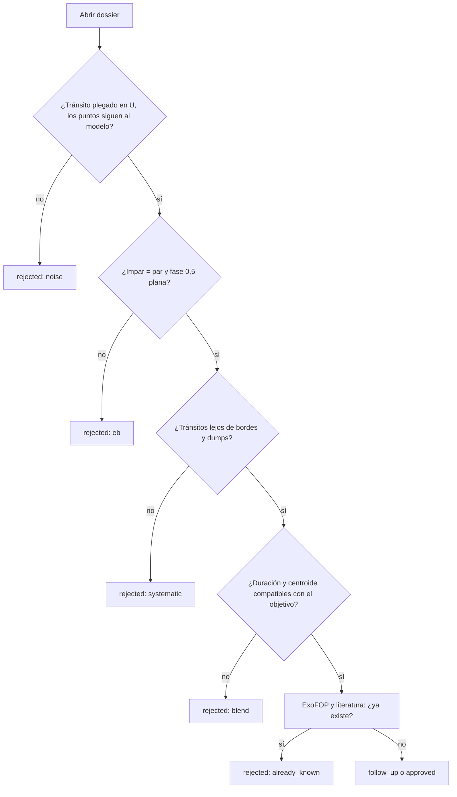

# M5. Vetting en la práctica

<p class="meta">Nivel intermedio · semanas 8–10 · unas 12 horas</p>

!!! abstract "En esta lección vas a aprender"
    - La pregunta que responde cada prueba del vetting básico, qué detecta, el límite y un caso real.
    - Cómo sale el veredicto de los vetos, las fallas duras y las fallas leves, cómo se calcula el score a partir de los pesos, y qué significan P1 y P2.
    - Cómo leer la tabla de validación: cuántos planetas reales y cuántos falsos positivos pasan.
    - Una guía para revisar candidatos con `planethunter candidates`, `dossier` y `review`.
    - Cómo comparar dossiers de planetas conocidos y de falsos positivos conocidos.

## La idea: intentar derribar la señal

El vetting (verificación) no intenta probar que una señal es un planeta. Intenta **derribarla**. Cada prueba es una pregunta que un falso positivo común respondería mal. Una señal que sobrevive a todas las preguntas no es un planeta confirmado; es solo una señal que no logramos derribar con los datos disponibles.

El vetting básico funciona sin internet, solo con la curva de luz, los centroides del archivo SPOC y los parámetros de la estrella. Está en `src/planethunter/vetting/basic.py`. Las pruebas que necesitan red (imagen de diferencia en el TPF, vecinas de Gaia, otros sectores, FPP) quedan para el vetting profundo, tema del nivel avanzado.

Cada prueba devuelve uno de tres resultados:

- **pasa**;
- **falla**: multiplica el score por un peso entre 0,3 y 0,6; algunas pruebas **vetan** por encima de un límite más estricto, y un veto deja el score en cero;
- **sin datos**: multiplica el score por 0,95 (`unknown_weight`). No es una falla.

Una falla que no es veto puede ser de dos tipos. Una **falla dura** es decisiva por sí sola: `shape` y `secondary_scan` aquí, `tpf_difference_image` y `fpp_triceratops` en el vetting profundo (`hard_fail_tests`). Todas las demás fallas son **fallas leves**: se tolera una, dos no. La sección "El veredicto y el score" lo junta todo.

## Las pruebas, una por una

La tabla las resume. Los casos reales son de la ejecución final de calibración del sector 69 (`20261009T203437Z-single-s69`), salvo que se indique otra cosa.

| Prueba | Pregunta | Qué detecta | Límite | ¿Veto? | Peso |
|---|---|---|---|---|---|
| `sde`, `snr` | ¿La señal es lo bastante fuerte? | Ruido | SDE ≥ 9; SNR ≥ 7,1 | Sí | — |
| `snr_pink` | ¿Sigue siendo fuerte cuando se cuenta el ruido rojo? | Ruido rojo que imita un tránsito | S/N_pink ≥ 9 | No (leve) | 0,5 |
| `n_transits` | ¿Vimos al menos 2 tránsitos? | Evento único sin período | ≥ 2, cada uno con ≥ 50 % cubierto por datos | Sí | — |
| `independence` | ¿Sobrevive si borramos las señales más fuertes de la estrella? | Eco de otra señal | quedan ≥ 50 % de los puntos | Sí | — |
| `odd_even` | ¿Impares y pares tienen la misma profundidad? | Binaria con período 2× | falla 3σ | ≥ 5σ | 0,4 |
| `secondary` | ¿Hay una caída en fase 0,5? | Eclipse secundario | falla 3σ | ≥ 5σ **y** ≥ 10 % | 0,4 |
| `secondary_scan` | ¿Hay una caída en otra fase? | Binaria excéntrica | falla 5σ | No (**dura**) | 0,5 |
| `shape` | ¿Fondo plano (U) o puntiagudo (V)? | Binaria rasante | τ/T14 ≤ 0,35; Rp/R* ≤ 0,3 | No (**dura**) | 0,5 |
| `kdr25_grazing` | ¿El tránsito solo roza el borde de la estrella? | Binaria rasante | k + b ≤ 1,04 | No (leve) | 0,6 |
| `radius` | ¿El tamaño es de planeta? | Estrella | falla > 22,4 R⊕ | > 33,6 R⊕, solo con una estrella confiable **y** otro indicio de binaria | 0,3 |
| `duration` | ¿La duración concuerda con la estrella? | Mezcla (blend); rasante extremo | razón 0,15 a 1,67 | No (leve) | 0,6 |
| `centroid` | ¿La luz se desplaza durante el tránsito? | Vecina como fuente | ≥ 3σ **y** fuente > 1 px | No (leve) | 0,4 |
| `edges_dumps` | ¿Tránsitos en bordes o en ajustes del telescopio? | Sistemático | ≤ 50 % | No (leve) | 0,4 |
| `consistency` | ¿Los tránsitos concuerdan entre sí? | Un evento dominando | p ≥ 0,001; el mayor < 80 % del SNR² | No (leve) | 0,5 |

### Filtros de detección: `sde`, `snr`, `n_transits`

**Pregunta:** ¿hay suficiente señal para hablar de período? Los límites vienen de las lecciones [M1](m1-statistics-for-signals.md) y [M3](m3-periodograms.md).

Al principio eran fallas leves. El efecto medido: señales con SNR 4,9 y señales con un solo tránsito se volvían P2 e iban a la cola de revisión. Hoy son veto.

**Casos reales.** Los planetas confirmados también caen aquí cuando el sector es débil: TOI-286.01 tuvo SNR 5,6 en el sector 69. De los 4 planetas reprobados en la calibración por SNR, ninguno sería detectable como nuevo en ese sector. Y GJ 143 b, con período de unos 35 días, aparece con **un** tránsito en el sector 69: sin segundo tránsito no hay período, y la señal se veta.

Un tránsito solo cuenta en `n_transits` si al menos la mitad de su tiempo esperado tiene datos. Una caída que cae casi toda en un hueco no es un tránsito que viste.

### `snr_pink`

**Pregunta:** ¿la señal sigue siendo fuerte cuando se cuenta el **ruido rojo**? Usa la S/N_pink de la lección [M1](m1-statistics-for-signals.md), con el ruido medido en bloques del largo del tránsito.

**Por qué existe.** Una estrella con ondulaciones lentas, mal eliminadas por el aplanado, deja caídas periódicas reales que duran horas. Llegan a SDE de 8 a 10, y el SDE y el SNR no logran rechazarlas: los dos suponen ruido blanco. Su S/N_pink queda por debajo de 9. El pipeline de vista rápida del TESS (QLP) usa S/N_pink ≥ 9 como umbral de detección (Guerrero et al. 2021).

**Calibración.** Como veto, esta prueba eliminaría cerca del 10 % de los planetas confirmados que hoy pasan, así que por ahora es una falla leve (`snr_pink_veto: false`). En las corridas hechas antes de que existiera la columna, el valor está vacío y la prueba da "sin datos", sin penalización.

### `independence`

**Pregunta:** ¿esta señal es independiente de las más fuertes de la misma estrella? La prueba enmascara los tránsitos de las otras señales y mide cuánto queda del tránsito de esta. Si queda menos del 50 %, es un eco.

**Caso real.** En la primera tanda del sector 69, la señal 1601 (11,95 d) estaba reaprovechando los eclipses de la señal 1600 (6,75 d), de la misma estrella. Vetada.

### `odd_even`

**Pregunta:** ¿los tránsitos impares y pares tienen la misma profundidad? Una binaria de estrellas distintas, encontrada con la mitad del período verdadero, alterna eclipses profundos y poco profundos. El error usa el ruido en bloques (lección M1).

**Casos reales.** TOI-343.01 (falso positivo): impar 2 294 ppm, par 4 583 ppm, 5,8σ, **veto**. TOI-2391.01: 6 019 contra 12 749 ppm, veto.

**Trampa.** El planeta confirmado TOI-114.01 también fue vetado: 6 690 contra 5 911 ppm, 5,7σ. Es el único planeta perdido por impar/par en la calibración. Con SNR alto, pequeñas diferencias (manchas, residuos del detrending) se vuelven significativas.

### `secondary` y `secondary_scan`

**Pregunta:** ¿existe una caída menor en fase 0,5 (o en otra fase)? La física está en la lección [M2](m2-transit-physics.md).

**Casos reales.** TOI-287.01: 4 503 ppm en fase 0,5, 37 % del primario, veto. WASP-18 b: 276 ppm, 3 % del primario, 8σ: **falla leve sin veto**, gracias a la regla del 10 %. El `secondary_scan` se creó porque la binaria excéntrica TOI-367.01 pasaba; también da falsas alarmas, como en el planeta TOI-329 b (5,3σ en fase 0,543), por eso nunca veta. Desde el 2026-10-10 es una **falla dura**: una caída de 5σ en otra fase reprueba la señal por sí sola. Medido en los sectores 69 y 107, esto eliminó muchas señales `NEW` y algunos falsos positivos conocidos, casi sin costo en planetas confirmados.

**Período a la mitad.** ¿Y si el "secundario" es tan profundo como el primario? TOI-187.01 tenía una caída en fase 0,5 del 108 % del primario y fue vetada como binaria con dos eclipses iguales. Pero la auditoría encontró planetas reales vetados de la misma forma: TOI-431 b y otros cinco TOIs se habían encontrado con el **doble** de su período verdadero, así que el tránsito intermedio aparecía en fase 0,5 como un "secundario" perfecto. La regla ahora: si la caída en fase 0,5 tiene la profundidad del primario (menos de 3σ de diferencia) y su duración (dentro de un 35 %), la señal se prueba de nuevo con **P/2**, y el resultado lleva la etiqueta `period_halved`. Una binaria con dos eclipses iguales también se prueba de nuevo con P/2; con el nuevo período, las otras pruebas tienen que atraparla.

### `shape`

**Pregunta:** ¿el tránsito tiene forma de U o de V? Mide $\tau/T_{14}$ en un ajuste de trapecio.

**Calibración.** Límite 0,35: detecta 8 de 18 falsos positivos y marca 3 de 50 planetas (rasantes reales: HIP 65 A b, LTT 9779 b, TOI-2382 b). **Casos:** TOI-297.01 (0,42), TOI-353.01 (0,45), TOI-4858.01 (0,41, y con $R_p/R_\star$ = 0,25).

**Falla dura.** Una forma de V ahora reprueba la señal por sí sola. La configuración dice el precio en su comentario: se pierden unos 3 Júpiter calientes rasantes por sector (como NGTS-6 Ab y NGTS-10 b), y se frenan de 4 a 9 binarias detectadas con la mitad de su período. Quitar `shape` de `hard_fail_tests` favorece la completitud.

### `kdr25_grazing`

**Pregunta:** ¿el tránsito solo **roza** el borde de la estrella? El trapecio es una forma aproximada. El proyecto también ajusta un modelo físico de tránsito (la biblioteca batman, Kreidberg 2015) con el oscurecimiento de borde de la banda de TESS, y obtiene dos números: $k = R_p/R_\star$ y el parámetro de impacto $b$. Si $k + b > 1{,}04$, el disco del planeta queda en parte fuera de la estrella durante todo el tránsito: eso es rasante. El límite viene del catálogo DR25 de Kepler (Thompson et al. 2018).

**Calibración.** Reprueba a 7 de 140 planetas confirmados con un ajuste bien restringido, todos rasantes que ya fallan en `shape` (LTT 9779 b, HIP 65 A b, NGTS-10 b, TOI-263 b y otros), y a cerca de la mitad de los falsos positivos conocidos. Falla leve, peso 0,6. Cuando el ajuste choca con el borde de su rango permitido, la prueba da "sin datos", sin penalización.

### `radius`

**Pregunta:** ¿el objeto tiene tamaño de planeta? $R_p = k \times R_\star$, con $k$ del ajuste físico cuando el tránsito no es rasante (si no, $k = \sqrt{\delta}$). El ajuste físico importa: $\sqrt{\delta}$ ignora el oscurecimiento de borde y sobreestima el radio en cerca de un 3 %. Falla por encima de 2 radios de Júpiter (22,4 R⊕). Veta por encima de 3 (33,6 R⊕), pero solo si el radio de la estrella es confiable (gravedad superficial $\log g \geq 3{,}5$, o sea, no es una gigante) **y** hay otro indicio de binaria (forma de V, impar/par o secundario). Mullally et al. (2015) no encontraron ningún falso positivo identificado solo por el radio inferido. Depende del radio de la estrella en el TIC: si el radio de la estrella está mal, el radio del planeta también.

**Casos reales.** TOI-147.01: 26,2 R⊕, falla. TOI-219.01: 33,3 R⊕, falla y por poco no es veto. TOI-353.01: 29,4 R⊕.

### `duration`

**Pregunta:** ¿la duración concuerda con el tamaño y la masa de la estrella? La física y la fórmula están en la lección M2.

**Casos reales.** Demasiado corta: señal 1594, 0,58 h en una gigante con 10,7 h previstas (razón 0,05). Demasiado larga: TOI-724.01, 8,40 h contra 3,56 h (razón 2,4). El límite superior es 1,67 (la lección M2 explica por qué). Cuando el ajuste de trapecio choca con el borde de sus duraciones permitidas, la prueba da "sin datos": la duración no se midió realmente.

### `centroid`

**Pregunta:** ¿el "centro de luz" de la imagen se desplaza durante el tránsito? Si la caída viene de una vecina, el centroide se mueve en la dirección opuesta a ella.

El truco es la **distancia implícita de la fuente**. Si una fuente a una distancia $D$ del centroide se oscurece con profundidad relativa $\delta$, el centroide se desplaza aproximadamente $\delta \times D$. Entonces $D \approx$ desplazamiento / profundidad.

**Calibración medida.** La primera versión reprobaba cualquier desplazamiento por encima de 3σ. Resultado: **11 de 41 planetas confirmados** reprobaban. Todos tenían la fuente implícita a 0,88 píxel como máximo, es decir, encima del objetivo. Con estrellas brillantes y muchos tránsitos, hasta un desplazamiento minúsculo se vuelve "significativo". Regla actual: falla solo si el desplazamiento es mayor que 3σ **y** la fuente implícita está a más de 1 píxel (21″).

**Caso real.** TOI-854.01 (falso positivo): desplazamiento de 12σ, fuente implícita a 2,0 píxeles. Falla.

**Tres refinamientos (2026-10-10).**

- **Error empírico.** La prueba también mide el "desplazamiento" en 200 épocas falsas fuera de los tránsitos; su dispersión es el error real de una época. Con el error antiguo, que suponía ruido blanco, épocas aleatorias "fallaban" entre el 2 % y el 47 % de las veces, cuando se esperaba el 1 %.
- **Profundidad diluida.** El centroide viene de toda la luz de la apertura, pero la profundidad del PDCSAP está corregida por contaminación. Por eso la profundidad usada es CROWDSAP × δ, la profundidad dentro de la apertura: $D \approx$ desplazamiento / (CROWDSAP × δ).
- **Cuando no puede decidir.** Las estrellas saturadas (Tmag < 7) y los sectores con menos de 3 tránsitos dan "sin datos" (Kostov et al. 2019).

### `edges_dumps`

**Pregunta:** ¿los tránsitos caen pegados a bordes de segmento o a ajustes de apuntado (*momentum dumps*)? Falla si más del 50 % cae cerca de uno u otro (lección M3).

**Casos reales.** Varias señales `NEW` de 11 a 12 días con el 100 % de los tránsitos en bordes de segmento: eventos de borde de órbita. El planeta TOI-481 b también falló (67 % en bordes): es falla leve porque los planetas reales a veces tienen mala suerte.

### `consistency`

**Pregunta:** ¿todos los tránsitos tienen una profundidad parecida? Chi cuadrado con error en bloques (lección M1).

**Casos reales.** TOI-343.01 (falso positivo): p = 6 × 10⁻⁷. Los planetas de SNR muy alto también fallan (WASP-97 b, WASP-18 b), por eso es falla leve.

## El veredicto y el score

Primero viene el **veredicto**. Una señal **reprueba** (`FAIL`) si tiene:

- cualquier veto; o
- cualquier falla dura (`shape`, `secondary_scan` y, en el vetting profundo, `tpf_difference_image` y `fpp_triceratops`); o
- más de una falla leve (`max_soft_fails: 1`).

Si no, **aprueba el vetting básico** (`PASS_BASIC`). Las pruebas "sin datos" no cuentan como fallas.

El **score** empieza en 1,0. Para cada prueba:

- falló sin veto: se multiplica por el peso de la prueba (tabla de arriba, de `config/thresholds.yaml`);
- sin datos: se multiplica por 0,95;
- vetó: el score pasa a 0.

El score ya no decide si aprueba o reprueba. **Ordena** las señales, y la severidad lo usa. Antes del 2026-10-10 la regla era "aprueba si el score es de al menos 0,5", así que una sola falla de peso bajo solía bastar para reprobar una señal; cinco planetas confirmados reprobaban por culpa de una sola prueba leve.

Para las señales `NEW` que aprueban, la severidad es: **P1** exige un score ≥ 0,8 (y, cuando existe el modelo calibrado, un `p_rank` lo bastante alto; lección [A4](../advanced/a4-machine-learning.md)); si no, **P2**. Una binaria eclipsante catalogada como estrella, o una estrella sin radio conocido, también limita la señal a P2. P0 exige además el vetting profundo (lección [A3](../advanced/a3-false-positive-probability.md)).

Tres ejemplos reales:

| Señal | Fallas | Cuenta | Score | Resultado |
|---|---|---|---|---|
| Pi Men c (sector 1) | ninguna | 1,0 | 1,0 | PASS_BASIC |
| WASP-18 b (sector 69) | `secondary`, `consistency` | 0,4 × 0,5 | 0,2 | FAIL: dos fallas leves |
| Señal 1594, reglas actuales | `duration` | 0,6 | 0,6 | PASS_BASIC (una falla leve), pero como máximo P2 |

!!! warning "El score no es una probabilidad"
    Un score de 1,0 dice que ninguna prueba automática encontró un problema. No dice que sea un planeta. Y WASP-18 b, un planeta confirmado, tiene score 0,2. El score es un **orden** útil para decidir qué mirar primero.

!!! example "Ejercicio 1"
    Calcula el score y el resultado:

    a) Falla en `duration`; todas las demás pasan.
    b) Falla en `duration`; `centroid` sin datos; el resto pasa.
    c) Falla en `odd_even` con 4,2σ y en `edges_dumps`.
    d) Falla en `shape`; todas las demás pasan.
    e) Todo pasa, pero `odd_even` dio 5,3σ.

    ??? success "Ver respuesta"
        a) Score **0,6**. Una falla leve: **PASS_BASIC**. Si es `NEW`, P2 (el score está por debajo de 0,8).

        b) 0,6 × 0,95 = **0,57**. Sigue siendo **PASS_BASIC**: "sin datos" no es una falla, solo baja el score. P2 si es `NEW`.

        c) 0,4 × 0,4 = **0,16**. **FAIL**: dos fallas leves. 4,2σ es falla (≥ 3σ), pero no veto (< 5σ).

        d) Score **0,5**, pero **FAIL**: `shape` es una falla dura. El score es el mismo que el de una señal con una falla leve; el veredicto no.

        e) **0**. Veto: 5,3σ supera el límite de 5σ de `odd_even`. Ninguna combinación de otras pruebas salva un veto.

## La validación: ¿el vetting funciona?

¿Cómo saber si los pesos y los límites tienen sentido? Ejecutando el vetting sobre señales de **respuesta conocida**: planetas confirmados (`KNOWN_PLANET`) y falsos positivos ya clasificados (`KNOWN_FP`).

**Sector 69, calibración** (194 objetivos elegidos: TOIs de la lista de recall más 30 falsos positivos del TFOPWG):

| Clase | Señales | Aprobadas | Tasa |
|---|---|---|---|
| KNOWN_PLANET | 54 | 44 | 81 % |
| KNOWN_TOI | 74 | 61 | 82 % |
| KNOWN_FP | 18 | 8 | 44 % |
| NEW | 10 | 0 | 0 % |

**Sector 107, sector completo** (12 998 estrellas, 4 431 señales; ejecución `20261009T221706Z-single-s107`, tabla impresa por `planethunter vet`):

| Clase | Señales | Aprobadas | Tasa |
|---|---|---|---|
| KNOWN_PLANET | 84 | 66 | 79 % |
| KNOWN_TOI | 104 | 77 | 74 % |
| KNOWN_FP | 132 | 7 | 5 % |
| NEW | 1 339 | 62 | 5 % |

La guía del proyecto resume así las calibraciones del sector 69: **los planetas confirmados pasan entre un 77 % y un 84 %**, y **los falsos positivos entre un 11 % y un 44 %**, según la muestra y la versión de las pruebas. En el sector 107 completo: **79 % contra 5 %**. Estas tablas se midieron con las reglas del 2026-10-09 (aprueba si el score es de al menos 0,5); las reglas nuevas se van a medir de nuevo en los mismos sectores.

¿Por qué los falsos positivos pasan mucho más en el sector 69? Porque la muestra se eligió a dedo: falsos positivos que el TFOPWG solo descartó con trabajo adicional. Los 8 que todavía pasan incluyen secundarios vistos solo sumando los sectores 1 a 69 (TOI-366, 307, 297, 184), una binaria excéntrica (TOI-367), formas en V marginales (TOI-189, 4858) y una binaria de fondo. En el sector 107, la muestra es el sector entero, dominado por binarias obvias: vetadas por radio (45), secundario (43) e impar/par (14).

¿Y por qué reprueba el 20 % de los planetas reales? En el sector 107, los vetos en planetas fueron por SNR (4), número de tránsitos (2) y secundario (1). Las fallas leves más comunes: forma, centroide, consistencia. Los planetas débiles en un sector y los rasantes reales pagan el precio de un vetting que necesita derribar binarias.

!!! tip "En la herramienta"
    `uv run planethunter vet <run_id>` imprime esa tabla en cada ejecución, con las columnas `class`, `n`, `pass`, `pass_rate`, `common_failures` y `vetoes` (clase, número de señales, aprobadas, tasa de aprobación, fallas comunes y vetos). Qué esperar: `KNOWN_PLANET` cerca del 80 % y `KNOWN_FP` bajo. Si `KNOWN_PLANET` cae mucho después de un cambio, el vetting se volvió demasiado estricto. Si `KNOWN_FP` sube, se volvió demasiado permisivo.

## Guía de revisión de candidatos

Los candidatos son señales `NEW` que pasaron el vetting básico. Tres comandos:

```bash
uv run planethunter candidates                   # la cola, por severidad y score
uv run planethunter dossier <signal_id>          # genera el dossier HTML en data/dossiers/
uv run planethunter review <signal_id> rejected --reason eb --note "eclipses alternados"
```

El `review` acepta tres decisiones: `approved`, `rejected` y `follow_up`. Rechazar **exige** un motivo:

| Motivo | Cuándo usarlo |
|---|---|
| `eb` | Binaria eclipsante: impar/par distinto, secundario, forma de V, radio de estrella |
| `blend` | La señal viene de otra estrella: centroide desplazado, duración incompatible, vecina conocida |
| `systematic` | Defecto instrumental: tránsitos en bordes o dumps, un solo sector |
| `noise` | No hay un tránsito convincente: pico débil, curva plegada sin forma |
| `already_known` | El objeto ya existe y el crossmatch no lo detectó |
| `other` | Ninguno de los anteriores; explícalo en la nota |

La nota se guarda junto al motivo (por ejemplo, `[eb] eclipses alternados`). Los rechazados salen de la lista. Las revisiones se convierten en datos de entrenamiento para el futuro clasificador.



Para cada candidato, recorre el dossier en este orden: encabezado (severidad, clase, score, host conocido); **Parameters** (¿la estrella tiene radio? ¿el planeta tiene tamaño de planeta?); **Light curve** (¿tránsitos pegados a líneas azules o a bordes?); **Folded transit** (¿U o V?); **Odd, even and secondary** (impar, par y secundario); **Depth per transit** (profundidad por tránsito: ¿algún punto fuera de la línea?); tabla **Vetting** (lee cada nota, no solo el resultado); **Crossmatch** (antigüedad de los espejos); **Next action** (próxima acción).

!!! note "Escribe siempre la nota"
    "eb" solo enseña poco. "eb: par 2× más profundo que impar, secundario del 12 % en fase 0,5" enseña mucho, a ti dentro de tres meses y al clasificador.

## Ejercicio principal: planetas contra falsos positivos

!!! example "Ejercicio 2"
    Genera y compara 5 dossiers de `KNOWN_PLANET` y 5 de `KNOWN_FP`. Para listar señales de cada clase ya verificadas en tu base de datos, guarda este script como `listar_conocidos.py` y ejecuta `uv run python listar_conocidos.py`:

    ```python
    import duckdb

    con = duckdb.connect("data/planethunter.duckdb", read_only=True)
    df = con.execute("""
        SELECT c.match_class, s.signal_id, s.tic_id, c.matched_name,
               round(s.period_days, 3) AS periodo_d, round(s.depth_ppm) AS prof_ppm,
               round(v.score, 2) AS score, v.vetoed_by, v.failed
        FROM signals s
        JOIN crossmatch c USING (signal_id)
        JOIN vetting v USING (signal_id)
        WHERE c.match_class IN ('KNOWN_PLANET', 'KNOWN_FP')
        ORDER BY c.match_class, s.signal_id DESC
        LIMIT 60
    """).df()
    print(df.to_string(index=False))
    ```

    Elige 5 de cada clase (de preferencia variados: algunos aprobados, algunos reprobados) y genera los dossiers con `uv run planethunter dossier <signal_id>`. Para cada uno, anota en una tabla: profundidad, radio, forma (τ/T14), impar/par, fase 0,5, razón de duración, centroide, score. Después responde: ¿qué distingue a los dos grupos **visualmente**?

    ??? success "Ver respuesta"
        La respuesta depende de las señales elegidas, pero los patrones que aparecen en el sector 69 son:

        - **Profundidad y radio.** Los falsos positivos tienden a ser más profundos (de miles a decenas de miles de ppm) y a dar radios por encima de 22 R⊕ (TOI-147.01, TOI-219.01, TOI-353.01). Los planetas pequeños casi nunca son falsos positivos obvios.
        - **Forma.** En el gráfico "Folded transit", los FP muestran V o rampas largas (τ/T14 de 0,36 a 0,45); los planetas, U con rampas cortas (0,1 a 0,15).
        - **Impar, par y fase 0,5.** En los FP, el panel impar/par muestra profundidades distintas (TOI-343.01) o el tercer panel muestra una caída clara (TOI-287.01). En los planetas, los dos primeros paneles son iguales y el tercero es plano. Excepción que debes reconocer: los Júpiter ultracalientes, como WASP-18 b, con una ocultación pequeña en fase 0,5.
        - **Centroide.** Algunos FP muestran la fuente implícita a más de 1 píxel (TOI-854.01).
        - **Dónde se parecen.** Los FP que solo se revelan con varios sectores o con imágenes de alta resolución parecen planetas en todos los gráficos de un sector. Por eso existe el vetting profundo.

        Si elegiste planetas reprobados (WASP-18 b, TOI-114.01, TOI-481 b), observa que la reprobación viene de las pruebas de **consistencia** e **impar/par** en señales de SNR altísimo: diferencias pequeñas y reales, pero sin aspecto de binaria.

!!! example "Ejercicio 3"
    ¿Qué motivo de rechazo usarías?

    a) Dossier con 2 tránsitos, ambos a menos de 0,1 d del inicio de un segmento.
    b) τ/T14 = 0,45, par 2× más profundo que impar, Rp = 28 R⊕.
    c) Duración de 0,6 h en una estrella de 2,5 R☉; centroide con fuente implícita a 1,8 píxeles.
    d) ExoFOP muestra un CTOI enviado ayer con el mismo período.

    ??? success "Ver respuesta"
        a) `systematic`. Los tránsitos en bordes de segmento son la firma de las rampas del detrending. Nota sugerida: "2/2 tránsitos en borde de segmento".

        b) `eb`. Tres indicios de binaria al mismo tiempo: forma de V, alternancia impar/par, tamaño de estrella.

        c) `blend`. Duración demasiado corta para una estrella grande (como la señal 1594) y centroide apuntando fuera del objetivo: la señal probablemente viene de una vecina más pequeña.

        d) `already_known`. El espejo local todavía no tenía el CTOI. Conviene anotar el nombre del CTOI en la nota.

## Checklist de la lección

- [ ] Sé decir la pregunta de cada prueba de la tabla y un caso real de cada una.
- [ ] Sé decidir el veredicto a partir de los vetos, las fallas duras y las fallas leves, y calcular el score a partir de las fallas, de las pruebas sin datos y de los vetos.
- [ ] Sé explicar por qué el centroide usa la distancia implícita de la fuente.
- [ ] Sé leer la tabla de validación y explicar la diferencia entre el sector 69 y el sector 107.
- [ ] Generé y comparé 5 dossiers `KNOWN_PLANET` y 5 `KNOWN_FP`.
- [ ] Revisé al menos 10 candidatos con `planethunter review`, cada uno con motivo y nota.
- [ ] Leí `docs/benchmarks/2026-10-09-s0069-vetting.md` y sé explicar cada fila de la tabla "What was measured and fixed" (lo que se midió y se corrigió).

## Para ir más allá

- En el repositorio, `docs/benchmarks/2026-10-09-s0069-vetting.md`: la calibración completa, con lo que se midió y se corrigió, los FP que todavía pasan y el embudo de la primera tanda real.
- Guerrero et al. (2021), *The Astrophysical Journal Supplement Series* 254, 39: cómo hace el equipo de TESS el vetting de los TOIs. Compara sus criterios con los de esta lección.
- Thompson et al. (2018), *The Astrophysical Journal Supplement Series* 235, 38: el Robovetter de Kepler, el "abuelo" de las pruebas automáticas. Queda para la lección [A2](../advanced/a2-mission-vetting.md).
- Foros de Planet Hunters TESS en [zooniverse.org](https://www.zooniverse.org): voluntarios que discuten, con los mismos argumentos de esta lección, si una señal es un planeta o una binaria.
