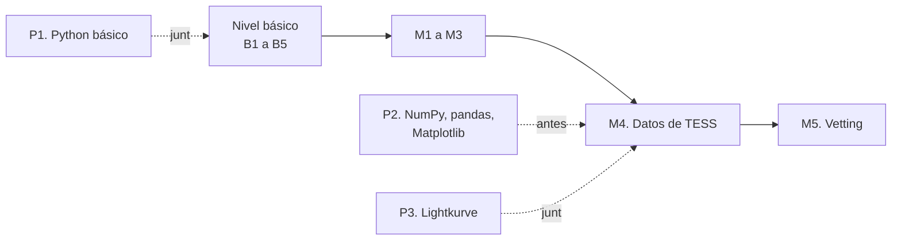

# Ruta de programación

<p class="meta">Ruta paralela · del nivel básico al intermedio · unas 30 a 35 horas en total</p>

Esta ruta enseña Python, el lenguaje de programación en el que está escrito PlanetHunter. No es un curso de informática genérico: todos los ejemplos hablan de estrellas, tránsitos y curvas de luz. Aprendes a programar y, al mismo tiempo, repasas la ciencia de las lecciones.

!!! abstract "Al final de la ruta podrás"
    - Escribir y correr pequeños programas en Python en tu computadora con Windows.
    - Simular una curva de luz, leer la tabla de TOIs de ExoFOP y hacer gráficos.
    - Descargar datos reales de TESS con la biblioteca Lightkurve y medir un tránsito.
    - Abrir los archivos que graba PlanetHunter (Parquet y base de datos DuckDB) y hacerles preguntas.

## Por qué programar ayuda

Puedes usar PlanetHunter sin programar. Los comandos están en el [laboratorio](../lab/using-planethunter.md). Entonces, ¿por qué aprender Python?

- **Para no depender de una caja negra.** Cuando el sistema dice "profundidad 10 583 ppm", puedes rehacer la cuenta y comprobarla.
- **Para hacer preguntas que el sistema no hace.** Por ejemplo: "¿cuántos candidatos del sector 69 tienen un período menor que 1 día?". Una línea de código lo responde.
- **Para entender las pruebas del vetting.** Cada prueba es una función de Python de pocas líneas. Leyendo el código, ves exactamente qué mide.
- **Para contribuir.** Cambiar un límite o crear una prueba nueva exige tocar el código y medir el efecto.

Una analogía: PlanetHunter es un auto. Se puede manejar sin saber mecánica. Pero quien entiende el motor se da cuenta de cuándo un ruido es normal y cuándo es una falla.

## Cómo avanza la ruta junto con los niveles

La ruta corre en paralelo a la ruta de ciencia. No necesitas terminarla antes de empezar el curso.

| Lección | Cuándo hacerla | Por qué |
|---|---|---|
| [P1. Python básico](p1-python-basics.md) | Junto con el nivel básico (opcional) | Practicas con las cuentas de B1 y B2: profundidad, ppm, radio del planeta |
| [P2. NumPy, pandas y Matplotlib](p2-numpy-pandas-matplotlib.md) | Después del básico, **antes de M4** | M4 usa arrays, tablas y gráficos todo el tiempo |
| [P3. Lightkurve en la práctica](p3-lightkurve-in-practice.md) | **Junto con M4** | Es la parte práctica de M4: datos reales de TESS y datos de PlanetHunter |



En el plan de estudios, la programación es opcional en el nivel básico y necesaria a partir del intermedio.

## Las lecciones

- **[P1. Python básico](p1-python-basics.md)**: variables, listas, diccionarios, bucles y funciones, con cuentas de tránsito. Unas 10 horas.
- **[P2. NumPy, pandas y Matplotlib](p2-numpy-pandas-matplotlib.md)**: simular una curva de luz, leer la lista de TOIs y hacer gráficos. Unas 12 horas.
- **[P3. Lightkurve en la práctica](p3-lightkurve-in-practice.md)**: medir el planeta WASP-18 b con datos reales y consultar la base de datos de PlanetHunter. Unas 10 horas.

## Preparar la computadora (Windows 11 y VS Code)

Vas a instalar tres cosas: **uv** (un gestor de Python), **Python 3.12** y, si todavía no lo tienes, **Git**. VS Code ya lo tienes.

### Paso 1. Abre una terminal en VS Code

Una **terminal** es una ventana donde escribes comandos en lugar de hacer clic. En VS Code, usa el menú **Terminal > New Terminal** o el atajo ++ctrl+grave++. Aparece un panel abajo con algo como `PS C:\Users\tu_usuario>`. Ese "PS" significa PowerShell, la terminal predeterminada de Windows.

### Paso 2. Instala uv

**uv** instala Python, crea un entorno aislado para cada proyecto y descarga las bibliotecas. Es lo que usa PlanetHunter. Escribe en la terminal:

```powershell
winget install --id=astral-sh.uv -e
```

Si `winget` no existe en tu computadora, usa el instalador oficial:

```powershell
powershell -ExecutionPolicy ByPass -c "irm https://astral.sh/uv/install.ps1 | iex"
```

**Cierra la terminal y abre otra.** Windows solo ve los programas nuevos en terminales nuevas. Después comprueba:

```powershell
uv --version
```

Debe aparecer algo como `uv 0.x.y`. El número exacto no importa.

### Paso 3. Instala Python 3.12

El propio uv instala Python:

```powershell
uv python install 3.12
uv python list
```

La lista debe mostrar una línea con `cpython-3.12`. Listo. No necesitas descargar nada del sitio python.org.

!!! note "¿Por qué 3.12 y no la versión más nueva?"
    PlanetHunter exige Python 3.12 (mira `requires-python` en el archivo `pyproject.toml`). Algunas bibliotecas de astronomía tardan en adaptarse a las versiones nuevas. Usar la misma versión evita sorpresas.

### Paso 4. Instala Git (si todavía no lo tienes)

**Git** guarda el historial de cambios de un proyecto. Lo vas a necesitar para descargar PlanetHunter.

```powershell
winget install --id Git.Git -e
git --version
```

### Paso 5. Instala la extensión de Python en VS Code

En VS Code, haz clic en el ícono de cuadraditos a la izquierda (Extensiones), busca **Python** (autor: Microsoft) y haz clic en **Install**. Colorea el código, señala errores y permite correr archivos con un botón.

### Paso 6. Crea una carpeta de estudios

Guarda tus ejercicios en una carpeta separada de PlanetHunter. Así no mezclas tus pruebas con el código del proyecto.

```powershell
cd ~
uv init --python 3.12 estudios-exoplanetas
cd estudios-exoplanetas
uv add numpy pandas matplotlib
```

Qué hace cada línea:

1. `cd ~` va a tu carpeta de usuario.
2. `uv init` crea la carpeta `estudios-exoplanetas` con un archivo `pyproject.toml` (la "ficha" del proyecto) y algunos archivos auxiliares. Según la versión de uv, también aparece un `main.py` o una carpeta `src`. Puedes ignorarlos.
3. `uv add` instala las bibliotecas de la lección P2 en un entorno solo de este proyecto, la carpeta `.venv`.

En la lección P3 vas a agregar más bibliotecas con `uv add lightkurve pyarrow duckdb`.

Abre la carpeta en VS Code: **File > Open Folder** y elige `estudios-exoplanetas`. Después presiona ++ctrl+shift+p++, escribe **Python: Select Interpreter** y elige el que tiene `.venv` en la ruta.

## Cómo correr un script

Un **script** es un archivo de texto con extensión `.py` que contiene instrucciones en Python. Crea en VS Code un archivo llamado `hola.py` dentro de la carpeta de estudios con este contenido:

```python
# Mi primer script
print("¡Hola! Voy a buscar planetas.")
profundidad_ppm = 84
print("La Tierra delante del Sol apaga", profundidad_ppm, "partes por millón de la luz.")
```

Guarda (++ctrl+s++) y córrelo en la terminal, desde dentro de la carpeta de estudios:

```powershell
uv run python hola.py
```

`uv run` garantiza que el Python usado sea el del entorno del proyecto, con las bibliotecas que instalaste. También funciona hacer clic en el triángulo ("Run Python File") en la esquina superior derecha de VS Code, siempre que hayas elegido el intérprete del `.venv` en el paso 6.

!!! warning "Problemas comunes"
    - **"uv no se reconoce como nombre de un cmdlet"**: cierra y vuelve a abrir la terminal. Si persiste, reinicia VS Code.
    - **"No such file or directory"**: estás en la carpeta equivocada. Usa `cd` para entrar en la carpeta del script y `ls` para ver los archivos.
    - **Acentos raros en la salida**: es solo la forma en que la terminal los muestra. Los datos no cambian.
    - **Coma decimal**: en Python, los números usan punto. Escribe `3.7`, nunca `3,7`.

## Curso complementario recomendado

Para quien nunca programó, recomiendo el **Curso em Vídeo — Python**, del profesor Gustavo Guanabara. Es gratuito, en portugués, está en YouTube y en el sitio de Curso em Vídeo, y tiene ejercicios con corrección en video. Está dividido en tres "mundos":

| Mundo de Curso em Vídeo | Combina con |
|---|---|
| Mundo 1 (fundamentos) | Lección P1, primera mitad |
| Mundo 2 (condiciones y bucles) | Lección P1, segunda mitad |
| Mundo 3 (listas, diccionarios, funciones, módulos) | Final de P1 y lección P2, antes de M4 |

Las lecciones de esta ruta no reemplazan el curso: muestran cómo usar lo que él enseña en el contexto de los exoplanetas.

!!! tip "En la herramienta"
    Todo PlanetHunter es Python. Los comandos de la línea de comandos están en `src/planethunter/cli.py`. Cuando termines P3, abre ese archivo: vas a reconocer funciones, listas, diccionarios y tablas de pandas en casi cada línea.

## Cómo saber que terminaste la ruta

Terminaste cuando puedes, sin ayuda:

1. Escribir una función que reciba la profundidad en ppm y el radio de la estrella y devuelva el radio del planeta en radios terrestres.
2. Leer el CSV de TOIs de ExoFOP y contar cuántos hay en cada disposición (CP, KP, PC, FP...).
3. Descargar la curva de luz de un objetivo con Lightkurve, encontrar el período con BLS y medir la profundidad.
4. Consultar en la base de datos `data/planethunter.duckdb` todas las señales de una estrella.

## Checklist de la ruta

- [ ] Instalé uv y Python 3.12 y comprobé las versiones
- [ ] Creé la carpeta `estudios-exoplanetas` y corrí `hola.py`
- [ ] Terminé la lección P1
- [ ] Terminé la lección P2 antes de empezar M4
- [ ] Terminé la lección P3 junto con M4

## Para ir más allá

- Curso em Vídeo — Python (Gustavo Guanabara). El mejor punto de partida gratuito en portugués para quien nunca programó.
- Documentación de NumPy, sección "absolute beginners" ([numpy.org](https://numpy.org/doc/stable/user/absolute_beginners.html)). Útil como consulta durante P2.
- Tutoriales oficiales de Lightkurve ([lightkurve.github.io](https://lightkurve.github.io/lightkurve/tutorials/index.html)). Base de la lección P3 y del módulo M4.
