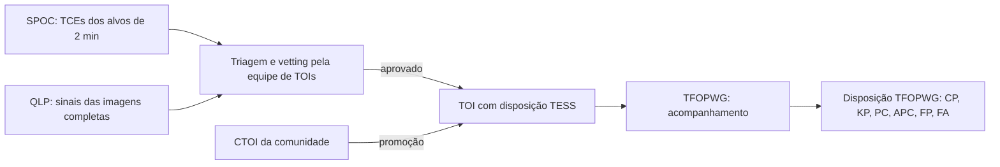

# A2. Como as missões fazem vetting

Nível avançado · semanas 3–6 · cerca de 16 horas

!!! abstract "Nesta aula você vai aprender"
    - O que o Data Validation do Kepler e do TESS calcula para cada sinal (Twicken et al. 2018).
    - Como o Robovetter do Kepler DR25 decide e, principalmente, como mede a própria confiabilidade (Thompson et al. 2018).
    - Como nasce um TOI e quem decide o que ele é (Guerrero et al. 2021).
    - O que é o catálogo de binárias eclipsantes do TESS (Prša et al. 2022) e o bug real que ele causou no PlanetHunter.
    - Como funcionam imagem-diferença e centróides, e o casamento trânsito a trânsito que nasceu do caso HD 23472.

O PlanetHunter não inventou o vetting. Quase todos os testes dele têm um ancestral nos pipelines das missões Kepler e TESS. Estudar esses ancestrais serve a dois propósitos: entender **por que** cada teste existe e enxergar **o que ainda falta** no projeto.

## 1. Data Validation: a bateria de diagnósticos

O pipeline científico do Kepler, e depois o do TESS (operado pelo **SPOC**, Science Processing Operations Center), tem duas etapas principais. A primeira, a busca, produz **TCEs** (Threshold Crossing Events): sinais periódicos que passaram de um limite de detecção. A segunda, o **Data Validation** (DV), ajusta um modelo de trânsito a cada TCE e roda uma bateria de diagnósticos. Twicken et al. (2018), *PASP* 130, 064502, descrevem a arquitetura do DV do Kepler. O SPOC herdou essa arquitetura para o TESS, e os relatórios DV de cada TCE do TESS estão públicos no MAST e linkados nas páginas de alvo do ExoFOP.

Os principais diagnósticos do DV:

| Diagnóstico | Pergunta | Ancestral de qual teste do PlanetHunter |
|---|---|---|
| Profundidade ímpar/par | Os trânsitos alternados têm a mesma profundidade? | `odd_even` |
| Secundário fraco | Há uma queda em outra fase? | `secondary`, `secondary_scan` |
| Discriminação de binária pelo período | Outro TCE da mesma estrela tem período igual ou múltiplo? | `independence` (em parte) |
| Movimento do centróide | O centro de luz da abertura se desloca durante o trânsito? | `centroid` (MOM_CENTR) |
| Centróide da imagem-diferença | Onde está a fonte do que apagou? | `tpf_difference_image` |
| Fantasma óptico | O sinal é mais forte no halo em volta da estrela do que no núcleo da abertura? | não tem |
| Teste de bootstrap | Qual a probabilidade de o ruído sozinho produzir esse SNR? | parcialmente, pelo piso de ruído em `other_sectors` e pelas rodadas nulas |
| Contaminação por "rolling band" | Os trânsitos coincidem com um padrão de ruído eletrônico conhecido do detector? | não tem (é específico do Kepler) |

O DV **não decide**. Ele produz números e gráficos para alguém decidir. No Kepler, essa decisão foi primeiro humana e depois automatizada.

## 2. O Robovetter do Kepler DR25

Thompson et al. (2018), *ApJS* 235, 38, apresentam o catálogo final do Kepler (DR25), com cerca de 4 000 candidatos a planeta. O coração do artigo é o **Robovetter**: uma árvore de decisão que lê os diagnósticos de cada TCE e atribui uma de quatro marcas de falso positivo:

- **NT** (Not Transit-like): não parece trânsito. Variabilidade, sistemático, forma estranha.
- **SS** (Stellar eclipse): eclipse de estrela. Secundário significativo, ímpar/par diferente, formato em V.
- **CO** (Centroid Offset): a fonte está deslocada do alvo.
- **EC** (Ephemeris match indicates Contamination): o período e a época casam com os de outra estrela conhecida do campo, o que indica contaminação.

Sem nenhuma marca, o TCE vira candidato.

### A lição mais importante do Robovetter

Não são os testes. É a **medição**. A equipe do Kepler mediu duas coisas que todo sistema de vetting deveria medir:

1. **Completude do vetting**: injetaram trânsitos sintéticos nos pixels, rodaram o pipeline inteiro e contaram quantos o Robovetter aprovou.
2. **Confiabilidade**: criaram alarmes falsos de propósito, **invertendo** as curvas de luz (quedas viram subidas e vice-versa) e **embaralhando** a ordem dos dados no tempo. Qualquer "trânsito" achado nessas curvas é, por construção, falso. A fração deles que o Robovetter aprova estima quantos falsos ainda contaminam o catálogo.

Com isso, cada candidato ganhou um **score de disposição**: a fração de vezes que ele passou quando os limites do Robovetter foram perturbados. É uma ideia parecida com o score do PlanetHunter, mas medida, não apenas definida.

!!! info "Curvas invertidas no PlanetHunter"
    O PlanetHunter mede o vetting em falsos positivos reais (FP/FA do TFOPWG) e, desde 2026-10-10, também em rodadas nulas no estilo do Kepler: `planethunter search --null inverted` vira o fluxo de cabeça para baixo e `--null scrambled` desloca cada órbita de dados no tempo. Todo sinal que elas produzem é um alarme falso, sem precisar de rótulo. Medir quantos deles o vetting aprova é um bom projeto seu para a aula A5.

## 3. O catálogo de TOIs

Guerrero et al. (2021), *ApJS* 254, 39, descrevem como nascem os **TOIs** (TESS Objects of Interest) na missão principal (setores 1 a 26), com mais de 2 200 objetos. O fluxo, simplificado:

Dois detalhes importam para você:

- Há **duas disposições** diferentes. A **TESS Disposition** é dada pela equipe que cria o TOI (por exemplo, PC para candidato, EB para binária). A **TFOPWG Disposition** é dada pelo grupo de acompanhamento depois de observações em solo: CP (planeta confirmado), KP (planeta já conhecido), PC (ainda candidato), APC (candidato ambíguo), FP (falso positivo), FA (alarme falso). O benchmark do projeto usa a do TFOPWG quando existe (`benchmark.py`, função `build`).
- Os **CTOIs** entram no mesmo fluxo. A equipe pode promovê-los a TOI. É o caminho que você vai preparar na aula A6.

## 4. O catálogo de binárias do TESS e o bug dos hot Jupiters

Prša et al. (2022), *ApJS* 258, 16, publicaram o catálogo de binárias eclipsantes do TESS para os setores 1 a 26: cerca de 4 600 sistemas, com período, época e um parâmetro de morfologia (quão "destacadas" ou "em contato" são as estrelas). O PlanetHunter espelha esse catálogo para o crossmatch.

O bug real: na primeira calibração no setor 69, **9 sinais** casaram com o catálogo de binárias e foram classificados como `KNOWN_FP`. Quando alguém olhou um por um, eram **WASP-18 b, WASP-100 b, HATS-16 b** e outros **planetas confirmados**, todos hot Jupiters. Planetas gigantes muito próximos da estrela produzem trânsitos profundos e, às vezes, ocultações visíveis. Um catálogo construído para achar eclipses, com critérios automáticos e revisão visual, inevitavelmente pega alguns deles.

A correção (em `crossmatch/core.py`, função `_priority`) define uma **ordem de evidência** quando vários objetos casam na mesma estrela:

1. Planeta confirmado (Exoplanet Archive, exoplanet.eu, Kepler ou K2, ou TFOPWG CP/KP).
2. Disposição FP/FA do TFOPWG.
3. TOI.
4. CTOI.
5. Candidato publicado (listas como DIAmante, DTARPS, LEO-Vetter, ExoMiner++ e candidatos do Kepler/K2): classe `KNOWN_PUBLISHED`.
6. Catálogo de binárias (Prša et al. 2022 e o catálogo "TESS Ten Thousand" de Kostov et al. 2025).

Primeiro são reunidos todos os objetos que casam na estrela, e só depois a ordem é aplicada. A auditoria de 2026-10-10 trouxe mais duas regras. Uma binária (linha de catálogo ou disposição FP) casa em **qualquer** alias, inclusive 2P e P/2, e dá `KNOWN_FP`: a exceção para planetas com períodos quase ressonantes não vale para binárias. E uma linha do catálogo de binárias que na verdade é o próprio planeta conhecido da estrela (como WASP-173 A b) não marca mais a estrela como hospedeira de binária.

A lição vai além do catálogo: **nenhum catálogo é verdade**. Cada um foi feito com um objetivo, por um método, com uma taxa de erro. Quando dois catálogos discordam, a regra de prioridade precisa refletir qual evidência é mais forte. Uma confirmação por velocidade radial pesa mais que uma classificação automática de forma.

## 5. Lado a lado

| Teste | DV / Robovetter | Equipe de TOIs | PlanetHunter |
|---|---|---|---|
| Força do sinal | Limite de SNR na busca (TPS) | Limite de SNR | `sde` ≥ 9, `snr` ≥ 7,1 (veto) |
| Número de trânsitos | ≥ 2 na busca | ≥ 2 (monotrânsitos à parte) | `n_transits` ≥ 2 (veto) |
| Ímpar/par | DV, Robovetter SS | Sim | `odd_even` (falha a 3σ, veto a 5σ) |
| Secundário | DV, Robovetter SS | Sim | `secondary` (veto só se ≥ 10 % do primário), `secondary_scan` |
| Formato em V | Robovetter SS | Visual | `shape` (`v_shape_max` 0,35, falha grave); `kdr25_grazing` (k + b > 1,04, o corte do DR25, falha leve) |
| Raio implausível | Sim | Sim | `radius` (falha 22,4 R⊕; veto 33,6 R⊕ só com estrela confiável e outro sinal de binária) |
| Duração × densidade | Parcial | Visual | `duration` (0,15 a 1,67 × previsto) |
| Centróide | DV, Robovetter CO | Sim | `centroid` offline, `tpf_difference_image` |
| Vizinhos e diluição | Parcial | Gaia | `gaia_neighbors` (modelo de PSF sobre a abertura real) |
| Contaminação por efeméride | Robovetter EC | Sim | crossmatch `NEARBY_KNOWN` (até 2′), trânsito a trânsito e sinais compartilhados na rodada |
| Ruído vermelho | — | S/N_pink ≥ 9 (QLP) | `snr_pink` |
| Sistemáticos do instrumento | Rolling band, fantasma | Visual | `edges_dumps` |
| Outros setores / trimestres | Consistência entre trimestres | Multi-setor | `other_sectors`, com busca às cegas |
| Probabilidade de FP | Validação estatística à parte | Acompanhamento | `fpp_triceratops` |
| Confiabilidade medida | Curvas invertidas e embaralhadas | Acompanhamento em solo | FPs do TFOPWG nos setores 69 e 107; rodadas nulas invertidas e embaralhadas |

O que salta da tabela: o PlanetHunter cobre a maioria dos testes clássicos, mas **não tem** teste de fantasma óptico nem teste de bootstrap formal, e as rodadas nulas são novas e ainda não são usadas para relatar um número de confiabilidade. São candidatos naturais para melhorias, e a autoavaliação vai pedir que você proponha uma.

## 6. Imagem-diferença e centróides

O pixel do TESS tem 21″. Dentro da abertura de um alvo cabem várias estrelas. A pergunta "de qual estrela vem a queda?" é, em muitos casos, a mais importante do vetting.

### Movimento do centróide (offline)

O SPOC grava, para cada cadência, o **centróide** (centro de luz ponderado) da abertura, nas colunas MOM_CENTR. Se a queda vem do alvo, o centróide quase não se mexe. Se vem de um vizinho, o centro de luz se desloca **em direção oposta** ao vizinho durante o trânsito.

O deslocamento sozinho engana: uma queda profunda num vizinho fraco e uma queda rasa num vizinho brilhante podem dar o mesmo movimento. O projeto usa a **distância implícita da fonte**:

$$
d_\text{fonte} \approx \frac{\Delta x}{\delta} ,
$$

o deslocamento dividido pela profundidade fracionária. O teste `centroid` só falha se o deslocamento for maior que 3σ **e** a fonte implícita estiver a mais de 1 pixel (`centroid_max_offset_px`). Essa regra nasceu de uma medição: com o critério só de significância, 11 de 41 planetas confirmados falhavam, e todos tinham fonte implícita até 0,88 px.

Três refinamentos da auditoria de 2026-10-10:

- **A profundidade na abertura.** A profundidade do PDCSAP é corrigida da contaminação, mas o centróide MOM_CENTR não é. A profundidade certa na fórmula é $\delta_\text{ap} = \text{CROWDSAP} \times \delta$.
- **Um erro empírico.** O erro que supunha ruído branco fazia épocas aleatórias fora do trânsito "falharem" de 2 % a 47 % das vezes, contra 1 % esperado. Agora a mesma medida é feita em 200 épocas falsas fora do trânsito, e a dispersão delas é o erro de uma época. Cada setor é avaliado separadamente, porque a orientação dos pixels do detector muda de um setor para outro.
- **Saber quando não decidir.** Estrelas saturadas (Tmag < 7) e setores com menos de 3 trânsitos dão "sem dados" (Kostov et al. 2019).

### Imagem-diferença (com rede, por candidato)

O teste `tpf_difference_image` baixa o arquivo de pixels (TPF) do alvo e faz:

1. Média das imagens **fora** do trânsito (entre 1 e 3 durações do centro).
2. Média das imagens **dentro** do trânsito (até 0,4 duração do centro).
3. **Diferença** = fora − dentro. O que apagou aparece brilhante.
4. Centróide da diferença comparado com a **posição de catálogo** do alvo (a posição do TIC, época 2000, levada adiante com o movimento próprio da estrela até a data do TPF).
5. Incerteza: a dispersão dos centróides calculados trânsito a trânsito, dividida pela raiz do número de trânsitos (precisa de pelo menos 3).

Falha se o deslocamento passa de 1 pixel e é significativo (3σ). É uma **falha grave**: sozinha, ela reprova o sinal. Com menos de 3 trânsitos não há estimativa de erro, e um deslocamento acima de 1 pixel dá "sem dados" em vez de falha. A primeira versão comparava o centróide da diferença com o centróide fora do trânsito; Bryson et al. (2013) comparam com a posição de catálogo. Com a referência antiga, 10 de 20 falhas no setor 107 tinham o centróide da diferença a menos de 1 pixel da posição do TIC. No dossiê, o `x` vermelho (centróide da diferença) deve cair dentro do círculo laranja (posição do TIC); a `+` branca marca o centróide fora do trânsito. Na primeira fatia real de 2 164 estrelas, o sinal 1528 foi reprovado neste teste.

O método profissional (Bryson et al. 2013) ajusta à imagem-diferença o modelo da resposta do instrumento a uma estrela pontual (a PRF), mais preciso com vizinhos próximos. O centróide ponderado do projeto é uma aproximação deliberadamente simples.

### Do centróide aos vizinhos Gaia

O teste não consegue separar fontes mais próximas que a própria incerteza. O projeto define um **raio de exclusão** igual a 3 vezes o menor erro de centróide (mínimo de 0,3 px). Depois, o teste `gaia_neighbors` lista as estrelas Gaia DR3 até 2,5 pixels e, para cada uma, calcula a profundidade que ela precisaria ter para produzir o sinal sozinha. Usa a fórmula do triceratops (Giacalone et al. 2021):

$$
\delta_\text{necessária} = \delta_\text{obs} \times \frac{F_\text{alvo,ap}}{F_\text{vizinho,ap}}, \qquad F_\text{ap} = 10^{-0,4\,T} \times (\text{fração da PSF da estrela dentro da abertura}) .
$$

$T$ é a magnitude do TESS (convertida de $G$ do Gaia e da cor quando preciso), e a PSF é modelada como uma gaussiana de 0,75 px sobre os pixels reais da abertura. A profundidade observada é a do PDCSAP, já corrigida da diluição, e por isso se refere à luz do próprio alvo. É por isso que o fluxo do alvo, e não o fluxo total, está no numerador; a primeira versão usava o fluxo total e superestimava a profundidade necessária.

Acima de 100 %, é impossível. Um vizinho possível **dentro** do raio de exclusão continua plausível, e o teste termina com "requer imagem": só imagem de alta resolução resolve. E se a imagem-diferença mostra um deslocamento significativo e um vizinho capaz de produzir a queda está a menos de 1 pixel do centróide da diferença, o teste falha: o culpado tem nome.

## 7. Casamento trânsito a trânsito: o caso HD 23472

HD 23472 tem cinco planetas conhecidos. Num único setor, o TLS viu um trânsito do planeta b e um do planeta c e "achou" um planeta de **10,29 dias**. O crossmatch por período não pegou: 10,29 dias não é o período de nenhum planeta conhecido, nem alias. O sinal chegou a P1. O mesmo aconteceu com TOI-703 (.01 + .02 virando 11,40 d) e GJ 143 (8,80 d).

A correção, em `crossmatch/core.py` (função `explain_transits`), pergunta para **cada trânsito observado**: algum objeto conhecido da estrela prevê um evento aqui?

- Para cada objeto, propaga a efeméride até a época do trânsito: $n = \text{round}[(t - T_0)/P]$, previsto $= T_0 + nP$.
- Tolerância: o maior entre metade da duração e 1 hora, mais 3 vezes a incerteza propagada, $3\,|n|\,\sigma_P$. Quando um catálogo não informa $\sigma_P$, assume-se $10^{-4} P$ em vez de zero.
- Objetos cuja incerteza propagada a $3\sigma$ passa de 0,25 dia (ou de 0,1 P) são ignorados: a efeméride já não serve.
- Testa também fase 0,5, porque muitos TOIs e CTOIs são binárias e o "trânsito" pode ser o eclipse secundário. Não para planetas confirmados, que não têm eclipse secundário capaz de se passar por trânsito.

A primeira versão classificava o sinal como conhecido se **pelo menos 50 %** dos trânsitos fossem explicados. Depois dessa correção, os 3 candidatos `NEW` que passavam o funil no benchmark caíram para **0**. Todos eram falsos.

Mas a auditoria achou a regra frouxa demais: com janelas de até ± (duração + 1 dia), fase 0,5 para todos os objetos e só dois trânsitos, ela "explicava" sinais aleatórios 36 % das vezes (80 % a 87 % para períodos conhecidos abaixo de 2 dias). A regra atual acrescenta um teste de **acaso**. Se as janelas dos objetos conhecidos cobrem uma fração $f$ do tempo, a probabilidade de $k$ ou mais dos $n$ trânsitos caírem nelas por sorte é binomial:

$$
P(X \geq k) = \sum_{j=k}^{n} \binom{n}{j} f^{j} (1-f)^{n-j} .
$$

O sinal é conhecido (`match_type = transit_times`) só se pelo menos 50 % dos trânsitos forem explicados **e** essa probabilidade ficar abaixo de 1 %. A taxa medida de casamentos por acaso caiu para entre 0,3 % e 1,3 %. Quase acertos (entre 1 % e 10 %) continuam `NEW`, com a nota `partial_known_transit_coincidence`, e não podem passar de P2.

### Além de uma estrela: picos de época e sinais compartilhados

Alguns sinais falsos só aparecem quando você olha todas as estrelas de uma rodada juntas (`crossmatch/runlevel.py`):

- **Picos de época.** Um evento do telescópio num dado momento põe um "trânsito" em muitas estrelas sem relação ao mesmo tempo. O projeto conta, em intervalos de 0,25 dia, quantas estrelas diferentes têm um trânsito ali, e marca os intervalos com muito mais do que o acaso permite. No setor 107, essa verificação marcou centenas de sinais `NEW`. Um sinal com metade ou mais dos trânsitos em picos (`epoch_spike_frac` ≥ 0,5) não gera alerta.
- **Sinais compartilhados.** O mesmo período (ou 2P, P/2) e o mesmo instante de trânsito em outro alvo a menos de 2′ significam um só sinal visto por duas aberturas. A estrela que consegue de fato produzir a queda, e cuja abertura perde mais luz, é a `source` (no máximo P2); a outra é a `victim` (sem alerta). Duas entradas a menos de 2″ uma da outra são um `duplicate`: o TIC dividiu uma estrela em duas (Paegert et al. 2021).

!!! tip "Na ferramenta"
    - Os testes básicos estão em `src/planethunter/vetting/basic.py`; os aprofundados (imagem-diferença, vizinhos Gaia, outros setores, SIMBAD, binárias do Gaia, FPP), em `src/planethunter/vetting/deep.py`.
    - A prioridade entre catálogos e o casamento trânsito a trânsito estão em `src/planethunter/crossmatch/core.py`; picos de época e sinais compartilhados, em `src/planethunter/crossmatch/runlevel.py`.
    - No dossiê: seção 7 (imagem-diferença) e seção 9 (crossmatch, com o tipo de casamento e a idade de cada espelho).
    - Rode `uv run planethunter vet-deep <run_id>` para ver a imagem-diferença e os vizinhos de candidatos reais.

!!! example "Exercício 1. Qual vizinho pode ser a fonte?"
    Um candidato tem profundidade de 2 000 ppm (já corrigida da diluição). O alvo tem $T = 10{,}0$. Há dois vizinhos Gaia: A com $T = 14{,}0$ e B com $T = 18{,}0$. Para simplificar, suponha que toda a luz das três estrelas cai dentro da abertura (fração da PSF igual a 1 para todas). Qual deles poderia produzir o sinal sozinho?

    ??? success "Ver resposta"
        1. Fluxo de A relativo ao alvo: $10^{-0,4 \times 4} = 10^{-1,6} \approx 0{,}0251$. De B: $10^{-0,4 \times 8} = 10^{-3,2} \approx 0{,}000631$.
        2. A precisaria de $0{,}002 / 0{,}0251 \approx 0{,}080$, ou seja, **8,0 %**. Uma binária eclipsante faz isso com facilidade. **A é possível.**
        3. B precisaria de $0{,}002 / 0{,}000631 \approx 3{,}17$, ou seja, **317 %**. Impossível: uma estrela não pode perder mais que todo o seu brilho. **B está descartado.**
        4. Se A estiver dentro do raio de exclusão do centróide, o teste termina com "requer imagem".
        5. Na vida real, um vizinho na borda da abertura só põe parte da sua luz dentro dela. Isso diminui $F_\text{vizinho,ap}$ e aumenta a profundidade de que ele precisaria: um vizinho a 2 pixels de distância é muito mais difícil de culpar que um no mesmo pixel.

!!! example "Exercício 2. O trânsito é de quem?"
    Uma estrela tem um planeta conhecido com $P = 17{,}667$ d, $T_0 = 1400{,}000$ BTJD, $\sigma_P = 0{,}0005$ d (efeméride hipotética). O sistema detectou um trânsito de 3,6 h (0,15 d) em 3184,400 BTJD. Esse trânsito é explicado pelo planeta conhecido?

    ??? success "Ver resposta"
        1. $n = \text{round}[(3184{,}400 - 1400{,}000)/17{,}667] = \text{round}(101{,}0) = 101$.
        2. Previsto: $1400{,}000 + 101 \times 17{,}667 = 3184{,}367$ BTJD. Diferença: $0{,}033$ d.
        3. Incerteza propagada: $3 \times 101 \times 0{,}0005 = 0{,}152$ d. Abaixo de 0,25 dia (e abaixo de $0{,}1 P = 1{,}77$ d), a efeméride vale.
        4. Tolerância: $\max(0{,}15/2;\ 1/24) + 0{,}152 = 0{,}075 + 0{,}152 = 0{,}227$ d.
        5. $0{,}033 < 0{,}227$: **sim**, o trânsito é explicado. Se metade ou mais dos trânsitos do sinal forem explicados assim, **e** a chance binomial de tantas coincidências ficar abaixo de 1 %, ele é classificado como conhecido.

!!! example "Exercício 3. Centróide significativo, mas inocente"
    O centróide do alvo se desloca $0{,}0020$ px durante um trânsito de profundidade $0{,}005$ (5 000 ppm), com significância de 6σ. Outro sinal: deslocamento de $0{,}010$ px, profundidade $0{,}002$, significância 4σ. Qual falha no teste `centroid`?

    ??? success "Ver resposta"
        Suponha CROWDSAP = 1 (sem contaminação), de modo que a profundidade na abertura é igual à profundidade.

        1. Primeiro sinal: fonte implícita $0{,}0020 / 0{,}005 = 0{,}4$ px. Significativo, mas abaixo de 1 px. **Passa.** É o comportamento típico de planeta real numa estrela com vizinhos fracos.
        2. Segundo: $0{,}010 / 0{,}002 = 5$ px, ou cerca de 105″. Significativo (4σ > 3σ) **e** acima de 1 px. **Falha.**
        3. Moral: significância diz se o movimento é real; a distância implícita diz se ele importa.

## Checklist da aula

- [ ] Li Twicken et al. (2018) e sei listar cinco diagnósticos do DV.
- [ ] Li Thompson et al. (2018) e sei explicar as marcas NT, SS, CO, EC e o uso de curvas invertidas e embaralhadas.
- [ ] Li Guerrero et al. (2021) e sei a diferença entre TESS Disposition e TFOPWG Disposition.
- [ ] Sei contar o bug dos hot Jupiters no catálogo de binárias e justificar a ordem de prioridade do crossmatch.
- [ ] Sei calcular a distância implícita da fonte e a profundidade necessária num vizinho.
- [ ] Sei explicar o casamento trânsito a trânsito com o caso HD 23472, e por que ele precisa de um teste de acaso.

## Para ir além

- Twicken et al. (2018), *Publications of the Astronomical Society of the Pacific* 130, 064502. A arquitetura do Data Validation; leia a seção dos diagnósticos com os relatórios DV de um TOI real abertos ao lado.
- Thompson et al. (2018), *The Astrophysical Journal Supplement Series* 235, 38. O DR25 e o Robovetter; a parte sobre confiabilidade medida é a mais importante para quem constrói sistemas.
- Guerrero et al. (2021), *The Astrophysical Journal Supplement Series* 254, 39. O processo que transforma sinais em TOIs e o papel dos CTOIs.
- Prša et al. (2022), *The Astrophysical Journal Supplement Series* 258, 16. O catálogo de binárias do TESS; útil para entender o parâmetro de morfologia e os limites de uma classificação automática.
- Bryson et al. (2013), *Publications of the Astronomical Society of the Pacific* 125, 889. Como identificar falsos positivos de fundo com imagens-diferença e ajuste de PRF.
- Coughlin et al. (2014), *The Astronomical Journal* 147, 119. Casamento de efemérides no campo do Kepler: centenas de candidatos eram contaminação de outras estrelas. A base da marca EC e do `NEARBY_KNOWN`.
