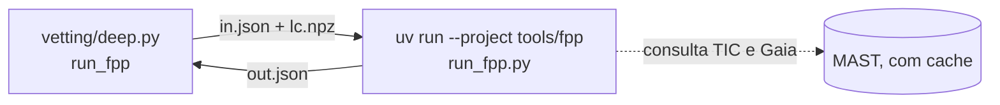

# A3. Probabilidade de falso positivo

Nível avançado · semanas 6–8 · cerca de 12 horas

!!! abstract "Nesta aula você vai aprender"
    - O raciocínio bayesiano por trás de uma probabilidade de falso positivo, sem precisar de cálculo avançado.
    - O que Morton (2012) propôs com o vespa e o que Giacalone et al. (2021) mudaram com o triceratops.
    - O significado de cada cenário (TP, EB, PEB, PTP, STP, SEB, DTP, BEB, NTP, NEB...) e como FPP e NFPP são calculados.
    - Por que os limiares 0,015 e $10^{-3}$ existem e por que um FPP baixo **não** dispensa imagem de alta resolução.
    - Como o PlanetHunter roda o triceratops num ambiente isolado e o que o caso real do WASP-100 b (FPP 0,35) ensina.

Até aqui, cada teste do vetting respondeu "sim" ou "não" a uma pergunta. Mas a pergunta que realmente importa é outra: **dado tudo que eu sei, qual a chance de isto ser um planeta?** Responder exige combinar o que os dados mostram com o que se sabe sobre a população de estrelas e planetas. Esse é o terreno da estatística bayesiana.

## 1. Bayes em linguagem simples

Imagine um exame médico que acerta 95 % das vezes. Seu resultado deu positivo. Qual a chance de você ter a doença? A resposta depende de quão **comum** a doença é. Se só uma pessoa em mil a tem, a maioria dos positivos é alarme falso, mesmo com um exame bom.

Com sinais de trânsito é igual. A pergunta "isto é planeta?" depende de duas coisas:

1. **Quão bem cada explicação reproduz os dados** (a forma do trânsito, a profundidade, a ausência de secundário). Isso se chama **verossimilhança** (likelihood).
2. **Quão comum é cada explicação antes de olhar os dados**: quantas estrelas têm planetas desse tamanho, quantas são binárias, quantas estrelas de fundo cabem no pixel. Isso se chama **probabilidade a priori** (prior).

O teorema de Bayes junta as duas. Para cada cenário $j$:

$$
P(\text{cenário}_j \mid \text{dados}) = \frac{P(\text{dados} \mid \text{cenário}_j)\; P(\text{cenário}_j)}{\sum_k P(\text{dados} \mid \text{cenário}_k)\; P(\text{cenário}_k)} .
$$

Em palavras: multiplique "quão bem explica" por "quão comum é", faça isso para todos os cenários e divida cada resultado pela soma, para que as probabilidades somem 1.

A **probabilidade de falso positivo** (FPP) é simplesmente a soma das probabilidades de todos os cenários que **não** são "planeta no alvo".

## 2. Morton (2012) e o vespa

Morton (2012), *The Astrophysical Journal* 761, 6, transformou essa ideia num procedimento automático, implementado no programa **vespa**. Os cenários considerados:

- **Planeta** transitando o alvo.
- **EB**: o próprio alvo é uma binária eclipsante.
- **HEB**: o alvo faz parte de um sistema triplo hierárquico, e um par de estrelas eclipsantes está diluído pela luz da estrela principal.
- **BEB**: uma binária eclipsante de fundo, não resolvida, dentro da abertura.
- Versões com **período dobrado** das binárias (eclipses primário e secundário iguais, que parecem trânsitos de período $P$).

Para cada cenário, o vespa simula uma população realista (estrelas de fundo de um modelo da Galáxia, estatística de binárias, taxas de ocorrência de planetas), gera a curva de trânsito que cada membro produziria e compara a **forma** com a observada, resumida por profundidade, duração total e duração do ingresso. Restrições externas, como uma imagem de alta resolução que exclui companheiras acima de certo brilho, cortam partes da população.

O método tornou possível **validar** planetas sem medir a massa. Morton et al. (2016), *ApJ* 822, 86, aplicaram a abordagem a todo o catálogo do Kepler e validaram cerca de 1 280 planetas com FPP abaixo de 1 %. "Validado", aqui, tem sentido preciso: a probabilidade de qualquer explicação alternativa é muito baixa. Não é "confirmado", que exige medida independente, em geral de massa.

## 3. Triceratops: o vespa adaptado ao pixel do TESS

Giacalone et al. (2021), *The Astronomical Journal* 161, 24, criaram o **triceratops** para o TESS. A diferença central: com pixels de 21″, a questão "qual estrela vizinha conhecida está produzindo o sinal?" vira protagonista. O triceratops:

1. Consulta o TIC e o Gaia para listar as estrelas em volta do alvo.
2. Usa os **pixels da abertura** do setor para calcular quanto da luz de cada estrela cai dentro dela.
3. Calcula, para cada estrela, a profundidade que ela precisaria ter para produzir o sinal (a mesma conta do teste `gaia_neighbors` da aula A2).
4. Para cada cenário, sorteia muitos conjuntos de parâmetros plausíveis, gera o modelo de curva, compara com a curva dobrada observada e calcula a probabilidade.

### Os cenários

| Sigla | O que acontece | Planeta no alvo? |
|---|---|---|
| **TP** | Planeta transitando o alvo, sem companheira | Sim |
| **EB**, EBx2P | O alvo é uma binária eclipsante (x2P: período real é o dobro, eclipses iguais) | Não |
| **PTP** | Planeta transitando o alvo, que tem uma companheira ligada não resolvida diluindo a luz | Sim |
| **PEB**, PEBx2P | O alvo tem companheira ligada não resolvida, e o próprio alvo é eclipsado por outra estrela | Não |
| **STP** | Planeta transitando a **companheira** ligada não resolvida | Não (o planeta existe, mas na outra estrela, e seu raio está errado) |
| **SEB**, SEBx2P | A companheira ligada não resolvida é uma binária eclipsante | Não |
| **DTP** | Planeta transitando o alvo, diluído por uma estrela de fundo não resolvida | Sim |
| **DEB**, DEBx2P | O alvo é binária eclipsante, diluída por estrela de fundo | Não |
| **BTP** | Planeta transitando uma estrela de fundo não resolvida | Não |
| **BEB**, BEBx2P | Estrela de fundo não resolvida é binária eclipsante | Não |
| **NTP** | Planeta transitando uma estrela **vizinha conhecida** (resolvida no Gaia) | Não |
| **NEB**, NEBx2P | Uma vizinha conhecida é binária eclipsante | Não |

As letras ajudam a memorizar: **P** de primária (o alvo num sistema não resolvido), **S** de secundária (a companheira), **D** de diluído, **B** de fundo (background), **N** de vizinha (nearby).

### FPP e NFPP

$$
\text{FPP} = 1 - \left(P_\text{TP} + P_\text{PTP} + P_\text{DTP}\right),
\qquad
\text{NFPP} = P_\text{NTP} + P_\text{NEB} + P_\text{NEBx2P} .
$$

O **FPP** é a probabilidade de não ser um planeta no alvo. O **NFPP** (nearby FPP) é a parte do FPP que vem de vizinhas **conhecidas e resolvidas**. A distinção importa: um NFPP alto aponta um culpado concreto, que pode ser checado com imagem-diferença ou fotometria em solo da vizinha.

### Os limiares

- **FPP < 0,015 e NFPP < $10^{-3}$**: o nível que Giacalone et al. propõem para **validação estatística**. Os autores calibraram esses valores com TOIs de disposição conhecida.
- **FPP < 0,5**: "candidato plausível", mais provável planeta do que não.
- **NFPP > 0,1**: "provável falso positivo de vizinha".
- Essas classes só valem onde os autores as calibraram: planetas menores que 8 R⊕, SNR de pelo menos 15 e dados de 2 minutos. Para dados de imagens completas de 30 minutos, não há região de validação confiável.

No PlanetHunter (função `fpp_test` em `vetting/deep.py`):

| Condição | Efeito |
|---|---|
| FPP < 0,5 e NFPP ≤ 0,1 | Teste passa |
| FPP ≥ 0,5, ou NFPP > 0,1 | **Falha grave**: sozinha, reprova o sinal (peso 0,3 no score) |
| NFPP > 0,5 | **Veto**: uma vizinha conhecida é a fonte mais provável |
| FPP < 0,015 e NFPP < 0,001 | Nota "nível de validação (exige imagem de alta resolução)" |
| Rp ≥ 8 R⊕, SNR < 15 ou dados mais grossos que 2 min | Nota "fora da região de validação" |

A severidade lê os mesmos números (`alerts/severity.py`). **P0** exige vetting aprofundado completo (imagem-diferença e vizinhos Gaia aprovados, FPP calculado) com FPP < 0,1, NFPP < 0,001 e a região de validação acima (Rp < 8 R⊕, SNR ≥ 15, dados de 2 minutos). FPP < 0,1 é uma escolha do projeto, entre "plausível" (0,5) e "validado" (0,015). Tudo o que não pode ser verificado limita o sinal a P1, e NFPP > 0,1 o limita a P2.

## 4. Exemplo real: WASP-100 b

O projeto rodou o triceratops no planeta confirmado **WASP-100 b** (TIC 38846515), com dados do setor 69, profundidade de cerca de 7 500 ppm e período de 2,848 dias. Resultado, guardado no cache do vetting:

| Cenário | Probabilidade |
|---|---|
| TP | 0,541 |
| PEB | 0,347 |
| PTP | 0,112 |
| SEB | 0,0001 |
| DTP | ~$2 \times 10^{-9}$ |

**FPP = 0,35. NFPP ≈ $10^{-109}$**, essencialmente zero.

Um planeta confirmado, com FPP de 35 %. Como interpretar?

1. **Nenhuma vizinha conhecida é suspeita** (NFPP desprezível). O sinal está no alvo ou em algo não resolvido junto dele.
2. **O concorrente é o PEB**: o alvo teria uma companheira ligada não resolvida, e seria ele próprio eclipsado por uma estrela pequena. Com trânsito profundo e só fotometria do TESS, essa explicação reproduz a forma razoavelmente bem.
3. **O que derrubaria o PEB**: uma imagem de alta resolução que exclua companheiras próximas (o triceratops aceita a **curva de contraste** dessa imagem como entrada), e a velocidade radial, que mediu a massa planetária do WASP-100 b. Nenhuma das duas entrou no cálculo.

A lição: **o FPP mede o que os dados fornecidos permitem excluir**, não a verdade. Um planeta real pode ter FPP médio quando faltam observações que eliminem cenários. Por isso o FPP é um dos últimos testes, não o juiz final.

Na mesma linha, dois sinais de um teste do projeto no setor 107 mostram o outro lado:

- **Sinal 4053** (TIC 139552249): NTP numa vizinha (TIC 139552250) com 0,68; TP 0,28. FPP 0,68, **NFPP 0,68**. Veto: o sinal provavelmente vem da vizinha.
- **Sinal 4278** (TIC 146320921): SEB 0,32, NEB 0,25, TP 0,21, STP 0,13. FPP 0,74, NFPP 0,25. Reprovado no FPP (FPP ≥ 0,5, e NFPP acima de 0,1), mas sem veto: os cenários são variados e nenhum culpado domina.

## 5. Por que FPP baixo não dispensa imagem de alta resolução

Esta é a ideia mais mal compreendida da validação estatística. Quatro razões:

1. **As priors de companheiras não resolvidas são grandes.** Cerca de metade das estrelas tipo Sol têm companheiras. Sem imagem, o modelo precisa considerar companheiras em qualquer separação abaixo da resolução do TESS. Uma curva de contraste elimina boa parte desse espaço e é exatamente isso que move o FPP de "baixo" para "validável".
2. **O modelo só conhece os cenários que lista.** Sistemáticos do instrumento, variabilidade estelar e erros de detrending não estão entre os cenários. O triceratops assume que o sinal é astrofísico e vem de alguma estrela. É por isso que testes como `other_sectors` e `edges_dumps` precisam vir antes.
3. **Os parâmetros estelares podem estar errados.** Um raio estelar errado no TIC muda a profundidade esperada, a duração esperada e a plausibilidade de cada cenário.
4. **É a regra da própria literatura.** Giacalone et al. recomendam o limiar de validação junto com imagem de alta resolução, e trabalhos de validação com triceratops em geral apresentam a curva de contraste.

Por isso a nota do PlanetHunter diz "nível de validação (exige imagem de alta resolução)". Mesmo um FPP de 0,001 não autoriza ninguém a chamar o candidato de planeta validado sem essa observação.

## 6. Como o projeto roda o triceratops

O triceratops exige versões antigas de bibliotecas numéricas (NumPy 1.26, SciPy 1.13). O ambiente principal do PlanetHunter usa o TLS 2.0, que depende do NumPy 2. As duas coisas não convivem no mesmo ambiente.

A solução é um **ambiente isolado** em `tools/fpp/`, com seu próprio `pyproject.toml` (triceratops 1.1.0, `numpy<2`, lightkurve). A conversa entre os dois ambientes é por arquivos:

1. O código principal dobra a curva de luz no período, recorta 2,5 durações em volta do trânsito e grava fase, fluxo e erro num arquivo `lc.npz`. A curva é a mesma que o vetting usa: cada setor achatado de novo com os trânsitos mascarados.
2. Grava `in.json` com TIC, setores, profundidade (fração), período, pixels da abertura de cada setor, número de sorteios, número de repetições e o tempo de exposição real dos dados.
3. Chama `uv run --project tools/fpp python tools/fpp/run_fpp.py in.json out.json` como subprocesso, com tempo limite de 1 800 s por repetição (`fpp_timeout_s`).
4. O script do ambiente isolado roda `calc_depths` e `calc_probs` **3 vezes** (`fpp_repeats`) e grava `out.json` com a média e a dispersão do FPP e do NFPP, e os cinco cenários mais prováveis. Giacalone et al. repetem cada caso 20 vezes; 3 repetições dão uma média e uma dispersão a um custo suportável.
5. O erro de fluxo passado ao triceratops é a dispersão **medida** do fluxo fora do trânsito (1,4826 × MAD) quando ela é maior que as barras de erro do pipeline. Na auditoria, os quatro candidatos com FPP = 1,000 tinham dispersão real 2 a 46 vezes maior que o erro do pipeline: o modelo estava ouvindo que os dados eram mais limpos do que eram.
6. Qualquer erro vira `"ok": false` com a mensagem, assim como rodadas que não trazem informação: uma estrela sem massa, raio, temperatura ou paralaxe no catálogo, ou uma rodada "degenerada" em que todos os sorteios foram geometricamente impossíveis. O código principal **nunca quebra** por causa do FPP. Sem resultado, o teste fica "sem dados", o campo `deep_pending` registra `fpp_triceratops` e o candidato não pode chegar a P0.

Custo: com $10^5$ sorteios (`fpp_draws`), cerca de **6 minutos por repetição** no WASP-100 b, ou seja, cerca de 18 minutos por candidato. Por isso o FPP só roda para quem passou em todo o resto do vetting.

!!! tip "Na ferramenta"
    - `uv run planethunter vet-deep <run_id>` roda o FPP para candidatos que passaram o vetting básico e aprofundado.
    - Configuração: `fpp_enabled`, `fpp_draws`, `fpp_repeats`, `fpp_timeout_s` e os limites `fpp_max`, `fpp_nfpp_fail` e `fpp_nfpp_veto` em `config/thresholds.yaml`.
    - Entradas e saídas ficam em `data/cache/fpp/sig<signal_id>/`. Abra o `out.json` para ver os cenários.
    - No dossiê, a linha `fpp_triceratops` da tabela de vetting mostra FPP e NFPP (média e dispersão das repetições), o nível, se o sinal está dentro da região de validação e os três cenários principais.

!!! example "Exercício 1. Calcule o FPP do WASP-100 b"
    Usando a tabela da seção 4, calcule FPP e NFPP e classifique o resultado pelos limiares do projeto.

    ??? success "Ver resposta"
        1. Cenários de planeta no alvo: TP 0,541 + PTP 0,112 + DTP ~0 = 0,653.
        2. FPP = 1 − 0,653 = **0,347**.
        3. Nenhum cenário N aparece entre os principais; NFPP ≈ $10^{-109}$, abaixo de $10^{-3}$.
        4. FPP < 0,5 e NFPP ≤ 0,1: **teste passa**, "candidato plausível". Mas FPP ≥ 0,1: não permitiria P0. E está longe de 0,015: não atinge nível de validação. (O WASP-100 b também é um gigante, maior que 8 R⊕: fora da região em que esses níveis foram calibrados.)
        5. O cenário a atacar é o PEB. Observação recomendada: imagem de alta resolução (para excluir companheira ligada) e velocidade radial.

!!! example "Exercício 2. Bayes com números de brinquedo"
    Os números a seguir são **ilustrativos**, não do projeto. Num grupo de sinais, antes de olhar a forma, 20 % são planetas, 50 % binárias no alvo e 30 % binárias de fundo. A forma observada (fundo plano, sem secundário) tem verossimilhança 0,8 sob "planeta", 0,05 sob "binária no alvo" e 0,3 sob "binária de fundo". (a) Qual o FPP? (b) Uma imagem de alta resolução exclui 90 % das binárias de fundo possíveis. Qual o novo FPP?

    ??? success "Ver resposta"
        (a) Produtos verossimilhança × prior: planeta $0{,}8 \times 0{,}2 = 0{,}16$; binária no alvo $0{,}05 \times 0{,}5 = 0{,}025$; fundo $0{,}3 \times 0{,}3 = 0{,}09$. Soma $0{,}275$. P(planeta) $= 0{,}16/0{,}275 \approx 0{,}58$. **FPP ≈ 0,42.**

        (b) A prior do fundo cai de 0,30 para 0,03. Fundo: $0{,}3 \times 0{,}03 = 0{,}009$. Soma $0{,}16 + 0{,}025 + 0{,}009 = 0{,}194$. P(planeta) $\approx 0{,}82$. **FPP ≈ 0,18.**

        A imagem não mudou a curva de luz. Mudou o que é possível. É exatamente o papel da curva de contraste no triceratops.

!!! example "Exercício 3. FPP num planeta e num falso positivo (prática)"
    Escolha um planeta confirmado e um TOI com disposição FP do TFOPWG no setor 69 (a lista sai de `uv run planethunter benchmark build 69 --kind fp`, gravada em `data/benchmark/`). Monte o `in.json` como descrito na seção 6 e rode o script isolado. Compare os cenários dominantes.

    ??? success "Ver resposta"
        Não há resposta única, mas o padrão esperado é:

        - No planeta: TP e PTP somam a maior parte; o concorrente principal tende a ser PEB ou SEB (companheira não resolvida), como no WASP-100 b. NFPP muito baixo.
        - No falso positivo: cenários EB, NEB ou SEB dominam. Se for NEB, confira a vizinha apontada na imagem-diferença: o centróide deveria se deslocar na direção dela.
        - Registre o tempo de execução e o número de sorteios. Rode duas vezes (os sorteios são aleatórios a cada execução): se o FPP variar muito, o número de sorteios é pequeno demais para aquele caso.
        - Escreva no caderno: qual observação mudaria o resultado de cada um?

## Checklist da aula

- [ ] Sei explicar o teorema de Bayes com o exemplo do exame médico e com cenários de trânsito.
- [ ] Li Morton (2012) e sei listar os cenários do vespa.
- [ ] Li Giacalone et al. (2021) e sei o significado de cada sigla da tabela de cenários.
- [ ] Sei calcular FPP e NFPP a partir de uma lista de cenários.
- [ ] Sei dar quatro razões pelas quais FPP baixo não dispensa imagem de alta resolução.
- [ ] Sei descrever como o projeto roda o triceratops em `tools/fpp` e o que acontece quando ele falha.
- [ ] Rodei o FPP em pelo menos um alvo e anotei os cenários.

## Para ir além

- Morton (2012), *The Astrophysical Journal* 761, 6. O método de validação estatística; leia a seção que define os cenários e as figuras de forma do trânsito.
- Giacalone et al. (2021), *The Astronomical Journal* 161, 24. O triceratops; leia a tabela de cenários e a calibração dos limiares.
- Morton et al. (2016), *The Astrophysical Journal* 822, 86. A aplicação em massa ao Kepler; mostra o que "validado" significa na prática.
- Torres et al. (2011), *The Astrophysical Journal* 727, 24. O método BLENDER, aplicado ao Kepler-9 d; outra escola de validação estatística, mais detalhada e mais cara.
- Lissauer et al. (2012), *The Astrophysical Journal* 750, 112. Por que candidatos em sistemas com vários planetas são quase sempre planetas; um "bônus de multiplicidade" que entra como prior em validações.
- Sivia, *Data Analysis: A Bayesian Tutorial* (Oxford University Press, 2ª ed., 2006). Introdução curta e clara à estatística bayesiana para quem vem das ciências exatas.
