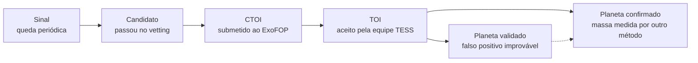

# B3. O telescópio TESS

<p class="meta">Nível básico · semana 4 · cerca de 4 horas</p>

!!! abstract "Nesta aula você vai aprender"
    - O que é o TESS, o que ele observa e por que divide o céu em setores de cerca de 27 dias.
    - O que são as câmeras, as cadências (20 s, 2 min, 200 s) e a zona de visão contínua.
    - Por que o pixel do TESS é grande (21 segundos de arco) e o problema que isso causa.
    - Onde ficam os dados (MAST) e o que são TIC e Tmag.
    - O que são TOI, CTOI e TFOPWG, e o caminho de um sinal até virar planeta confirmado.

## O que é o TESS

O **TESS** (*Transiting Exoplanet Survey Satellite*, satélite de busca de exoplanetas em trânsito) é um telescópio espacial da NASA, operado em parceria com o MIT, lançado em abril de 2018. A função dele é uma só: medir, com muita precisão e por semanas seguidas, o brilho de muitas estrelas, para achar trânsitos.

O antecessor, o telescópio Kepler, olhou fixamente para **uma** região pequena do céu por quatro anos. Achou milhares de planetas, mas a maioria ao redor de estrelas fracas e distantes, difíceis de estudar com outros telescópios. O TESS faz o oposto: observa **quase o céu inteiro**, priorizando estrelas brilhantes e próximas. Planetas de estrelas brilhantes são mais fáceis de confirmar e de estudar depois.

Os dados do TESS são **públicos**. Qualquer pessoa pode baixar e analisar. É isso que o PlanetHunter faz.

## Câmeras e setores

O TESS tem **quatro câmeras** idênticas, alinhadas lado a lado. Cada uma vê um quadrado de 24° × 24° do céu. Juntas, cobrem uma faixa de 24° × 96°, que vai de perto da **eclíptica** (o plano em que a Terra e os outros planetas orbitam o Sol) até o polo da eclíptica. Para ter ideia: 24° é cerca de 48 vezes o diâmetro da Lua cheia.

O telescópio fica parado olhando essa faixa por cerca de **27 dias**. Esse bloco de observação se chama **setor**. Depois ele gira e passa para a faixa vizinha, como os gomos de uma laranja.

```
              polo da eclíptica
                     *
                  /  |  \
               /     |     \       cada gomo = 1 setor (~27 dias)
            /   s3   |  s4    \    os gomos se sobrepõem perto do polo
         /     s2    |     s5   \
       /  s1         |        s6  \
      ---------------+-------------  eclíptica (plano das órbitas)
```

Por que 27 dias? A órbita do TESS ao redor da Terra é bem alongada e dura **13,7 dias**. Um setor são duas órbitas. A cada passagem perto da Terra, o telescópio envia os dados por rádio, o que causa uma **pausa curta no meio de cada setor**. Você vai ver essa lacuna nas curvas de luz.

Na missão principal (2018 a 2020), o TESS cobriu o hemisfério sul do céu no primeiro ano e o norte no segundo, 13 setores por ano. Depois disso vieram missões estendidas, que voltam às mesmas regiões. Em 2026 o TESS já passou de 100 setores e cobriu quase o céu inteiro várias vezes. Este curso usa como exemplo o **setor 69**, que o projeto analisou em detalhe.

## A zona de visão contínua

Repare no desenho: todos os gomos se encontram perto do **polo da eclíptica**. As estrelas a até cerca de 12° de cada polo caem em todos os setores daquele ano. Essa região se chama **zona de visão contínua** (CVZ, do inglês *continuous viewing zone*).

Estrelas na zona de visão contínua são observadas por quase um ano seguido em cada passagem. Isso permite achar planetas de período longo. No setor 69, o projeto mediu estrelas da zona de visão contínua do polo sul com **10 a 22 setores** de dados.

Há uma consequência útil, que aparece no vetting: se uma estrela tem 15 setores de dados e um sinal "novo" e profundo aparece em só um deles, quase certamente é um defeito daquele setor. Um planeta de verdade apareceria em todos.

## Cadências: de quanto em quanto tempo se mede

A **cadência** é o intervalo entre duas medidas de brilho seguidas. O TESS tira fotos continuamente, mas não envia tudo para a Terra: não há banda de rádio para isso. Então os dados chegam em produtos diferentes:

| Produto | Cadência | Quais estrelas |
|---|---|---|
| Curvas de luz de 20 segundos | 20 s | uma seleção pequena, de estrelas brilhantes ou de interesse especial (desde 2020) |
| Curvas de luz de 2 minutos | 2 min | cerca de 20 000 estrelas por setor, escolhidas antes da observação |
| Imagens completas (FFI) | 30 min (2018–2020), 10 min (2020–2022), **200 s** (desde 2022) | todas as estrelas no campo das câmeras |

As **FFI** (*full-frame images*, imagens do quadro inteiro) contêm milhões de estrelas, mas com cadência mais lenta e sem tratamento individual. As curvas de 2 minutos são as mais limpas e as que o PlanetHunter usa hoje. A busca em FFI, que alcança estrelas mais fracas, está no plano do projeto.

Cadência mais curta mostra melhor o formato do trânsito (entrada e saída). Cadência mais longa cobre mais estrelas. É uma troca.

## O pixel de 21 segundos de arco

Para medir tamanhos no céu, os astrônomos usam ângulos. Um grau tem 60 **minutos de arco** (′), e um minuto tem 60 **segundos de arco** (″). A Lua cheia mede cerca de meio grau, ou 1 800″.

Cada pixel das câmeras do TESS cobre **21″ × 21″** do céu. É um pixel enorme: telescópios em solo, com boa atmosfera, separam estrelas a cerca de 1″ uma da outra. O TESS foi projetado assim de propósito, para ver um campo gigantesco de uma vez.

A consequência é séria: **várias estrelas cabem no mesmo pixel**. A luz de uma estrela também se espalha por alguns pixels vizinhos. Então, quando o brilho medido "do alvo" cai, a queda pode ter vindo de **outra estrela** misturada na mesma região. Isso se chama **contaminação** ou **blend** (mistura). É uma das grandes fontes de falsos positivos, e você vai estudá-la na aula B4.

!!! info "Curiosidade"
    O TESS observa no vermelho e no infravermelho próximo (de 600 a 1 000 nanômetros). Isso favorece as anãs vermelhas, que brilham mais nessas cores. Como você viu na aula B2, estrelas pequenas são justamente as melhores para achar planetas pequenos.

## Onde ficam os dados: MAST, TIC e Tmag

Os dados do TESS ficam no **MAST** (*Mikulski Archive for Space Telescopes*), o arquivo público da NASA para telescópios espaciais. Lá estão as curvas de luz já processadas pela equipe da missão (o pipeline **SPOC**, para as curvas de 2 minutos) e por outros grupos (como o **QLP**, para as imagens completas).

Cada estrela tem um número no **TIC** (*TESS Input Catalog*), um catálogo com mais de 1,7 bilhão de objetos montado antes do lançamento. O número TIC é o "CPF" da estrela. Exemplo: **TIC 261136679** é a estrela Pi Mensae, que você vai analisar na aula B5. O TIC também guarda estimativas do raio, da massa e da temperatura de cada estrela, que o PlanetHunter usa para calcular o raio do planeta.

O brilho de cada estrela no TIC é dado em **Tmag**, a magnitude na "régua" do TESS. A escala de magnitudes é antiga e invertida:

- **Número menor = estrela mais brilhante.** Tmag 6 é muito brilhante; Tmag 13 é fraca.
- A escala é multiplicativa: **5 magnitudes = 100 vezes** em brilho. 1 magnitude ≈ 2,5 vezes.

Estrela mais brilhante significa mais luz chegando ao detector e, portanto, **menos ruído relativo**. Um trânsito de 300 ppm aparece bem numa estrela de Tmag 6 e se perde no ruído numa de Tmag 13.

O tempo nos arquivos do TESS é dado em **BTJD** (*Barycentric TESS Julian Date*): dias contados a partir de uma data de referência, corrigidos para o centro de massa do Sistema Solar. Na prática, é "dias desde o início da era TESS", com decimais. Todos os tempos do PlanetHunter estão em BTJD.

## Do sinal ao planeta confirmado

A equipe do TESS roda seus próprios pipelines em todos os dados. Quando um sinal passa nos testes deles e numa revisão humana, ele recebe um número **TOI** (*TESS Object of Interest*, objeto de interesse do TESS). Exemplo: TOI-144.01 é o sinal de Pi Men c. O ".01" indica o primeiro candidato daquela estrela.

Pessoas de fora da equipe (grupos de pesquisa, amadores, você no futuro) podem submeter seus próprios candidatos no **ExoFOP**, o portal de acompanhamento da missão. Esses viram **CTOI** (*Community TOI*). Um CTOI bom pode ser promovido a TOI.

Os TOIs são acompanhados pelo **TFOP** (programa de observações de acompanhamento do TESS), uma rede de astrônomos com telescópios em solo. O grupo de trabalho **TFOPWG** registra a situação de cada TOI:

| Código | Significa |
|---|---|
| PC | candidato a planeta (*planet candidate*) |
| APC | candidato ambíguo |
| CP | planeta confirmado a partir do TESS |
| KP | planeta já conhecido antes do TESS |
| FP | falso positivo (não é planeta) |
| FA | falso alarme (ruído ou defeito, não é sinal astrofísico) |

O caminho completo, com o vocabulário que este curso usa:



Um **planeta validado** é aquele em que uma análise estatística, junto com imagens de alta resolução feitas por outros telescópios, mostra que a chance de ser falso positivo é muito pequena. Um **planeta confirmado** tem evidência independente, em geral a massa medida por velocidade radial. Cada passo exige mais evidência, e os últimos exigem outros telescópios. Por isso o PlanetHunter **nunca** chama um candidato de "descoberta".

Em 2026, os catálogos que o PlanetHunter espelha têm cerca de 8 100 TOIs, 5 100 CTOIs e 6 400 planetas confirmados.

!!! tip "Na ferramenta"
    - **Ingestão:** `uv run planethunter ingest sector 69 --limit 2000` baixa curvas de 2 minutos do MAST e grava em Parquet, em pastas como `data/parquet/sector=0069/author=SPOC/`. O `author=SPOC` diz qual pipeline produziu a curva.
    - **TIC e Tmag:** a coluna `tmag` da lista de candidatos é o Tmag. Abaixo de 10 é brilhante, mais fácil de confirmar por outros telescópios. O dossiê mostra o TIC e um link direto para a página da estrela no ExoFOP.
    - **Pixel de 21″:** o crossmatch identifica a estrela pelo número TIC ou pela posição até **21″** (um pixel) e procura objetos conhecidos vizinhos até **120″**. Esses valores estão em `config/thresholds.yaml` (`host_radius_arcsec` e `nearby_radius_arcsec`).
    - **TOI e CTOI:** `uv run planethunter mirrors sync` baixa as listas de TOIs e CTOIs do ExoFOP, com a decisão do TFOPWG. Um sinal que casa com um TOI vira `KNOWN_TOI`; com um TOI marcado FP, vira `KNOWN_FP`.

!!! example "Exercício 1"
    A Lua cheia mede cerca de 1 800″ de diâmetro. Quantos pixels do TESS ela ocuparia, de ponta a ponta? E quantos pixels cabem no raio de 120″ que o crossmatch usa para procurar vizinhos?

    ??? success "Ver resposta"
        Lua: $1\,800 / 21 \approx 86$ pixels de diâmetro. Toda a Lua cheia caberia num quadrado de cerca de 86 × 86 pixels, ou seja, em pouco mais de 7 000 pixels.

        Vizinhos: $120 / 21 \approx 5{,}7$ pixels de raio. O PlanetHunter procura objetos conhecidos num círculo de quase 6 pixels ao redor do alvo, porque a luz de uma estrela se espalha por vários pixels e um vizinho a alguns pixels de distância ainda pode contaminar a medida.

!!! example "Exercício 2"
    Quantas vezes uma estrela de Tmag 6 é mais brilhante que uma de Tmag 13? Por que isso importa para achar planetas?

    ??? success "Ver resposta"
        A diferença é de 7 magnitudes. Cada 5 magnitudes são 100 vezes. Cada magnitude é cerca de 2,512 vezes.

        $$ 2{,}512^{7} \approx 630 $$

        Outra forma: 5 magnitudes dão 100×, e as 2 restantes dão $2{,}512^2 \approx 6{,}3$×. Então $100 \times 6{,}3 = 630$.

        A estrela de Tmag 6 é cerca de **630 vezes mais brilhante**. Mais luz significa menos ruído relativo em cada medida, então trânsitos rasos ficam visíveis. Além disso, planetas de estrelas brilhantes são muito mais fáceis de confirmar com velocidade radial.

!!! example "Exercício 3"
    Classifique cada caso na escala sinal → candidato → CTOI → TOI → validado → confirmado.

    1. O PlanetHunter achou uma queda periódica, mas ela ainda não passou pelo vetting.
    2. Um grupo submeteu ao ExoFOP um candidato achado por eles nos dados do TESS.
    3. Um TOI teve a massa medida por velocidade radial num telescópio no Chile.
    4. Um TOI com situação "PC" no TFOPWG.

    ??? success "Ver resposta"
        1. **Sinal.** Ainda não passou por nenhum teste de falso positivo.
        2. **CTOI.** Foi submetido pela comunidade; pode virar TOI se a equipe aceitar.
        3. **Planeta confirmado.** A massa medida por outro método é evidência independente.
        4. **TOI** com situação de candidato a planeta. Ainda não é planeta validado nem confirmado.

## Checklist da aula

- [ ] Sei o que é o TESS e em que ele difere do Kepler.
- [ ] Sei o que é um setor (~27 dias, duas órbitas de 13,7 dias) e por que há uma lacuna no meio.
- [ ] Sei o que são as quatro câmeras e a faixa de 24° × 96°.
- [ ] Sei o que é a zona de visão contínua e por que ela tem muitos setores de dados.
- [ ] Sei a diferença entre curvas de 20 s, 2 min e imagens completas (FFI, 200 s).
- [ ] Sei explicar o pixel de 21″ e por que ele mistura a luz de várias estrelas.
- [ ] Sei o que são MAST, TIC, Tmag e BTJD.
- [ ] Sei o que são TOI, CTOI, TFOPWG e o caminho até planeta confirmado.
- [ ] Fiz os três exercícios sem olhar a resposta.

## Para ir além

- Ricker et al. (2015), "Transiting Exoplanet Survey Satellite (TESS)", *Journal of Astronomical Telescopes, Instruments, and Systems* 1, 014003. A descrição oficial da missão. Leia o resumo e veja as figuras do campo de visão e da estratégia de setores.
- Página da missão TESS no site da NASA (nasa.gov) e o guia do TESS no HEASARC (heasarc.gsfc.nasa.gov). Explicam setores, câmeras, cadências e produtos de dados.
- Stassun et al. (2019), "The Revised TESS Input Catalog and Candidate Target List", *The Astronomical Journal* 158, 138. Como o TIC foi montado e de onde vêm o raio e a massa das estrelas. Basta a introdução.
- Guerrero et al. (2021), "The TESS Objects of Interest Catalog from the TESS Prime Mission", *The Astrophysical Journal Supplement Series* 254, 39. Como a equipe do TESS cria e acompanha os TOIs. Volte a ele no nível avançado.
- [ExoFOP-TESS](https://exofop.ipac.caltech.edu/tess/). Abra e procure "261136679" para ver a página de Pi Mensae, com os TOIs e as notas da comunidade.
