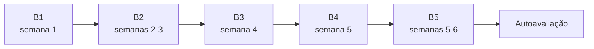

# Nível básico: entender o que estamos procurando

Nível básico · cerca de 6 semanas · 4 a 6 horas por semana

Este é o ponto de partida. Você não precisa saber nada de astronomia, física ou programação. O objetivo é construir **intuição**: ao final, olhar uma curva de luz não deve parecer um rabisco, e a frase "o sinal tem 300 ppm e período de 6,27 dias" deve fazer sentido imediato.

!!! abstract "Ao final do nível básico você vai conseguir"
    - Explicar o que é uma estrela, o que é um exoplaneta e como se acham planetas que ninguém consegue ver.
    - Explicar o método de trânsito e calcular, com papel e caneta, quanto a luz de uma estrela cai quando um planeta passa na frente dela.
    - Dizer o que o telescópio TESS observa, por que ele divide o céu em setores e por que o pixel grande dele causa problemas.
    - Reconhecer as principais imitações de planeta: binárias eclipsantes, estrelas vizinhas e defeitos do telescópio.
    - Rodar o PlanetHunter num planeta conhecido, abrir o dossiê gerado e achar nele o período, a profundidade e os trânsitos.

## As aulas

| Aula | Semana | Em uma frase |
|---|---|---|
| [B1. Céu, estrelas e planetas](b1-sky-stars-planets.md) | 1 | O que são estrelas e exoplanetas, as unidades que a área usa e os quatro métodos para achar planetas. |
| [B2. O método de trânsito](b2-transit-method.md) | 2–3 | Por que a luz cai quando um planeta passa na frente da estrela, e quanto ela cai. |
| [B3. O telescópio TESS](b3-tess-telescope.md) | 4 | Como o TESS observa o céu, onde ficam os dados e quem decide o que vira planeta. |
| [B4. Por que quase todo sinal é falso](b4-false-positives.md) | 5 | As imitações de planeta mais comuns e três histórias reais do setor 69. |
| [B5. Prática com olhos humanos](b5-human-eye-practice.md) | 5–6 | Treinar o olho no Planet Hunters TESS e ler, passo a passo, o dossiê de Pi Men c. |
| [Autoavaliação](assessment.md) | 6 | Dez perguntas para saber se você está pronto para o nível médio. |

## Quanto tempo leva

O plano assume **4 a 6 horas por semana**, durante cerca de **6 semanas**. Cada aula leva de 3 a 5 horas, contando leitura, exercícios e a parte prática. Se você tiver menos tempo, vá mais devagar: o ritmo importa menos que a constância.

!!! note "E a programação?"
    No nível básico, a [trilha de programação](../programming/index.md) é opcional. Se tiver fôlego, faça a aula P1 (Python básico) em paralelo. A partir do nível médio ela passa a ser necessária.

## O que você vai precisar

- Papel, caneta e uma calculadora (a do celular serve).
- Um navegador, para o [simulador de trânsito](../lab/transit-simulator.md) e para o Planet Hunters TESS.
- Para a aula B5: o PlanetHunter instalado (`uv sync` na pasta do projeto) e conexão com a internet para baixar os dados do TESS. O passo a passo está na aula e no [manual prático](../lab/using-planethunter.md).

!!! warning "Uma regra de vocabulário desde o primeiro dia"
    Neste curso, e no PlanetHunter, nada é chamado de "descoberta". Um sinal vira **candidato**, depois pode virar **CTOI**, **TOI**, **planeta validado** e, por fim, **planeta confirmado**. Cada passo exige mais evidência. Você vai entender por que na aula B3.

## Como saber que terminou

Você terminou o nível básico quando:

1. Marcou todos os itens das checklists das aulas B1 a B5.
2. Fez a [autoavaliação](assessment.md) **sem consultar** e acertou pelo menos **5 das 6 perguntas principais**.

Se errar mais de uma, volte às aulas indicadas nas respostas e tente de novo depois de alguns dias. Quando passar, siga para o [nível médio](../intermediate/index.md).

Termos novos aparecem no [glossário](../glossary.md).
