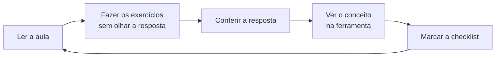

# Como estudar neste curso

5 minutos de leitura

## Ritmo

- **4 a 6 horas por semana** é o ritmo para o qual os prazos foram pensados. Mais devagar também funciona: o importante é constância.
- Prefira **sessões curtas e frequentes** (40–60 minutos, 4–5 vezes por semana) a uma maratona no fim de semana.

## O ciclo de cada aula

1. **Ler** com calma. Termos novos estão no [glossário](glossary.md).
2. **Exercícios**: tente resolver antes de abrir "Ver resposta". Errar e entender por quê ensina mais que acertar de primeira.
3. **Na ferramenta**: cada aula tem uma caixa dizendo onde o conceito aparece no PlanetHunter. Abra e veja com seus olhos.
4. **Checklist**: marque o que concluiu. O progresso aparece na [página inicial](index.md).

## Trilhas em paralelo

| Semana | Ciência | Programação |
|---|---|---|
| 1–6 | Nível básico (B1–B5) | P1. Python básico (opcional, mas recomendado) |
| 7–16 | Nível médio (M1–M5) | P2 antes de M4; P3 junto de M4 |
| 17 em diante | Nível avançado (A1–A6) | Usar o código do PlanetHunter |

## Como saber que pode avançar

Cada nível termina com uma **autoavaliação**. Responda sem consultar. Se acertar o mínimo indicado, siga em frente. Se não, volte às aulas das perguntas que errou.

## Dicas

- **Caderno de revisões.** Anote cada candidato que você revisar: o que viu, o que decidiu e por quê.
- **Desconfie de sinais bonitos demais.** A história mais importante do projeto é a de sinais perfeitos que eram falsos.
- **Pratique o olho.** O projeto [Planet Hunters TESS](https://www.zooniverse.org/projects/nora-dot-eisner/planet-hunters-tess) no Zooniverse é o melhor treino para reconhecer trânsitos em curvas reais.
- **Não leia artigos científicos de ponta a ponta no começo.** Resumo, figuras e conclusão primeiro.
