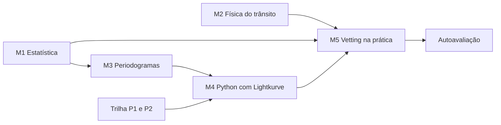

# Nível médio: entender como a ferramenta decide

Nível médio · cerca de 10 semanas · 4 a 6 horas por semana

No nível básico você aprendeu a reconhecer um trânsito, sabe o que é o TESS e por que uma binária eclipsante engana. Agora a pergunta muda. Não é mais "o que estamos procurando?", e sim "**como o PlanetHunter decide** se um sinal merece atenção?".

Cada decisão da ferramenta é um número comparado com um limite. SNR maior que 7,1. SDE maior que 9. Duração entre 0,15 e 1,67 vezes a prevista. Formato em V abaixo de 0,35. Neste nível você vai entender de onde vem cada número, o que ele mede e quando ele erra. No fim, vai revisar candidatos com critério próprio, sem depender do score.

!!! abstract "Ao final do nível médio você consegue"
    - Explicar SNR, SDE, sigma, ruído vermelho e qui-quadrado com suas palavras e com uma conta.
    - Prever a duração de um trânsito a partir do período e da estrela, e dizer quando uma duração é suspeita.
    - Ler um periodograma, reconhecer aliases e dizer por que a janela de detrending importa.
    - Baixar, limpar, dobrar e buscar um planeta conhecido em Python com Lightkurve.
    - Explicar cada teste do vetting básico, calcular o score e revisar candidatos com `planethunter review`.

## As aulas

| Aula | Semanas | Em uma frase |
|---|---|---|
| [M1. Estatística para sinais](m1-statistics-for-signals.md) | 1–3 | Média, mediana, sigma, SNR, ruído vermelho e qui-quadrado: a matemática que separa sinal de acaso. |
| [M2. Física do trânsito](m2-transit-physics.md) | 3–5 | Kepler, densidade estelar, duração, parâmetro de impacto, escurecimento de borda e eclipse secundário: a física por trás de cinco testes do vetting. |
| [M3. Periodogramas](m3-periodograms.md) | 5–6 | Como o BLS e o TLS acham um período, o que é SDE, por que aparecem aliases e por que a janela de detrending muda tudo. |
| [M4. Dados do TESS em Python](m4-tess-data-in-python.md) | 6–8 | Aula prática: você mesmo encontra Pi Men c com Lightkurve e compara com o resultado do PlanetHunter. |
| [M5. Vetting na prática](m5-vetting-in-practice.md) | 8–10 | Cada teste do vetting com um caso real, o cálculo do score, a validação medida e o roteiro de revisão de candidatos. |
| [Autoavaliação](assessment.md) | 10 | Seis perguntas do plano e quatro extras, com respostas comentadas. |

A ordem importa. M1 dá a linguagem estatística que M3 e M5 usam. M2 explica a física dos testes `duration`, `shape` e `secondary`. M4 depende de M3 (você vai rodar um periodograma) e da trilha de programação.

## Pré-requisitos

**Ciência.** O [nível básico](../basic/index.md) completo, com pelo menos 5 de 6 na [autoavaliação do básico](../basic/assessment.md). Você precisa estar à vontade com:

- profundidade de trânsito $\delta \approx (R_p/R_\star)^2$ e a unidade ppm;
- período, duração e o que é um setor do TESS;
- a diferença visual entre trânsito de planeta e eclipse de binária;
- o vocabulário sinal, candidato, CTOI, TOI, planeta validado, planeta confirmado.

**Programação.** A partir deste nível a trilha de programação deixa de ser opcional. Antes da aula M4, termine:

- [P1. Python básico](../programming/p1-python-basics.md): variáveis, listas, laços, funções.
- [P2. NumPy, pandas e Matplotlib](../programming/p2-numpy-pandas-matplotlib.md): arrays, tabelas e gráficos.

Veja a [página da trilha de programação](../programming/index.md) para o ritmo sugerido. Você pode fazer P1 e P2 em paralelo com M1 a M3.

**Ferramenta.** O PlanetHunter instalado e funcionando (`uv sync` na pasta do projeto). Se ainda não instalou, siga [Usando o PlanetHunter](../lab/using-planethunter.md).

**Matemática.** Frações, potências, raiz quadrada e raiz cúbica. Uma calculadora científica (ou o próprio Python) resolve o resto. Não há cálculo diferencial neste nível.

## Ritmo sugerido

| Semana | Ciência | Programação | Prática na ferramenta |
|---|---|---|---|
| 1–2 | M1: média a SNR | P1 | Ler as colunas `sde` e `snr` de `planethunter candidates` |
| 3 | M1: ruído vermelho, qui-quadrado; início de M2 | P1 | Achar um sinal reprovado em `consistency` |
| 4–5 | M2 | P2 | Calcular a duração prevista de 3 sinais e comparar com o dossiê |
| 6 | M3 | P2 | Achar no dossiê o "Applied alias factor" (fator de alias aplicado) e a janela de detrending |
| 7–8 | M4 | P3 (opcional) | Reproduzir Pi Men c e comparar com o dossiê |
| 9–10 | M5 e autoavaliação | — | Revisar 10 candidatos com `planethunter review` |

Se uma semana render menos, tudo bem. Melhor atrasar do que pular a parte de exercícios.

## Como saber que terminou

Você terminou o nível médio quando:

- [ ] marcou o checklist de todas as cinco aulas;
- [ ] resolveu pelo menos dois exercícios de cada aula sem olhar a resposta antes;
- [ ] reproduziu a detecção de Pi Men c em Python e escreveu, em poucas linhas, as diferenças em relação ao dossiê do PlanetHunter;
- [ ] revisou pelo menos 10 candidatos com `planethunter review`, cada um com motivo e nota;
- [ ] comparou 5 dossiês `KNOWN_PLANET` com 5 dossiês `KNOWN_FP` e anotou o que os distingue;
- [ ] acertou pelo menos 5 das 6 perguntas principais da [autoavaliação](assessment.md).

!!! tip "Na ferramenta"
    A regra de ouro do plano vale ainda mais aqui: sempre que aprender um conceito, procure-o num dossiê real em `data/dossiers/`. Cada aula tem uma caixa como esta dizendo onde o conceito aparece no PlanetHunter: comando, coluna, gráfico do dossiê ou teste do vetting.

!!! note "Um caderno de revisões"
    Abra agora um caderno (papel ou arquivo de texto). Para cada sinal que você olhar neste nível, anote: número do sinal, estrela, o que viu em cada gráfico e o que decidiu. Em dez semanas esse caderno vai ser seu material de estudo mais valioso.

## Curso complementar (opcional)

Se quiser outra voz explicando os mesmos temas, os cursos *Super-Earths and Life* (Harvard, plataforma edX) e *Astrobiology and the Search for Extraterrestrial Life* (Universidade de Edimburgo, Coursera) têm módulos sobre detecção de exoplanetas em linguagem acessível.

Pronto para começar? Vá para a [aula M1](m1-statistics-for-signals.md).
