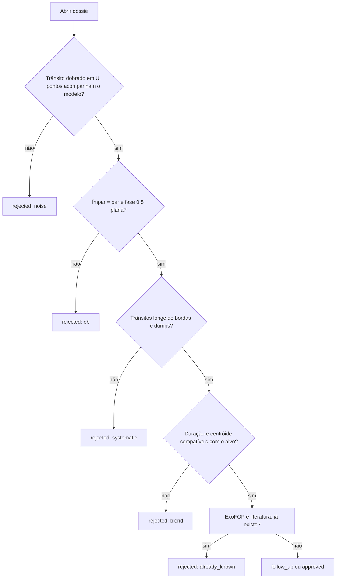

# M5. Vetting na prática

<p class="meta">Nível médio · semanas 8–10 · cerca de 12 horas</p>

!!! abstract "Nesta aula você vai aprender"
    - A pergunta que cada teste do vetting básico responde, o que ele pega, o limite e um caso real.
    - Como o veredito sai dos vetos, das falhas graves e das falhas leves, como o score é calculado a partir dos pesos, e o que significam P1 e P2.
    - Como ler a tabela de validação: quantos planetas reais e quantos falsos positivos passam.
    - Um roteiro para revisar candidatos com `planethunter candidates`, `dossier` e `review`.
    - Como comparar dossiês de planetas conhecidos e de falsos positivos conhecidos.

## A ideia: tentar derrubar o sinal

O vetting não tenta provar que um sinal é planeta. Tenta **derrubá-lo**. Cada teste é uma pergunta que um falso positivo comum responderia errado. Um sinal que sobrevive a todas as perguntas não é um planeta confirmado; é só um sinal que não conseguimos derrubar com os dados disponíveis.

O vetting básico roda sem internet, só com a curva de luz, os centróides do arquivo SPOC e os parâmetros da estrela. Está em `src/planethunter/vetting/basic.py`. Testes que precisam de rede (imagem-diferença no TPF, vizinhos Gaia, outros setores, FPP) ficam no vetting aprofundado, assunto do nível avançado.

Cada teste devolve um de três resultados:

- **passa**;
- **falha**: multiplica o score por um peso entre 0,3 e 0,6; alguns testes **vetam** acima de um limite mais duro, e veto zera o score;
- **sem dados**: multiplica o score por 0,95 (`unknown_weight`). Não é uma falha.

Uma falha que não é veto vem em dois tipos. Uma **falha grave** decide sozinha: `shape` e `secondary_scan` aqui, `tpf_difference_image` e `fpp_triceratops` no vetting aprofundado (`hard_fail_tests`). Qualquer outra falha é uma **falha leve**: uma é tolerada, duas não. A seção "O veredito e o score" junta tudo.

## Os testes, um por um

A tabela resume. Os casos reais são do run final de calibração do setor 69 (`20261009T203437Z-single-s69`), salvo indicação.

| Teste | Pergunta | Pega o quê | Limite | Veto? | Peso |
|---|---|---|---|---|---|
| `sde`, `snr` | O sinal é forte o bastante? | Ruído | SDE ≥ 9; SNR ≥ 7,1 | Sim | — |
| `snr_pink` | Continua forte quando o ruído vermelho é contado? | Ruído vermelho imitando trânsito | S/N_pink ≥ 9 | Não (leve) | 0,5 |
| `n_transits` | Vimos pelo menos 2 trânsitos? | Evento único sem período | ≥ 2, cada um com ≥ 50 % coberto por dados | Sim | — |
| `independence` | Sobrevive se apagarmos os sinais mais fortes da estrela? | Eco de outro sinal | ≥ 50 % dos pontos restam | Sim | — |
| `odd_even` | Ímpares e pares têm a mesma profundidade? | Binária com período 2× | falha 3σ | ≥ 5σ | 0,4 |
| `secondary` | Há queda em fase 0,5? | Eclipse secundário | falha 3σ | ≥ 5σ **e** ≥ 10 % | 0,4 |
| `secondary_scan` | Há queda em outra fase? | Binária excêntrica | falha 5σ | Não (**grave**) | 0,5 |
| `shape` | Fundo chato (U) ou pontudo (V)? | Binária rasante | τ/T14 ≤ 0,35; Rp/R* ≤ 0,3 | Não (**grave**) | 0,5 |
| `kdr25_grazing` | O trânsito só raspa a borda da estrela? | Binária rasante | k + b ≤ 1,04 | Não (leve) | 0,6 |
| `radius` | O tamanho é de planeta? | Estrela | falha > 22,4 R⊕ | > 33,6 R⊕, só com estrela confiável **e** outro sinal de binária | 0,3 |
| `duration` | A duração bate com a estrela? | Blend; rasante extremo | razão 0,15 a 1,67 | Não (leve) | 0,6 |
| `centroid` | A luz se desloca durante o trânsito? | Vizinha como fonte | ≥ 3σ **e** fonte > 1 px | Não (leve) | 0,4 |
| `edges_dumps` | Trânsitos em bordas ou ajustes do telescópio? | Sistemático | ≤ 50 % | Não (leve) | 0,4 |
| `consistency` | Os trânsitos concordam entre si? | Um evento dominando | p ≥ 0,001; maior < 80 % do SNR² | Não (leve) | 0,5 |

### Portões de detecção: `sde`, `snr`, `n_transits`

**Pergunta:** há sinal suficiente para falar de período? Os limites vêm das aulas [M1](m1-statistics-for-signals.md) e [M3](m3-periodograms.md).

No começo eram falhas leves. O efeito medido: sinais com SNR 4,9 e sinais com um só trânsito viravam P2 e iam para a fila de revisão. Hoje são veto.

**Casos reais.** Planetas confirmados também caem aqui quando o setor é fraco: o TOI-286.01 teve SNR 5,6 no setor 69. Dos 4 planetas reprovados na calibração por SNR, nenhum seria detectável como novo naquele setor. E GJ 143 b, com período de cerca de 35 dias, aparece com **um** trânsito no setor 69: sem segundo trânsito, não há período, e o sinal é vetado.

Um trânsito só conta em `n_transits` se pelo menos metade do tempo esperado dele tem dados. Uma queda que cai quase toda numa lacuna não é um trânsito que você viu.

### `snr_pink`

**Pergunta:** o sinal continua forte quando o **ruído vermelho** é contado? Usa o S/N_pink da aula [M1](m1-statistics-for-signals.md), com o ruído medido em blocos do tamanho do trânsito.

**Por que existe.** Uma estrela com oscilações lentas, mal removidas pelo achatamento, deixa quedas periódicas reais que duram horas. Elas chegam a SDE 8 a 10, e o SDE e o SNR não conseguem rejeitá-las: os dois supõem ruído branco. O S/N_pink delas fica abaixo de 9. O pipeline de visão rápida do TESS (QLP) usa S/N_pink ≥ 9 como limite de detecção (Guerrero et al. 2021).

**Calibração.** Como veto, este teste tiraria cerca de 10 % dos planetas confirmados que hoje passam, então por enquanto ele é uma falha leve (`snr_pink_veto: false`). Em execuções feitas antes de a coluna existir, o valor fica vazio e o teste dá "sem dados", sem penalidade.

### `independence`

**Pergunta:** este sinal é independente dos mais fortes da mesma estrela? O teste mascara os trânsitos dos outros sinais e mede quanto do trânsito deste sobra. Se sobrar menos de 50 %, é eco.

**Caso real.** Na primeira fatia do setor 69, o sinal 1601 (11,95 d) estava reaproveitando os eclipses do sinal 1600 (6,75 d), da mesma estrela. Vetado.

### `odd_even`

**Pergunta:** os trânsitos ímpares e pares têm a mesma profundidade? Uma binária de estrelas diferentes, encontrada com metade do período verdadeiro, alterna eclipses fundos e rasos. O erro usa o ruído em blocos (aula M1).

**Casos reais.** TOI-343.01 (falso positivo): ímpar 2 294 ppm, par 4 583 ppm, 5,8σ, **veto**. TOI-2391.01: 6 019 contra 12 749 ppm, veto.

**Armadilha.** O planeta confirmado TOI-114.01 também foi vetado: 6 690 contra 5 911 ppm, 5,7σ. É o único planeta perdido por ímpar/par na calibração. Com SNR alto, pequenas diferenças (manchas, resíduos de detrending) ficam significativas.

### `secondary` e `secondary_scan`

**Pergunta:** existe uma queda menor em fase 0,5 (ou em outra fase)? Física na aula [M2](m2-transit-physics.md).

**Casos reais.** TOI-287.01: 4 503 ppm em fase 0,5, 37 % do primário, veto. WASP-18 b: 276 ppm, 3 % do primário, 8σ: **falha leve sem veto**, graças à regra dos 10 %. O `secondary_scan` foi criado porque a binária excêntrica TOI-367.01 passava; ele também dá falsos alarmes, como no planeta TOI-329 b (5,3σ em fase 0,543), por isso nunca veta. Desde 2026-10-10 ele é uma **falha grave**: uma queda de 5σ em outra fase reprova o sinal sozinha. Medido nos setores 69 e 107, isso eliminou muitos sinais `NEW` e alguns falsos positivos conhecidos, quase sem custo em planetas confirmados.

**Período pela metade.** E se o "secundário" for tão fundo quanto o primário? O TOI-187.01 tinha uma queda em fase 0,5 com 108 % do primário e foi vetado como binária de dois eclipses iguais. Mas a auditoria achou planetas reais vetados do mesmo jeito: o TOI-431 b e outros cinco TOIs tinham sido achados com o **dobro** do período verdadeiro, e o trânsito do meio aparecia em fase 0,5 como um "secundário" perfeito. A regra agora: se a queda em fase 0,5 tem a profundidade do primário (menos de 3σ de diferença) e a duração dele (até 35 % de diferença), o sinal é testado de novo com **P/2**, e o resultado leva a marca `period_halved`. Uma binária de dois eclipses iguais também é testada de novo com P/2; no novo período, os outros testes precisam pegá-la.

### `shape`

**Pergunta:** o trânsito tem forma de U ou de V? Mede $\tau/T_{14}$ num ajuste de trapézio.

**Calibração.** Limite 0,35: pega 8 de 18 falsos positivos e marca 3 de 50 planetas (rasantes reais: HIP 65 A b, LTT 9779 b, TOI-2382 b). **Casos:** TOI-297.01 (0,42), TOI-353.01 (0,45), TOI-4858.01 (0,41, e com $R_p/R_\star$ = 0,25).

**Falha grave.** Um formato em V agora reprova o sinal sozinho. A configuração diz o preço no comentário: cerca de 3 Júpiteres quentes rasantes por setor (como NGTS-6 Ab e NGTS-10 b) se perdem, e 4 a 9 binárias detectadas com metade do período são barradas. Tirar `shape` de `hard_fail_tests` favorece a completude.

### `kdr25_grazing`

**Pergunta:** o trânsito só **raspa** a borda da estrela? O trapézio é uma forma grosseira. O projeto também ajusta um modelo físico de trânsito (a biblioteca batman, Kreidberg 2015) com escurecimento de borda da banda do TESS, e obtém dois números: $k = R_p/R_\star$ e o parâmetro de impacto $b$. Se $k + b > 1{,}04$, o disco do planeta fica em parte fora da estrela durante todo o trânsito: é rasante. O limite vem do catálogo DR25 do Kepler (Thompson et al. 2018).

**Calibração.** Reprova 7 de 140 planetas confirmados com ajuste bem determinado, todos rasantes que já falham em `shape` (LTT 9779 b, HIP 65 A b, NGTS-10 b, TOI-263 b e outros), e cerca de metade dos falsos positivos conhecidos. Falha leve, peso 0,6. Quando o ajuste bate no limite da faixa permitida, o teste dá "sem dados", sem penalidade.

### `radius`

**Pergunta:** o objeto tem tamanho de planeta? $R_p = k \times R_\star$, com $k$ do ajuste físico quando o trânsito não é rasante (senão, $k = \sqrt{\delta}$). O ajuste físico importa: $\sqrt{\delta}$ ignora o escurecimento de borda e superestima o raio em cerca de 3 %. Falha acima de 2 raios de Júpiter (22,4 R⊕). Veta acima de 3 (33,6 R⊕), mas só se o raio da estrela for confiável (gravidade superficial $\log g \geq 3{,}5$, ou seja, não é gigante) **e** houver outro sinal de binária (formato em V, ímpar/par ou secundário). Mullally et al. (2015) não acharam nenhum falso positivo identificado só pelo raio inferido. Depende do raio da estrela no TIC: raio errado, raio errado do planeta.

**Casos reais.** TOI-147.01: 26,2 R⊕, falha. TOI-219.01: 33,3 R⊕, falha por pouco sem veto. TOI-353.01: 29,4 R⊕.

### `duration`

**Pergunta:** a duração combina com o tamanho e a massa da estrela? Física e fórmula na aula M2.

**Casos reais.** Curto demais: sinal 1594, 0,58 h numa gigante com 10,7 h previstas (razão 0,05). Longo demais: TOI-724.01, 8,40 h contra 3,56 h (razão 2,4). O limite superior é 1,67 (a aula M2 explica por quê). Quando o ajuste de trapézio bate no limite das durações permitidas, o teste dá "sem dados": a duração não foi medida de verdade.

### `centroid`

**Pergunta:** o "centro de luz" da imagem se desloca durante o trânsito? Se a queda vier de uma vizinha, o centróide se move na direção oposta a ela.

O truque é a **distância implícita da fonte**. Se uma fonte a uma distância $D$ do centróide escurece com profundidade relativa $\delta$, o centróide se desloca cerca de $\delta \times D$. Então $D \approx$ deslocamento / profundidade.

**Calibração medida.** A primeira versão reprovava qualquer deslocamento acima de 3σ. Resultado: **11 de 41 planetas confirmados** reprovavam. Todos tinham fonte implícita a no máximo 0,88 pixel, ou seja, em cima do alvo. Com estrelas brilhantes e muitos trânsitos, até um deslocamento minúsculo vira "significativo". Regra atual: falha só se o deslocamento for maior que 3σ **e** a fonte implícita estiver a mais de 1 pixel (21″).

**Caso real.** TOI-854.01 (falso positivo): deslocamento de 12σ, fonte implícita a 2,0 pixels. Falha.

**Três refinamentos (2026-10-10).**

- **Erro empírico.** O teste também mede o "deslocamento" em 200 épocas falsas fora dos trânsitos; a dispersão delas é o erro real de uma época. Com o erro antigo, que supunha ruído branco, épocas aleatórias "falhavam" de 2 % a 47 % das vezes, quando o esperado era 1 %.
- **Profundidade diluída.** O centróide vem de toda a luz da abertura, mas a profundidade do PDCSAP é corrigida da contaminação. Por isso a profundidade usada é CROWDSAP × δ, a profundidade dentro da abertura: $D \approx$ deslocamento / (CROWDSAP × δ).
- **Quando não dá para decidir.** Estrelas saturadas (Tmag < 7) e setores com menos de 3 trânsitos dão "sem dados" (Kostov et al. 2019).

### `edges_dumps`

**Pergunta:** os trânsitos caem colados em bordas de segmento ou em ajustes de apontamento (*momentum dumps*)? Falha se mais de 50 % caírem perto de um ou de outro (aula M3).

**Casos reais.** Vários sinais `NEW` de 11 a 12 dias com 100 % dos trânsitos em bordas de segmento: eventos de borda de órbita. O planeta TOI-481 b também falhou (67 % em bordas): é falha leve porque planetas reais às vezes têm azar.

### `consistency`

**Pergunta:** todos os trânsitos têm profundidade parecida? Qui-quadrado com erro em blocos (aula M1).

**Casos reais.** TOI-343.01 (falso positivo): p = 6 × 10⁻⁷. Planetas de SNR muito alto também falham (WASP-97 b, WASP-18 b), por isso é falha leve.

## O veredito e o score

O **veredito** vem primeiro. Um sinal **reprova** (`FAIL`) se tiver:

- qualquer veto; ou
- qualquer falha grave (`shape`, `secondary_scan` e, no vetting aprofundado, `tpf_difference_image` e `fpp_triceratops`); ou
- mais de uma falha leve (`max_soft_fails: 1`).

Caso contrário, ele é **aprovado no básico** (`PASS_BASIC`). Testes "sem dados" não contam como falhas.

O **score** começa em 1,0. Para cada teste:

- falhou sem veto: multiplica pelo peso do teste (tabela acima, de `config/thresholds.yaml`);
- sem dados: multiplica por 0,95;
- vetou: o score vira 0.

O score não decide mais aprovação ou reprovação. Ele **ordena** os sinais, e a severidade o usa. Antes de 2026-10-10 a regra era "aprovado se o score for pelo menos 0,5", então uma única falha de peso baixo muitas vezes bastava para reprovar um sinal; cinco planetas confirmados reprovavam por causa de um único teste leve.

Para sinais `NEW` aprovados, a severidade segue: **P1** exige score ≥ 0,8 (e, quando o modelo calibrado existe, um `p_rank` alto o bastante; aula [A4](../advanced/a4-machine-learning.md)); senão, **P2**. Uma estrela que é binária eclipsante catalogada, ou sem raio conhecido, também limita o sinal a P2. P0 exige ainda o vetting aprofundado (aula [A3](../advanced/a3-false-positive-probability.md)).

Três exemplos reais:

| Sinal | Falhas | Conta | Score | Resultado |
|---|---|---|---|---|
| Pi Men c (setor 1) | nenhuma | 1,0 | 1,0 | PASS_BASIC |
| WASP-18 b (setor 69) | `secondary`, `consistency` | 0,4 × 0,5 | 0,2 | FAIL: duas falhas leves |
| Sinal 1594, regras atuais | `duration` | 0,6 | 0,6 | PASS_BASIC (uma falha leve), mas no máximo P2 |

!!! warning "O score não é uma probabilidade"
    Score 1,0 diz que nenhum teste automático encontrou problema. Não diz que é planeta. E WASP-18 b, um planeta confirmado, tem score 0,2. O score é uma **ordenação** útil para decidir o que olhar primeiro.

!!! example "Exercício 1"
    Calcule o score e o resultado:

    a) Falha em `duration`; todos os outros passam.
    b) Falha em `duration`; `centroid` sem dados; o resto passa.
    c) Falha em `odd_even` com 4,2σ e em `edges_dumps`.
    d) Falha em `shape`; todos os outros passam.
    e) Tudo passa, mas `odd_even` deu 5,3σ.

    ??? success "Ver resposta"
        a) Score **0,6**. Uma falha leve: **PASS_BASIC**. Se for `NEW`, P2 (o score está abaixo de 0,8).

        b) 0,6 × 0,95 = **0,57**. Continua **PASS_BASIC**: "sem dados" não é falha, só reduz o score. P2 se for `NEW`.

        c) 0,4 × 0,4 = **0,16**. **FAIL**: duas falhas leves. 4,2σ é falha (≥ 3σ), mas não veto (< 5σ).

        d) Score **0,5**, mas **FAIL**: `shape` é uma falha grave. O score é o mesmo de um sinal com uma falha leve; o veredito, não.

        e) **0**. Veto: 5,3σ passa do limite de 5σ do `odd_even`. Nenhuma combinação de outros testes salva um veto.

## A validação: o vetting funciona?

Como saber se os pesos e limites fazem sentido? Rodando o vetting em sinais de **resposta conhecida**: planetas confirmados (`KNOWN_PLANET`) e falsos positivos já classificados (`KNOWN_FP`).

**Setor 69, calibração** (194 alvos escolhidos: TOIs da lista de recall mais 30 falsos positivos do TFOPWG):

| Classe | Sinais | Aprovados | Taxa |
|---|---|---|---|
| KNOWN_PLANET | 54 | 44 | 81 % |
| KNOWN_TOI | 74 | 61 | 82 % |
| KNOWN_FP | 18 | 8 | 44 % |
| NEW | 10 | 0 | 0 % |

**Setor 107, setor inteiro** (12 998 estrelas, 4 431 sinais; run `20261009T221706Z-single-s107`, tabela impressa por `planethunter vet`):

| Classe | Sinais | Aprovados | Taxa |
|---|---|---|---|
| KNOWN_PLANET | 84 | 66 | 79 % |
| KNOWN_TOI | 104 | 77 | 74 % |
| KNOWN_FP | 132 | 7 | 5 % |
| NEW | 1 339 | 62 | 5 % |

O guia do projeto resume as calibrações do setor 69 assim: **planetas confirmados passam de 77 % a 84 %**, e **falsos positivos de 11 % a 44 %**, conforme a amostra e a versão dos testes. No setor 107 inteiro: **79 % contra 5 %**. Essas tabelas foram medidas com as regras de 2026-10-09 (aprovado se o score for pelo menos 0,5); as regras novas serão medidas de novo nos mesmos setores.

Por que os falsos positivos passam tanto mais no setor 69? Porque a amostra foi escolhida a dedo: falsos positivos que o TFOPWG só descartou com trabalho extra. Os 8 que ainda passam incluem secundários vistos só somando os setores 1 a 69 (TOI-366, 307, 297, 184), uma binária excêntrica (TOI-367), formas em V marginais (TOI-189, 4858) e binária de fundo. No setor 107, a amostra é o setor inteiro, dominado por binárias óbvias: vetadas por raio (45), secundário (43) e ímpar/par (14).

E por que 20 % dos planetas reais reprovam? No setor 107, os vetos em planetas foram por SNR (4), número de trânsitos (2) e secundário (1). As falhas leves mais comuns: forma, centróide, consistência. Planetas fracos num setor e rasantes reais pagam o preço de um vetting que precisa derrubar binárias.

!!! tip "Na ferramenta"
    `uv run planethunter vet <run_id>` imprime essa tabela a cada execução, com as colunas `class` (classe), `n`, `pass`, `pass_rate` (taxa de aprovação), `common_failures` (falhas mais comuns) e `vetoes` (vetos). O que esperar: `KNOWN_PLANET` perto de 80 % e `KNOWN_FP` baixo. Se `KNOWN_PLANET` cair muito depois de uma mudança, o vetting ficou rigoroso demais. Se `KNOWN_FP` subir, ficou frouxo.

## Roteiro de revisão de candidatos

Os candidatos são sinais `NEW` que passaram o vetting básico. Três comandos:

```bash
uv run planethunter candidates                   # a fila, por severidade e score
uv run planethunter dossier <signal_id>          # gera o dossiê HTML em data/dossiers/
uv run planethunter review <signal_id> rejected --reason eb --note "eclipses alternados"
```

O `review` aceita três decisões: `approved`, `rejected` e `follow_up`. Rejeitar **exige** um motivo:

| Motivo | Quando usar |
|---|---|
| `eb` | Binária eclipsante: ímpar/par diferente, secundário, forma em V, raio de estrela |
| `blend` | O sinal vem de outra estrela: centróide fora, duração incompatível, vizinha conhecida |
| `systematic` | Defeito instrumental: trânsitos em bordas ou dumps, um setor só |
| `noise` | Não há trânsito convincente: pico fraco, dobra sem forma |
| `already_known` | O objeto já existe e o crossmatch não pegou |
| `other` | Nenhum dos acima; explique na nota |

A nota é guardada junto ao motivo (por exemplo, `[eb] eclipses alternados`). Rejeitados saem da lista. As revisões viram dados de treino para o futuro classificador.



Para cada candidato, percorra o dossiê nesta ordem: cabeçalho (severidade, classe, score, host conhecido); parâmetros (a estrela tem raio? o planeta tem tamanho de planeta?); curva de luz (trânsitos colados em linhas azuis ou bordas?); trânsito dobrado (U ou V?); ímpar, par e secundário; profundidade por trânsito (algum ponto fora da linha?); tabela de vetting (leia cada nota, não só o resultado); crossmatch (idade dos espelhos); próxima ação.

!!! note "Escreva sempre a nota"
    "eb" sozinho ensina pouco. "eb: par 2× mais fundo que ímpar, secundário 12 % em fase 0,5" ensina muito, para você daqui a três meses e para o classificador.

## Exercício principal: planetas contra falsos positivos

!!! example "Exercício 2"
    Gere e compare 5 dossiês de `KNOWN_PLANET` e 5 de `KNOWN_FP`. Para listar sinais de cada classe já vetados no seu banco, salve este script como `listar_conhecidos.py` e rode `uv run python listar_conhecidos.py`:

    ```python
    import duckdb

    con = duckdb.connect("data/planethunter.duckdb", read_only=True)
    df = con.execute("""
        SELECT c.match_class, s.signal_id, s.tic_id, c.matched_name,
               round(s.period_days, 3) AS periodo_d, round(s.depth_ppm) AS prof_ppm,
               round(v.score, 2) AS score, v.vetoed_by, v.failed
        FROM signals s
        JOIN crossmatch c USING (signal_id)
        JOIN vetting v USING (signal_id)
        WHERE c.match_class IN ('KNOWN_PLANET', 'KNOWN_FP')
        ORDER BY c.match_class, s.signal_id DESC
        LIMIT 60
    """).df()
    print(df.to_string(index=False))
    ```

    Escolha 5 de cada classe (de preferência variados: alguns aprovados, alguns reprovados) e gere os dossiês com `uv run planethunter dossier <signal_id>`. Para cada um, anote numa tabela: profundidade, raio, forma (τ/T14), ímpar/par, fase 0,5, razão de duração, centróide, score. Depois responda: o que distingue os dois grupos **visualmente**?

    ??? success "Ver resposta"
        A resposta depende dos sinais escolhidos, mas os padrões que aparecem no setor 69 são:

        - **Profundidade e raio.** Falsos positivos tendem a ser mais fundos (milhares a dezenas de milhares de ppm) e a dar raios acima de 22 R⊕ (TOI-147.01, TOI-219.01, TOI-353.01). Planetas pequenos quase nunca são falsos positivos óbvios.
        - **Forma.** No gráfico "Trânsito dobrado", os FPs mostram V ou rampas longas (τ/T14 de 0,36 a 0,45); os planetas, U com rampas curtas (0,1 a 0,15).
        - **Ímpar, par e fase 0,5.** Nos FPs, o painel ímpar/par mostra profundidades diferentes (TOI-343.01) ou o terceiro painel mostra uma queda clara (TOI-287.01). Nos planetas, os dois primeiros painéis são iguais e o terceiro é plano. Exceção a reconhecer: Júpiteres ultraquentes, como WASP-18 b, com uma ocultação pequena em fase 0,5.
        - **Centróide.** Alguns FPs mostram fonte implícita a mais de 1 pixel (TOI-854.01).
        - **Onde eles se parecem.** FPs que só se revelam com vários setores ou com imagens de alta resolução parecem planetas em todos os gráficos de um setor. É por isso que existe o vetting aprofundado.

        Se você escolheu planetas reprovados (WASP-18 b, TOI-114.01, TOI-481 b), note que a reprovação vem de testes de **consistência** e **ímpar/par** em sinais de SNR altíssimo: diferenças pequenas e reais, mas sem cara de binária.

!!! example "Exercício 3"
    Qual motivo de rejeição você usaria?

    a) Dossiê com 2 trânsitos, ambos a menos de 0,1 d do início de um segmento.
    b) τ/T14 = 0,45, par 2× mais fundo que ímpar, Rp = 28 R⊕.
    c) Duração 0,6 h numa estrela de 2,5 R☉; centróide com fonte implícita a 1,8 pixel.
    d) O ExoFOP mostra um CTOI submetido ontem com o mesmo período.

    ??? success "Ver resposta"
        a) `systematic`. Trânsitos em bordas de segmento são a assinatura de rampas de detrending. Nota sugerida: "2/2 trânsitos em borda de segmento".

        b) `eb`. Três sinais de binária ao mesmo tempo: forma em V, alternância ímpar/par, tamanho de estrela.

        c) `blend`. Duração curta demais para uma estrela grande (como o sinal 1594) e centróide apontando para fora do alvo: o sinal provavelmente vem de uma vizinha menor.

        d) `already_known`. O espelho local ainda não tinha o CTOI. Vale anotar o nome do CTOI na nota.

## Checklist da aula

- [ ] Sei dizer a pergunta de cada teste da tabela e um caso real de cada.
- [ ] Sei decidir o veredito a partir dos vetos, das falhas graves e das falhas leves, e calcular o score a partir das falhas, dos testes sem dados e dos vetos.
- [ ] Sei explicar por que o centróide usa a distância implícita da fonte.
- [ ] Sei ler a tabela de validação e explicar a diferença entre o setor 69 e o setor 107.
- [ ] Gerei e comparei 5 dossiês `KNOWN_PLANET` e 5 `KNOWN_FP`.
- [ ] Revisei pelo menos 10 candidatos com `planethunter review`, cada um com motivo e nota.
- [ ] Li `docs/benchmarks/2026-10-09-s0069-vetting.md` e sei explicar cada linha da tabela "What was measured and fixed" (o que foi medido e corrigido).

## Para ir além

- No repositório, `docs/benchmarks/2026-10-09-s0069-vetting.md`: a calibração completa, com o que foi medido e corrigido, os FPs que ainda passam e o funil da primeira fatia real.
- Guerrero et al. (2021), *The Astrophysical Journal Supplement Series* 254, 39: como a equipe do TESS faz o vetting dos TOIs. Compare os critérios com os desta aula.
- Thompson et al. (2018), *The Astrophysical Journal Supplement Series* 235, 38: o Robovetter do Kepler, o "avô" dos testes automáticos. Fica para a aula [A2](../advanced/a2-mission-vetting.md).
- Fóruns do Planet Hunters TESS em [zooniverse.org](https://www.zooniverse.org): voluntários discutindo, com os mesmos argumentos desta aula, se um sinal é planeta ou binária.
