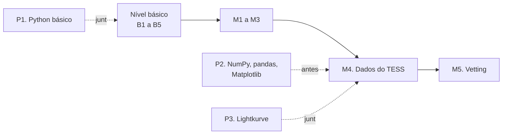

# Trilha de programação

<p class="meta">Trilha paralela · do nível básico ao médio · cerca de 30 a 35 horas no total</p>

Esta trilha ensina Python, a linguagem de programação em que o PlanetHunter foi escrito. Ela não é um curso de informática genérico: todos os exemplos falam de estrelas, trânsitos e curvas de luz. Você aprende a programar e, ao mesmo tempo, revisa a ciência das aulas.

!!! abstract "Ao final da trilha você vai conseguir"
    - Escrever e rodar pequenos programas em Python no seu computador com Windows.
    - Simular uma curva de luz, ler a tabela de TOIs do ExoFOP e fazer gráficos.
    - Baixar dados reais do TESS com a biblioteca Lightkurve e medir um trânsito.
    - Abrir os arquivos que o PlanetHunter grava (Parquet e banco DuckDB) e fazer perguntas a eles.

## Por que programar ajuda

Você pode usar o PlanetHunter sem programar. Os comandos estão no [laboratório](../lab/using-planethunter.md). Então por que aprender Python?

- **Para não depender de caixa-preta.** Quando o sistema diz "profundidade 10 583 ppm", você consegue refazer a conta e conferir.
- **Para fazer perguntas que o sistema não faz.** Por exemplo: "quantos candidatos do setor 69 têm período menor que 1 dia?". Uma linha de código responde.
- **Para entender os testes do vetting.** Cada teste é uma função Python de poucas linhas. Lendo o código, você vê exatamente o que ele mede.
- **Para contribuir.** Mudar um limite ou criar um teste novo exige mexer no código e medir o efeito.

Uma analogia: o PlanetHunter é um carro. Dá para dirigir sem saber mecânica. Mas quem entende o motor percebe quando um barulho é normal e quando é defeito.

## Como a trilha anda junto com os níveis

A trilha corre em paralelo à trilha de ciência. Você não precisa terminá-la antes de começar o curso.

| Aula | Quando fazer | Por quê |
|---|---|---|
| [P1. Python básico](p1-python-basics.md) | Junto do nível básico (opcional) | Você treina com as contas de B1 e B2: profundidade, ppm, raio do planeta |
| [P2. NumPy, pandas e Matplotlib](p2-numpy-pandas-matplotlib.md) | Depois do básico, **antes de M4** | M4 usa arrays, tabelas e gráficos o tempo todo |
| [P3. Lightkurve na prática](p3-lightkurve-in-practice.md) | **Junto de M4** | É a parte prática de M4: dados reais do TESS e dados do PlanetHunter |



No plano de estudos, a programação é opcional no básico e necessária a partir do médio.

## As aulas

- **[P1. Python básico](p1-python-basics.md)**: variáveis, listas, dicionários, laços e funções, com contas de trânsito. Cerca de 10 horas.
- **[P2. NumPy, pandas e Matplotlib](p2-numpy-pandas-matplotlib.md)**: simular uma curva de luz, ler a lista de TOIs e fazer gráficos. Cerca de 12 horas.
- **[P3. Lightkurve na prática](p3-lightkurve-in-practice.md)**: medir o planeta WASP-18 b com dados reais e consultar o banco do PlanetHunter. Cerca de 10 horas.

## Preparar o computador (Windows 11 e VS Code)

Você vai instalar três coisas: o **uv** (um gerenciador de Python), o **Python 3.12** e, se ainda não tiver, o **Git**. O VS Code você já tem.

### Passo 1. Abra um terminal no VS Code

Um **terminal** é uma janela onde você digita comandos em vez de clicar. No VS Code, use o menu **Terminal > New Terminal** ou o atalho ++ctrl+grave++. Aparece um painel embaixo com algo como `PS C:\Users\voce>`. Esse "PS" quer dizer PowerShell, o terminal padrão do Windows.

### Passo 2. Instale o uv

O **uv** instala o Python, cria um ambiente isolado para cada projeto e baixa as bibliotecas. É o que o PlanetHunter usa. Digite no terminal:

```powershell
winget install --id=astral-sh.uv -e
```

Se o `winget` não existir no seu computador, use o instalador oficial:

```powershell
powershell -ExecutionPolicy ByPass -c "irm https://astral.sh/uv/install.ps1 | iex"
```

**Feche o terminal e abra outro.** O Windows só enxerga programas novos em terminais novos. Depois confira:

```powershell
uv --version
```

Deve aparecer algo como `uv 0.x.y`. O número exato não importa.

### Passo 3. Instale o Python 3.12

O próprio uv instala o Python:

```powershell
uv python install 3.12
uv python list
```

A lista deve mostrar uma linha com `cpython-3.12`. Pronto. Você não precisa baixar nada do site python.org.

!!! note "Por que 3.12 e não a versão mais nova?"
    O PlanetHunter exige Python 3.12 (veja `requires-python` no arquivo `pyproject.toml`). Algumas bibliotecas de astronomia demoram a acompanhar versões novas. Usar a mesma versão evita surpresas.

### Passo 4. Instale o Git (se ainda não tiver)

O **Git** guarda o histórico de mudanças de um projeto. Você vai precisar dele para baixar o PlanetHunter.

```powershell
winget install --id Git.Git -e
git --version
```

### Passo 5. Instale a extensão Python no VS Code

No VS Code, clique no ícone de quadradinhos à esquerda (Extensões), procure **Python** (autor: Microsoft) e clique em **Install**. Ela colore o código, aponta erros e permite rodar arquivos com um botão.

### Passo 6. Crie uma pasta de estudos

Guarde seus exercícios numa pasta separada do PlanetHunter. Assim você não mistura seus testes com o código do projeto.

```powershell
cd ~
uv init --python 3.12 estudos-exoplanetas
cd estudos-exoplanetas
uv add numpy pandas matplotlib
```

O que cada linha faz:

1. `cd ~` vai para a sua pasta de usuário.
2. `uv init` cria a pasta `estudos-exoplanetas` com um arquivo `pyproject.toml` (a "ficha" do projeto) e alguns arquivos auxiliares. Conforme a versão do uv, aparece também um `main.py` ou uma pasta `src`. Pode ignorá-los.
3. `uv add` instala as bibliotecas da aula P2 num ambiente só desse projeto, a pasta `.venv`.

Na aula P3 você vai acrescentar mais bibliotecas com `uv add lightkurve pyarrow duckdb`.

Abra a pasta no VS Code: **File > Open Folder** e escolha `estudos-exoplanetas`. Depois aperte ++ctrl+shift+p++, digite **Python: Select Interpreter** e escolha o que tem `.venv` no caminho.

## Como rodar um script

Um **script** é um arquivo de texto com extensão `.py` contendo instruções em Python. Crie no VS Code um arquivo chamado `ola.py` dentro da pasta de estudos com este conteúdo:

```python
# Meu primeiro script
print("Olá! Vou procurar planetas.")
profundidade_ppm = 84
print("A Terra na frente do Sol apaga", profundidade_ppm, "partes por milhão da luz.")
```

Salve (++ctrl+s++) e rode no terminal, de dentro da pasta de estudos:

```powershell
uv run python ola.py
```

`uv run` garante que o Python usado é o do ambiente do projeto, com as bibliotecas que você instalou. Também funciona clicar no triângulo ("Run Python File") no canto superior direito do VS Code, desde que você tenha escolhido o interpretador do `.venv` no passo 6.

!!! warning "Problemas comuns"
    - **"uv não é reconhecido como nome de cmdlet"**: feche e reabra o terminal. Se persistir, reinicie o VS Code.
    - **"No such file or directory"**: você está na pasta errada. Use `cd` para entrar na pasta do script e `ls` para ver os arquivos.
    - **Acentos estranhos na saída**: é só a exibição do terminal. Os dados não mudam.
    - **Vírgula decimal**: em Python, números usam ponto. Escreva `3.7`, nunca `3,7`.

## Curso complementar recomendado

Para quem nunca programou, recomendo o **Curso em Vídeo — Python**, do professor Gustavo Guanabara. É gratuito, em português, está no YouTube e no site do Curso em Vídeo, e tem exercícios com correção em vídeo. Ele é dividido em três "mundos":

| Mundo do Curso em Vídeo | Combina com |
|---|---|
| Mundo 1 (fundamentos) | Aula P1, primeira metade |
| Mundo 2 (condições e laços) | Aula P1, segunda metade |
| Mundo 3 (listas, dicionários, funções, módulos) | Fim da P1 e aula P2, antes de M4 |

As aulas desta trilha não substituem o curso: elas mostram como usar o que ele ensina no contexto de exoplanetas.

!!! tip "Na ferramenta"
    Todo o PlanetHunter é Python. Os comandos da linha de comando estão em `src/planethunter/cli.py`. Quando terminar a P3, abra esse arquivo: você vai reconhecer funções, listas, dicionários e tabelas do pandas em quase toda linha.

## Como saber que você terminou a trilha

Você terminou quando consegue, sem ajuda:

1. Escrever uma função que recebe profundidade em ppm e raio da estrela e devolve o raio do planeta em raios terrestres.
2. Ler o CSV de TOIs do ExoFOP e contar quantos estão em cada disposição (CP, KP, PC, FP...).
3. Baixar a curva de luz de um alvo com Lightkurve, achar o período com BLS e medir a profundidade.
4. Consultar no banco `data/planethunter.duckdb` todos os sinais de uma estrela.

## Checklist da trilha

- [ ] Instalei o uv e o Python 3.12 e conferi as versões
- [ ] Criei a pasta `estudos-exoplanetas` e rodei `ola.py`
- [ ] Concluí a aula P1
- [ ] Concluí a aula P2 antes de começar M4
- [ ] Concluí a aula P3 junto com M4

## Para ir além

- Curso em Vídeo — Python (Gustavo Guanabara). O melhor ponto de partida gratuito em português para quem nunca programou.
- Documentação do NumPy, seção "absolute beginners" ([numpy.org](https://numpy.org/doc/stable/user/absolute_beginners.html)). Útil como consulta durante a P2.
- Tutoriais oficiais do Lightkurve ([lightkurve.github.io](https://lightkurve.github.io/lightkurve/tutorials/index.html)). Base da aula P3 e do módulo M4.
